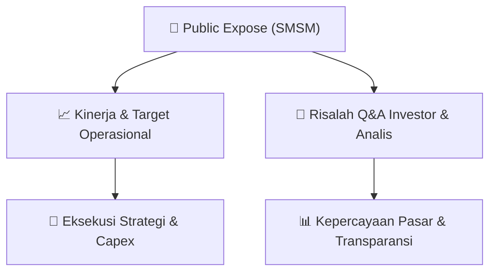

# 📢 Laporan Intelijen Paparan Publik (Public Expose) - [[SMSM]]
🏢 **Emiten**: `[[SMSM]]` | 📅 **Tanggal Pelaksanaan**: `2026-09-14` | 📑 **Dokumen**: `Public Expose lamp2`
⬅️ [[knowledge-base/daily-digests/Daily_Digest_20260914|Kembali ke Daily Digest]] | 🎛️ [[Dashboard|Ke Dashboard Utama]]

---

## 📌 1. Ringkasan Eksekutif & Paparan Direksi
> [!NOTE]
> Paparan Publik (Public Expose) PT Selamat Sempurna Tbk (SMSM) yang diselenggarakan pada 9 September 2026 secara virtual melalui webinar. Acara dihadiri oleh manajemen SMSM, perwakilan IDX, dan sejumlah analis/investor. Paparan ini berfokus pada kinerja perusahaan, strategi pertumbuhan, dan prospek bisnis ke depan. Sayangnya, dokumen yang tersedia hanya berisi laporan kehadiran (attendance report) dan tidak memuat materi presentasi atau transkrip tanya jawab secara detail.

#### 🎯 Guidance Operasional & Target Strategis
- Tidak tersedia dalam dokumen. Dokumen yang diberikan hanya berisi daftar hadir peserta dan panelis, tanpa informasi mengenai target kinerja, ekspansi, atau belanja modal (capex).

## 📊 2. Matriks Indikator Operasional & Parameter Kunci
| Parameter Utama | Nilai / Keterangan Resmi |
| :--- | :--- |
| **Tanggal Pelaksanaan** | `9 September 2026` |
| **Durasi Acara** | `± 89 menit (09:19 - 10:48 WIB)` |
| **Jumlah Panelis** | `9 orang (termasuk perwakilan IDX dan manajemen SMSM)` |
| **Jumlah Peserta** | `± 49 peserta (termasuk analis, investor, dan media)` |
| **Perwakilan Manajemen SMSM** | `Stefany, Lidiana Widjojo, Ang Andri Pribadi, Loviana, Sumarni` |
| **Perwakilan IDX** | `Sulthan Hanif` |

---

## 💬 3. Risalah Tanya Jawab (Q&A Session)
### ❓ Pertanyaan 1 (Tidak tersedia)
**Pertanyaan**: Tidak tersedia dalam dokumen. Dokumen yang diberikan hanya berisi laporan kehadiran (attendance report) dan tidak memuat transkrip sesi tanya jawab.

**Jawaban Manajemen**: Tidak tersedia dalam dokumen.

> [!TIP]
> **Implikasi Bagi Investor**: Tidak dapat dianalisis karena kurangnya data. Investor disarankan untuk mencari sumber lain seperti rekaman webinar atau siaran pers resmi perusahaan untuk mendapatkan informasi mengenai sesi tanya jawab.

## 📌 4. Peta Jalur Strategis & Roadmap

---

## 🔗 Knowledge Graph
- [[knowledge-base/daily-digests/Daily_Digest_20260914|📄 Daily Digest 2026-09-14]]
- [[knowledge-base/calendars/Action_Calendar|🗓️ Kalender Terpusat Aksi Korporasi]]
- [[Dashboard|🎛️ Kembali ke Dashboard Utama]]