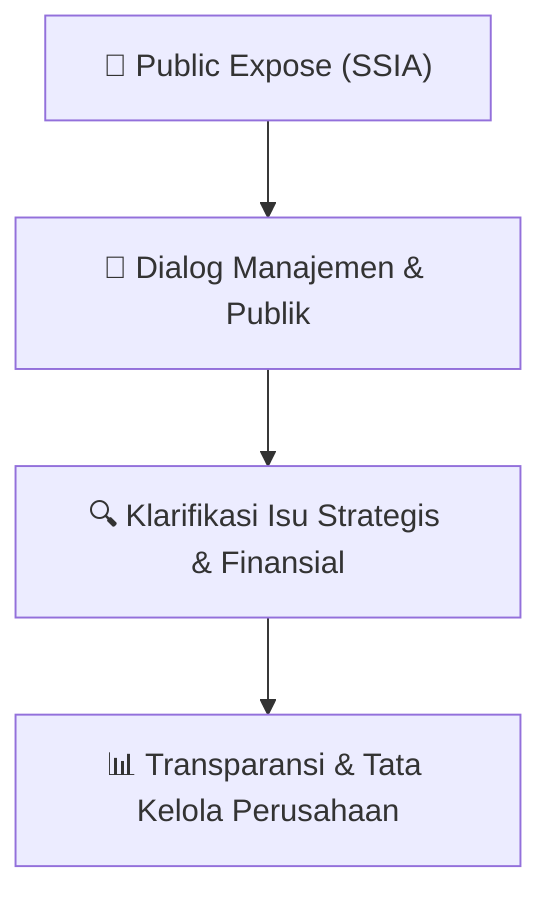

# 🎤 Laporan Hasil Public Expose: [SSIA]

🏢 **Emiten**: `SSIA` | 📅 **Tanggal Pelaksanaan**: `2026-09-08` | ❓ **Total Pertanyaan**: `4 Pertanyaan`
⬅️ [[knowledge-base/daily-digests/SSIA_20260908|Kembali ke Daily Digest]] | 🎛️ [[Dashboard/SSIA|Ke Dashboard Emiten]]

> [!IMPORTANT]
> Dokumen ini memuat seluruh risalah hasil pelaksanaan dan sesi tanya jawab (Q&A) Public Expose SSIA. Informasi dicatat secara verbatim guna memberikan analisis sentimen dan arah kebijakan manajemen bagi investor.

---

## ℹ️ 1. Informasi Penyelenggaraan & Kehadiran

| Parameter | Detail Pelaksanaan |
|---|---|
| **Nomor Surat** | 041L/CS/XI/2026 |
| **Perihal** | Laporan Hasil Public Expose Tahunan |
| **Waktu Pengumuman** | 08-09-2026 16:44 |
| **Jumlah Kehadiran Peserta** | Penyampaian Hasil Public Expose |
| **Lampiran Berkas** | `2` |

---

## 💬 2. Risalah Tanya Jawab Manajemen & Investor (4 Pertanyaan)

### ❓ Pertanyaan #1

> **Penanya**: *Investor / Analis Publik*

```text
Pertanyaan:
1. Anitana Widya
Pertanyaan: Berapa capex tahun ini dan realisasinya serta fokusnya untuk apa saja? 
Melihat realisasi semester I/2026, apakah ada rencana revisi target, berapa besar?
Erlin Budiman - SSIA: untuk CAPEX seperti yang sudah diumumkan pada awal tahun 
CAPEX untuk SSIA sebesar Rp2,2 triliun. Dimana Rp1,5 triliun akan untuk 
Pembangunan Subang Smartpolitan yang terdiri dari land acquisition dan land 
development. Kemudian, ada Rp330 miliar kami anggarkan untuk kelanjutan 
Pembangunan Paradisus by Melia Bali pada awal tahun, dimana masih ada beberapa 
bagian proyek yang harus diselesaikan. Realisasinya, per semester pertama itu ada 
di Rp1,1 triliun sehingga realisasi kami sudah cukup in-line. Untuk Subang 
Smartpolitan kami sudah mengeluarkan sekitar Rp800 miliar, kemudian untuk SAI 
atau Paradisus kami sudah bayarkan sekitar Rp200 miliar. Untuk sisanya kami 
anggarkan untuk anak usaha lain seperti hotel lain kami dan NRCA.
Untuk target, seperti yang sudah dikemukakan pada presentasi pada awal tahun kami 
menargetkan sebesar Rp7,5 triliun ada sedikit pergeseran menjadi Rp7,2 triliun 
dikarenakan adanya perlambatan peraihan kontrak baru serta realisasi penjualan 
lahan industri. Kami masih optimis bisa mencapai pertumbuhan pendapatan 63% 
YoY dan kami juga menargetkan laba bersih berada di level sekitar Rp400 miliar atau 
meningkat sekitar 570%.
```

💡 **Jawaban & Klarifikasi Manajemen**:

> *Teks tanggapan manajemen tidak tersedia*

---

### ❓ Pertanyaan #2

> **Penanya**: *Investor / Analis Publik*

```text
Pertanyaan:
2. Michael Oktavianus – investor & Achmad Zainuddin - Reporter Bisnis.com
Pertanyaan: Bagaimana permintaan industri DC saat ini? apa tantangan dan 
hambatan penjualan ke sektor ini? Apakah  tren perkembangan AI dan data center 
akan meningkatkan permintaan lahan di perseroan?
Wilson Effendy – SSIA: Sekarang kami melihat adanya peningkatan permintaan baik 
itu di Karawang maupun di Subang. Untuk di Karawang sendiri pada tahun ini kami 
akan merealisasikan penjualan data center sekitar 10 ha. Untuk tantangan bagi data 
center memang cukup beragam dan banyak terkait Listrik dan air. Di Karawang sendiri 
Listrik di supply oleh PLN dan air oleh Kawasan. Untuk kebutuhan air saat ini kami 
sudah mampu memenuhi hal tersebut. Untuk Subang sendiri kami baru 
menyelesaikan tahap pertama untuk infrastruktur Listrik dan kami sedang 
melanjutkan ke fase berikutnya. Permintaan sendiri data center di Subang sudah 
mulai masuk dan para calon tenant sedang melakukan peninjauan kembali dari 
kesiapan infrastruktur Subang. Kami berharap bisa mendatangkan tenant data center 
di Subang pada tahun depan.
Kami melihat trend pemakaian AI di Indonesia akan meningkatkan permintaan data 
center selama 2-3 tahun ke depan. Untuk data center kami berkomitmen akan 
memenuhi permintaan mereka terkait dengan Listrik dan air apabila mereka akan 
menjadi tenan baik itu di Karawang maupun di Subang ke depannya.
```

💡 **Jawaban & Klarifikasi Manajemen**:

> *Teks tanggapan manajemen tidak tersedia*

---

### ❓ Pertanyaan #3

> **Penanya**: *Investor / Analis Publik*

```text
Pertanyaan:
3. Tan Richard Tanjung – investor & Anitana Widya
Pertanyaan: Apakah NRCA juga mendapatkan proyek bangun Data center di tahun 
2026?  Mohon infokan tingkat keterisian hotel bintang 5? Selain itu bagaimana 
sentimen tol patimban untuk kinerja perseroan kedepannya?
Johannes Suriadjaja – SSIA: Saat ini NRCA sedang dalam melakukan proses tender 
untuk menjadi kontraktor salah satu data center dan nilainya cukup besar. Saat ini 
kami masih menunggu hasil dari tender tersebut.
Erlin Budiman – SSIA: Untuk semester pertama tingkat keterisian hotel, kami melihat 
seperti BATIQA untuk 7 lokasi yang ada di Indonesia berada di level 71% diikuti oleh 
UMANA Bali di 47%, Paradisus by Melia Bali sebesar 44% dikarenakan dibukanya 
hotel secara bertahap dari Febuari hingga Juni. Untuk Paradisus sendiri diharapkan 
hingga akhir tahun tingkat keterisian di atas 60%. Gran Melia Jakarta berada di sekitar 
38%.
Johannes Suriadjaja – SSIA: Tol Patimban ini sangat penting bagi perkembangan 
Subang Smartpolitan dan selain menjadi jalur utama ke Pelabuhan Patimban. Saat ini 
Pelabuhan Patimban sudah beroperasi untuk Car terminal untuk ekspor dan impor 
serta direncanakan menjadi yang terbesar di Indonesia dengan kapasitas sebesar 
600.000 ribu mobil setahun. Disisi lain, kami juga mendengar bahwa saat ini 
Pelabuhan Patimban sudah mulai untuk container terminal. Sehingga, Pelabuhan 
Patimban memegang peranan penting untuk ekspor impor di Indonesia.
Kami melihat apabila tol ini sudah jadi hal ini akan menambah nilai dari Subang 
Smartpolitan. Jadi ini kami harapkan untuk Pembangunan tol dapat dipercepat.
```

💡 **Jawaban & Klarifikasi Manajemen**:

> *Teks tanggapan manajemen tidak tersedia*

---

### ❓ Pertanyaan #4

> **Penanya**: *Investor / Analis Publik*

```text
Pertanyaan:
4. Anonymous User
Pertanyaan: Apa tujuan konsolidasi hotel unit di bawah satu PT Suryalaya Anindita 
International? Bagaimana progress pembangunan jalan tol Patimban yang dikerjakan 
oleh NRCA dengan ADHI? Apakah terdapat kendala saat ini?
Johannes Suriadjaja – SSIA: Untuk seksi pemerintah sendiri progress pembangunan 
sudah mencapai 70% terlaksana, sementara yang masih berjalan sedikit lambat yaitu 
bagian dari sektor swasta dikarenakan tender baru diberikan pada akhir tahun 2025 
seperti yang disampaikan oleh Ibu Erlin pada sesi pemaparan. Pada seksi pertama 
yang kami kerjakan bersama ADHI dan untuk progressnya sudah mencapai 14%. 
Kami berharap Pembangunan dapat dipercepat kedepannya dikarenakan sempat 
terjadi kendala logistik pada awal Pembangunan. Kami masih optimis tol tersebut
akan selesai pada 2027 dan menjadi katalis bagi pertumbuhan Subang Smartpolitan. 
Hal yang tidak kalah penting tol ini menjadi nilai tambah bagi tenan dan calon tenan 
kami dikarenakan adanya pemangkasan biaya logistik.
Erlin Budiman – SSIA : Tujuan konsolidasi unit-unit usaha perhotelan di bawah PT 
Suryalaya Anindita International adalah Mengoptimalkan aset perhotelan dan 
mendukung pertumbuhan pendapatan di masa depan. Efisiensi pengambilan 
keputusan dan pengendalian operasional melalui struktur organisasi dan 
kepemilikan yang lebih terarah. Sinergi antarhotel dan aset terkait untuk menangkap 
peluang pertumbuhan industri perhotelan. Mengkonsolidasikan seluruh hotel yang 
dimiliki saat ini serta beberapa land bank untuk pengembangan hotel dan fasilitas 
pendukung di masa depan. Memperkuat platform bisnis perhotelan yang lebih kuat 
dan terstruktur, mengingat Perseroan saat ini lebih dikenal sebagai perusahaan 
konstruksi dan kawasan industri.
```

💡 **Jawaban & Klarifikasi Manajemen**:

> *Teks tanggapan manajemen tidak tersedia*

---

## 📌 3. Peta Jalur Transparansi & Kepercayaan Pasar



---

*Dokumen diolah otomatis oleh **Swarm Intelijen Pasar Modal Indonesia** pada 2026-10-12 16:49 WIB.*