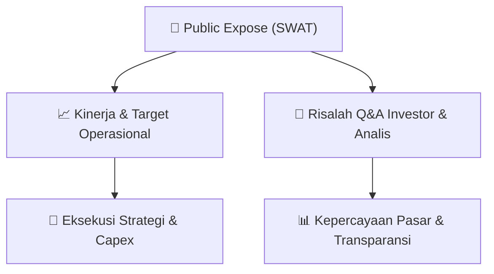

# 📢 Laporan Intelijen Paparan Publik (Public Expose) - [[SWAT]]
🏢 **Emiten**: `[[SWAT]]` | 📅 **Tanggal Pelaksanaan**: `2026-09-13` | 📑 **Dokumen**: `Public Expose lamp2`
⬅️ [[knowledge-base/daily-digests/Daily_Digest_20260913|Kembali ke Daily Digest]] | 🎛️ [[Dashboard|Ke Dashboard Utama]]

---

## 📌 1. Ringkasan Eksekutif & Paparan Direksi
> [!NOTE]
> Public Expose PT Sriwahana Adityakarta Tbk (SWAT) tahun 2026 diselenggarakan pada 11 September 2026 di Hotel Aston Solo, dihadiri 10 peserta. Acara dipimpin oleh Komisaris Utama, Sri Hetti Turinani, karena Direktur Utama berhalangan hadir. Paparan mencakup profil perusahaan dan kinerja keuangan 2025, namun tidak ada sesi tanya jawab karena tidak ada pertanyaan dari peserta. Acara berlangsung singkat dari pukul 10.40 hingga 11.15 WIB.

#### 🎯 Guidance Operasional & Target Strategis
- Tidak ada panduan kinerja atau target ekspansi yang disampaikan secara eksplisit dalam paparan publik ini. Materi hanya mencakup profil perusahaan dan kinerja keuangan tahun 2025, tanpa rincian angka atau proyeksi ke depan. Tidak ada katalis spesifik yang diungkapkan.

## 📊 2. Matriks Indikator Operasional & Parameter Kunci
| Parameter Utama | Nilai / Keterangan Resmi |
| :--- | :--- |
| **Tanggal Public Expose** | `11 September 2026` |
| **Tempat** | `Hotel Aston Solo, Surakarta` |
| **Jumlah Peserta** | `10 orang (tidak termasuk manajemen)` |
| **Kehadiran Direksi** | `Direktur Utama berhalangan hadir` |
| **Kehadiran Komisaris** | `Komisaris Utama hadir (Sri Hetti Turinani)` |
| **Materi Paparan** | `Profil perusahaan dan kinerja keuangan 2025` |
| **Sesi Tanya Jawab** | `Tidak ada pertanyaan dari peserta` |

---

## 💬 3. Risalah Tanya Jawab (Q&A Session)
`Materi presentasi Public Expose / Risalah Q&A terlampir dalam dokumen resmi bursa.`

## 📌 4. Peta Jalur Strategis & Roadmap

---

## 🔗 Knowledge Graph
- [[knowledge-base/daily-digests/Daily_Digest_20260913|📄 Daily Digest 2026-09-13]]
- [[knowledge-base/calendars/Action_Calendar|🗓️ Kalender Terpusat Aksi Korporasi]]
- [[Dashboard|🎛️ Kembali ke Dashboard Utama]]