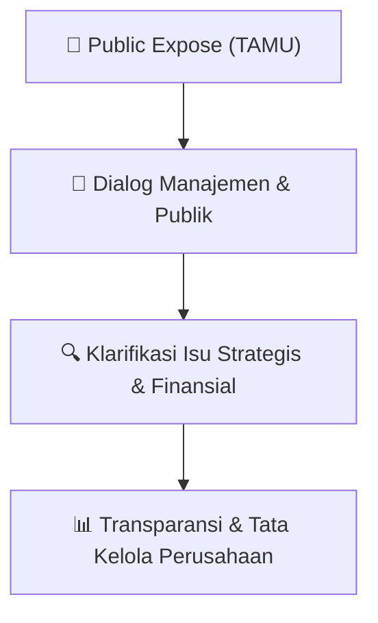

# 🎤 Laporan Hasil Public Expose: [TAMU]

🏢 **Emiten**: `TAMU` | 📅 **Tanggal Pelaksanaan**: `2026-08-10` | ❓ **Total Pertanyaan**: `4 Pertanyaan`
⬅️ [[knowledge-base/daily-digests/TAMU_20260810|Kembali ke Daily Digest]] | 🎛️ [[Dashboard/TAMU|Ke Dashboard Emiten]]

> [!IMPORTANT]
> Dokumen ini memuat seluruh risalah hasil pelaksanaan dan sesi tanya jawab (Q&A) Public Expose TAMU. Informasi dicatat secara verbatim guna memberikan analisis sentimen dan arah kebijakan manajemen bagi investor.

---

## ℹ️ 1. Informasi Penyelenggaraan & Kehadiran

| Parameter | Detail Pelaksanaan |
|---|---|
| **Nomor Surat** | 0060/PTS-CS/BEI/VIII/2026 |
| **Perihal** | Laporan Hasil Public Expose Tahunan |
| **Waktu Pengumuman** | 10-08-2026 23:00 |
| **Jumlah Kehadiran Peserta** | Penyampaian Hasil Public Expose |
| **Lampiran Berkas** | `2` |

---

## 💬 2. Risalah Tanya Jawab Manajemen & Investor (4 Pertanyaan)

### ❓ Pertanyaan #1

> **Penanya**: Investor Individu

```text
Pertanyaan:
Layanan seperti catering dan agency dikelola sendiri atau subkontrakkan? Jika pihak ketiga, 
bagaimana memastikan harga wajar dan menghindari benturan kepentingan dengan pihak 
berelasi? Bagaimana strategi menejemen untuk menjaga & meningkatkan porsi free float agar 
memenuhi ketentuan minimum bursa?

2
```

💡 **Jawaban & Klarifikasi Manajemen**:

> Perseroan berkomitmen untuk senantiasa memenuhi ketentuan free float sebagaimana 
> ditetapkan oleh Bursa Efek Indonesia. Perseroan tetap melakukan pemantauan secara berkala 
> terhadap komposisi kepemilikan saham dan berkoordinasi dengan pemegang saham dan pihak 
> terkait. 
>  
> B.

---

### ❓ Pertanyaan #2

> **Penanya**: Bapak Ilham sebagai pemegang saham

```text
Pertanyaan:
Mengingat saat ini TAMU masuk papan pemantauan khusus, apa langkah strategi dari menejemen 
agar bisa Kembali normal?
```

💡 **Jawaban & Klarifikasi Manajemen**:

> Perseroan terlebih dahulu fokus pada penyelesaian kondisi yang menyebabkan saham Perseroan 
> pada papan pemantauan khusus. Perseroan akan berusaha untuk meningkatkan kinerja operasional 
> dan keuangan serta pemenuhan kewajiban pelaporan dan informasi tepat waktu. 
>  
> C.

---

### ❓ Pertanyaan #3

> **Penanya**: Ibu Rostini sebagai pemegang saham

```text
Pertanyaan:
Menurut catatan IDX perushaan sampai sekarang belum mengadakan RUPS. Kapan rencana 
Perseroan untuk melaksanakan RUPS?
```

💡 **Jawaban & Klarifikasi Manajemen**:

> Perseroan telah melaksanakan RUPS Tahunan tahun buku 2025 sebelum Public Expose hari ini 
> dilaksanakan, yaitu pada hari ini, Kamis, 30 Juli 2026. 
>  
> D.

---

### ❓ Pertanyaan #4

> **Penanya**: Investor Individu

```text
Pertanyaan:
Apakah Perseroan ada rencana untuk melakukan Corporate Action?
```

💡 **Jawaban & Klarifikasi Manajemen**:

> Perseroan belum ada rencana untuk melakukan Corporate Action untuk 6 bulan ke depan. 
>  
>  
> Setelah tidak ada lagi hadirin yang mengajukan pertanyaan, maka acara Public Expose Perseroan ditutup 
> pada pukul 12.00 WIB. 
>  
> Demikian laporan pelaksanaan Public Expose PT Pelayaran Tamarin Samudra Tbk pada tahun 2026.

---

## 📌 3. Peta Jalur Transparansi & Kepercayaan Pasar



---

*Dokumen diolah otomatis oleh **Swarm Intelijen Pasar Modal Indonesia** pada 2026-10-12 16:49 WIB.*