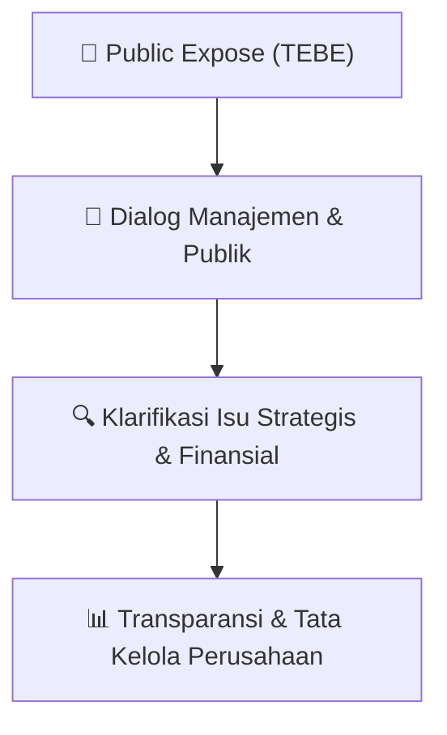

# 🎤 Laporan Hasil Public Expose: [TEBE]

🏢 **Emiten**: `TEBE` | 📅 **Tanggal Pelaksanaan**: `2026-10-06` | ❓ **Total Pertanyaan**: `2 Pertanyaan`
⬅️ [[knowledge-base/daily-digests/TEBE_20261006|Kembali ke Daily Digest]] | 🎛️ [[Dashboard/TEBE|Ke Dashboard Emiten]]

> [!IMPORTANT]
> Dokumen ini memuat seluruh risalah hasil pelaksanaan dan sesi tanya jawab (Q&A) Public Expose TEBE. Informasi dicatat secara verbatim guna memberikan analisis sentimen dan arah kebijakan manajemen bagi investor.

---

## ℹ️ 1. Informasi Penyelenggaraan & Kehadiran

| Parameter | Detail Pelaksanaan |
|---|---|
| **Nomor Surat** | NO.047/DBL-IDX/IX/2026 |
| **Perihal** | Laporan Hasil Public Expose Insidentil |
| **Waktu Pengumuman** | 06-10-2026 14:41 |
| **Jumlah Kehadiran Peserta** | Penyampaian Hasil Public Expose |
| **Lampiran Berkas** | `1` |

---

## 💬 2. Risalah Tanya Jawab Manajemen & Investor (2 Pertanyaan)

### ❓ Pertanyaan #1

> **Penanya**: *Investor / Analis Publik*

```text
Pertanyaan:
1. Ibu Michele Halim dari Calon Investor  
Pertanyaan:
1) Berapa Target Pendapatan & Laba Perseroan di tahun 2026 ?  
 
Jawaban:  
Volume  throughput sampai akhir tahun 2026 diperkirakan mengalami penurunan 
dibandingkan dengan tahun 2025. Penurunan terjadi karena beberapa faktor, salah 
satu faktor utama karena keterlambatan penerbitan RKAB oleh pemilik-pemilik IUP 
sehingga Perseroan menargetkan volume throughput loading Batubara sampai akhir 
tahun 2026 sebanyak 5,13 juta MT, menurun dibanding tahun 2025 yang tercatat 
sebesar 7,1 juta MT. Perseroan menargetkan Pendapatan pada akhir tahun 2026 
sebesar Rp451 Miliar, dan Laba Sebelum Pajak sebesar Rp62 Miliar, mengalami 
penurunan dibandingkan dengan tahun 2025 sejalan dengan penurunan volume 
throughput Batubara yang diloading oleh Perseroan. 
 
2) Apakah Perseroan berencana untuk membagikan Dividen di Tahun ini?  
 
Jawaban:  
Perseroan akan memberitahukan kebijakan terkait pembagian dividen setelah 
mendapatkan laporan kinerja pada akhir tahun 2026. Dengan adanya beberapa 
rencana strategis yang akan dilakukan oleh Perseroan seperti pengembangan usaha 
dan rencana pembangunan kantor yang berlokasi di Banjarmasin, diharapkan 
kebijakan dalam pembagian dividen Tahun Buku 2026 dapat memperhatikan 
kebutuhan rencana strategis Perseroan.  
 
2. Bpk. Daniel Amir dari Calon Investor  
Pertanyaan:
1) Apa Langkah strategis Perseroan dalam menyikapi penurunan Produksi Batubara 
oleh pemilik tambang yang menyebabkan menurunnya Pendapatan Perseroan?  
 
Jawaban:  
Langkah strategis Perseroan dalam menyikapi penurunan Produksi Batubara salah 
satunya dengan terus berusaha menjajaki dan melakukan kajian untuk ekspansi bisnis 
dan diversifikasi usaha diluar Batubara. Saat ini Perseroan sedang melakukan kajian 
untuk melayani jasa kepelabuhanan diluar Batubara yang dapat dijalankan oleh 
Entitas Anak PT Pelabuhan Talenta Bumi yang telah menjadi Badan Usaha 
Kepelabuhanan (BUP) dan telah beroperasi pada awal tahun 2026. Sehingga 
pelayanan Pelabuhan Perseroan tidak hanya sebatas melayani komoditas Batubara 
saja.  Diharapkan untuk kedepannya sinergi antar Entitas Anak dengan Grup Perseroan 
bisa lebih kuat dan dapat mendukung seluruh usaha yang dilakukan oleh Perseroan. 
Selain itu Perseroan juga melakukan berbagai langkah Cost Efficiency yang diharapkan 
dapat mengoptimalkan profitabilitas dan kinerja operasional Perseroan. Didalam 
kegiatan efisiensi, Perseroan juga melakukan penataan loading Batubara dengan
Equity Tower Lt. 26 F, SCBD Lot.9  
Jl. Jenderal Sudirman, Kav. 52-53, Kebayoran Baru, Jakarta 12190 – Indonesia
Ph: 021-35451300
melakukan penataan di stockpile sehingga bisa lebih menghemat biaya bahan bakar.  
 
2) Apakah Perseroan dapat menginformasikan secara singkat bagaimana Kinerja 
Perseroan di Q3 2026 ini?  
 
Jawaban:  
Perseroan belum dapat memastikan informasi kinerja Perseroan dikarenakan proses 
data masih berlangsung didalam internal Perseroan. Namun sampai bulan September 
2026, Perseroan mencatatkan kinerja yang cukup positif karena ada peningkatan dari 
volume Batubara yang diloading. Pada bulan Agustus 2026 tercatat volume thoughput 
sebesar 585.000 MT dan dibulan September 2026 tercatat mengalami kenaikan 
sebesar 810.000 MT dengan demikian Perseroan optimis bahwa kinerja Q3 tahun 
2026 akan jauh lebih baik dibandingkan periode sebelumnya.  
 
3. Bpk. Rudy Chandra dari Calon Investor  
Pertanyaan:
1) Dengan mulai dijalaninya usaha trading Batubara, apakah Perseroan berencana 
untuk melakukan ekspor?  
 
Jawaban:  
Dengan dimulainya kegiatan usaha trading Batubara ,Perseroan telah menjajaki 
potensi ekspor Batubara. Dari aspek dinamika pasar, kebutuhan, dan regulasi yang 
sedang berlaku saat ini. Diharapkan mendapatkan hasil yang positif sehingga 
Perseroan dapat melanjutkan untuk memenuhi kelengkapan perizinan kegiatan 
ekspor Batubara, diharapkan dalam waktu dekat Perseroan dapat melakukan kegiatan 
ekspor danterus memantau kebijakan pemerintah tentang kegiatan ekspor Batubara 
yang berkaitan dengan trading Batubara.  
 
4. Daniel Analyst dari Private Equity Holdings  
Pertanyaan:
1) Mengacu pada slide 14, 9, 13, dan 7 ,bagaimana angka Laba Bersih pada Juli – 
Agustus 2026, sekitar Rp27,2 Miliar jika sudah dihitung setelah pajak dan imbalan 
kerja dan mengapa angka yang belum dikurangi pajak ditampilkan sebagai laba 
bersih dimana margin tercatat 18.4%? 
 
Jawaban:  
Perseroan memperhitungan beban imbalan Kerja dan beban pajak setiap triwulanan 
sebagai bagian dari penyampaian Laporan Keuangan Interim kepada publik 
sebagaiamana diatur dalam peraturan pasar modal yang berlaku. Angka yang 
disajikan proyeksi sampai dengan Agustus merupakan angka perhitungan Inhouse 
sementara, Dimana belum memperhitungkan kedua jenis beban tersebut. Sehingga 
Laba Bersih Rp27,2 Miliar belum memperhitungkan Beban Pajak dan Beban Imbalan 
kerja Q3 2026. Namun dapat Perseroan laporkan sampai dengan periode per 31 
Agustus 2026, estimasi Laba Bersih jika sudah dikurangi dengan Beban Imbalan Kerja 
dan juga perhitungan untuk Pajak Badan sementara, sebesar 15,8% sehingga turun 
kurang lebih sebesar -3% dari angka yang disajikan oleh Perseroan, dari Perseroan 
akan memperhitungkan kembali pada saat penutupan Q3 2026 Perseroan.
Equity Tower Lt. 26 F, SCBD Lot.9  
Jl. Jenderal Sudirman, Kav. 52-53, Kebayoran Baru, Jakarta 12190 – Indonesia
Ph: 021-35451300
IMPLEMENTATION REPORT  
INCIDENTAL PUBLIC EXPOSE
1 October 2026 
PT. DANA BRATA LUHUR Tbk 
 
The 2026 Incidental Public Expose of PT. Dana Brata Luhur Tbk (the Company) (“PUBEX”) has been held 
on: 
 
Day/Date  
:  Thursday, 1st October 2026 
Time  
: 14.00 – 15.00 GMT+7 
Place 
: Zoom Meetings 
 
The following is the report on the implementation of PUBEX, in which the Company was represented by:
• 
Company’s Management:  
 
Director  
 
 
 
 
 
: Welly Susanto 
 
Director  
 
 
 
 
 
: Didik Prasetyo  
 
Corporate Secretary  
 
 
 
 
: Alfon Mubarak  
 
Member of Nomination and Remuneration Committee : Aries Subhan  
 
Finance General Manager  
 
 
 
: Fajril Amirul  
 
• 
The total attendees of the PUBEX Zoom Meetings were 50 (fifty) participants. The participants at 
this PUBEX event consisted of shareholders, prospective investors, and securities companies.  
 
PUBEX was opened at 2:00 PM WIB by Mr. Welly Susanto, the Company's Director. Some of the points 
mentioned during the opening include:
• 
PUBEX is conducted based on:  
The Decree of the Board of Directors of PT Indonesia Stock Exchange Number: Kep-00066/BEI/09-
2022 regarding Amendments to Regulation Number I-E on the Obligations to Submit Information, 
Point III.3.2, which emphasizes the obligation for listed companies to conduct an Incidental Public 
Expose at the request of the Exchange if the Exchange determines that the Listed Company has 
experienced an event or incident or there is information that may affect the value of Securities or 
investors’ decisions. 
• 
This PUBEX event was held in relation to Information Disclosure conducted by the Company to 
fulfill the principles of transparency, which are part of a good corporate governance system.  
 
Presentation Session: 
The agenda presented in PUBEX was divided into 3 parts, namely:
• 
Company’s Financial Performance  
• 
Business Plan Projection  
• 
Stock Price Analysis 
After the presentation of all PUBEX materials by Management, the event continued with a question and 
answer session.
Equity Tower Lt. 26 F, SCBD Lot.9  
Jl. Jenderal Sudirman, Kav. 52-53, Kebayoran Baru, Jakarta 12190 – Indonesia
Ph: 021-35451300
Q&A Session 
 
Here are the questions posed by the participants and the answers provided by the Company’s 
management during this event:
```

💡 **Jawaban & Klarifikasi Manajemen**:

> *Teks tanggapan manajemen tidak tersedia*

---

### ❓ Pertanyaan #1

> **Penanya**: *Investor / Analis Publik*

```text
Pertanyaan:
1. Mrs. Michelle as Prospective Investor 
Question:
1) What are the Company’s Revenue and Profit Targets for 2026? 
Answer: 
Throughput volume through the end of 2026 is expected to decrease compared to 
2025. This declining volume is occurred  because several factors, one of the main 
factor is the delay in the issuance of RKAB approvals by IUP holders. As a result, the 
Company is targeting a coal loading throughput volume of 5,13 million MT by the end 
of 2026, down from 7,1 million MT recorded in 2025. Accordingly, the Company is 
targeting Revenue of Rp451 billion and Profit Before Tax of Rp62 billion by the end of 
2026. Both figures are expected to decrease compared to 2025, in line with the 
decrease in coal throughput volume loaded by the Company. 
 
2) Does the Company plan to distribute Dividends this year? 
 
Answer: 
The Company will announce its policy regarding dividend distribution after receiving 
the performance report at the end of 2026. With several strategic plans to be carried 
out by the Company, such as business development and the planned construction of 
an office located in Banjarmasin, it is expected that the dividend distribution policy 
for the 2026 Fiscal Year will take into account the needs of the Company's strategic 
plans. 
 
2. Mr. Daniel Amir as Prospective Investor 
Question:
1) What are the strategic steps of the Company is taking to deal with the decline in 
Coal Production by mine owners that causes a decrease in the Company's Revenue?  
 
Answer: 
One of the Company's strategic steps to deal with the decline in Coal Production is to 
continuously explore and conduct studies for business expansion and diversification 
outside of Coal. Currently, the Company is conducting a study to provide port services 
beyond Coal that can be operated by the Subsidiary PT Pelabuhan Talenta Bumi, which 
has become a Port Business Entity (BUP) and started operations at the beginning of 
2026. This way, the Company's port services will not be limited to serving coal 
commodities only. It is expected that in the future, the synergy between the 
Subsidiaries and the Company Group can be stronger and support all the businesses 
carried out by the Company. In addition, the Company also takes various Cost 
Efficiency steps that are expected to optimize the Company's profitability and 
operational performance. In the efficiency activities, the Company also arranges the 
coal loading by organizing the stockpile so that it can save more on fuel costs.
Equity Tower Lt. 26 F, SCBD Lot.9  
Jl. Jenderal Sudirman, Kav. 52-53, Kebayoran Baru, Jakarta 12190 – Indonesia
Ph: 021-35451300
2) Can the Company briefly share how its performance has been in the Q3 2026? 
 
Answer: 
The Company is not yet able to confirm its performance information because the data 
process is still ongoing internally. However, until September 2026, the Company 
recorded quite positive performance due to an increase in the volume of coal being 
loaded. In August 2026, the throughput volume was recorded at 585.000 MT, and in 
September 2026, it increased to 810.000 MT. Therefore, the Company believes that 
Q3 2026 performance will be much better compared to the previous period.  
 
3. Mr. Rudy Chandra as Prospective Investor 
Question:
1) With the commencement of coal trading business, does the Company plan to 
export? 
 
Answer:   
With the commencement of the coal trading business, the Company has been 
exploring the potential for coal exports. Considering the current market dynamics, 
demand, and regulations, it is expected to achieve positive results so that the 
Company can proceed with completing the necessary permits for coal export 
activities. Hopefully, in the near future, the Company will be able to carry out export 
activities and continue to monitor government policies regarding coal export activities 
related to coal trading. 
 
4. Mr. Daniel Analyst as Private Equity Holdings 
Question:
1) Referring to slides 14, 9, 13, and 7, how is the Net Profit for July – August 2026 
around IDR 27.2 billion after tax and employee benefits, and why is the figure before 
tax shown as net profit when the margin is recorded at 18.4%? 
 
Answer: 
The company calculates employee benefits expenses and tax expenses quarterly as 
part of delivering the Interim Financial Statements to the public, as regulated by the 
applicable capital market rules. The figures presented as projections up to August are 
temporary in-house calculations, which do not yet account for these two types of 
expenses. So, the Net Profit of IDR 27,2 billion does not yet include tax expenses and 
employee benefits for Q3 2026. However, the Company can report that up to the 
period ending August 31, 2026, the estimated Net Profit, after deducting Employee 
Benefit Expenses and also calculating for temporary Corporate Tax at 15,8%, will 
decrease by approximately -3% from the figures presented by the Company, and the 
Company will recalculate this at the close of Q3 2026.
Equity Tower Lt. 26 F, SCBD Lot.9  
Jl. Jenderal Sudirman, Kav. 52-53, Kebayoran Baru, Jakarta 12190 – Indonesia
Ph: 021-35451300
2) Referring to slides 16, 12, 9, 5, and 7, how does management ensure that the 
expansion of coal trading and non-coal commodities for internal group consumption 
is conducted at fair prices and with approvals that comply with the rules?  
 
Answer: 
As a public listed company, expanding the coal trading business needs to consider the 
applicable capital market regulations. Currently, the company is exploring the 
necessary permits for export and hopes to achieve results that can improve the 
company's performance and support the company's current focus, which is mainly on 
infrastructure services. Therefore, having coal trading activities as well as trading 
outside the coal commodity can provide more optimal results and is expected to 
support the company's performance in the future. The business diversification 
strategy becomes very important because having a permit as a Port Business Entity 
(BUP) allows the company to provide services beyond coal. In the Company's current 
ecosystem, there is quite a large potential for business activities that the Company 
can explore to optimize its performance.
After the Q&A session concluded, the Public Expose was closed at 3:00 PM WIB.
Thus, we submit this report, and we thank you for your attention.
Dengan Hormat/Sincerely,  
PT. Dana Brata Luhur Tbk
GT. Denny Ramdhani 
Direktur Utama/President Director
Equity Tower Lt. 26 F, SCBD Lot.9  
Jl. Jenderal Sudirman, Kav. 52-53, Kebayoran Baru, Jakarta 12190 – Indonesia
Ph: 021-35451300
DAFTAR HADIR/LIST OF ATTENDEES PUBLIC EXPOSE INSIDENTIL
1 Oktober 2026
No. 
Nama/Name 
Keterangan/Information 
1 
Michele Gabriela 
Sucorinvest 
2 
Hanmin 
Bisnis 
3 
Alvin N  
Calon Investor  
4 
Jan  
Investor  
5 
Elisabeth Mantiri  
Calon Inevestor 
6 
Yohanes Yudhatama 
Individu  
7 
Alex Buhe  
Ritel 
8 
Perwira Wira 
PT Dana Brata Luhur tbk  
9 
Hans Tantio  
Ashmore Asset Management 
10 
Albroston Simanjuntak  
Climate Policy Initiative 
11 
Omaha Invest  
Calon Investor  
12 
Dewi Karimah 
Omaha  
13 
Adriel Lukito  
BNI Sekuritas  
14 
Herman Koeswanto  
Ashmore  
15 
David Huang  
Investor 
16 
Alice Lie  
PT Schroder Investment Management  
17 
Rudy Chandra  
Calon Investor  
18 
Daniel Amir  
Calon Investor  
19 
Willian Adriel  
IDX 
20 
Yohan Kurniawa 
Investor  
21 
Fakhrul Fadillah 
Calon Investor  
22 
Limlim Abdul Halim  
PT Talenta Bumi Energi  
23 
Vincent Tjandra  
Stockbit  
24 
Louis Saja  
Calon Investor  
25 
Aulia Rosada  
Calon Investor  
26 
Michelle Hakim  
Lencir  
27 
Shiervine Angelica  
Calon Investor  
28 
Hayley S  
Investor  
29 
Hamzah prh 
Calon Investor  
30 
Kasino  
Calon Investor  
31 
Zulfa Anankara  
PT Dana Brata Luhur tbk  
32 
Halim Sujanto  
Calon Investor  
33 
David Wicaksana Kusuma  
David Group Companies  
34 
Riyadus  
Investor  
35 
Kayla Wiguna  
BNI Sekuritas 
36 
Ilham Firdaus 
BNI Sekuritas  
37 
Darren Lukita  
BNI Sekuritas  
38 
Aditya Prabowo  
Investor  
39 
Geovani Tuwan  
CV Batanium   
40 
Anthony Lim  
Ashmore  
41 
Leonardo Bas 
Retail Investor
Equity Tower Lt. 26 F, SCBD Lot.9  
Jl. Jenderal Sudirman, Kav. 52-53, Kebayoran Baru, Jakarta 12190 – Indonesia
Ph: 021-35451300
42 
Deefandi Nasrul  
Investor  
43 
Neel  
Investor  
44 
Daniel Analyst  
Private Equity Holdings 
45 
Herman Ang  
Investor  
46 
Yohanes Yudhatama  
PT Sucorinvest Asset Management  
47 
Evan Huda  
Investor  
48 
Ian Dewanto  
Investor Ritel  
49 
William Giovanni 
Investor  
50 
Bayu Wibowo  
PT BA
```

💡 **Jawaban & Klarifikasi Manajemen**:

> *Teks tanggapan manajemen tidak tersedia*

---

## 📌 3. Peta Jalur Transparansi & Kepercayaan Pasar



---

*Dokumen diolah otomatis oleh **Swarm Intelijen Pasar Modal Indonesia** pada 2026-10-12 16:50 WIB.*