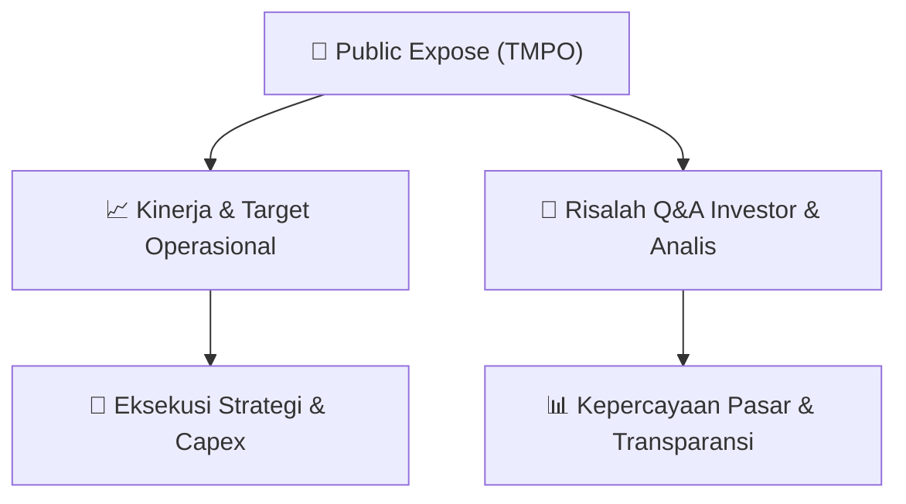

# 📢 Laporan Intelijen Paparan Publik (Public Expose) - [[TMPO]]
🏢 **Emiten**: `[[TMPO]]` | 📅 **Tanggal Pelaksanaan**: `2026-09-01` | 📑 **Dokumen**: `Public Expose lamp1`
⬅️ [[knowledge-base/daily-digests/Daily_Digest_20260901|Kembali ke Daily Digest]] | 🎛️ [[Dashboard|Ke Dashboard Utama]]

---

## 📌 1. Ringkasan Eksekutif & Paparan Direksi
> [!NOTE]
> PT Tempo Inti Media Tbk (TMPO) menyelenggarakan Paparan Publik Insidental pada 2 September 2026 sebagai tindak lanjut penghentian sementara perdagangan saham oleh BEI pada 26 Agustus 2026 akibat peningkatan harga kumulatif signifikan. Perdagangan saham dibuka kembali pada 27 Agustus 2026. Perseroan menyampaikan kinerja Semester I 2026 dengan pendapatan usaha Rp79,73 miliar, turun 3,96% dari Rp83,01 miliar pada Semester I 2025. Rugi bersih membaik menjadi Rp6,58 miliar dari Rp7,11 miliar, turun 7,47% YoY, didorong efisiensi operasional dan pengendalian biaya. Perseroan juga memaparkan transformasi digital melalui penerapan login wall Tempo.co sejak 1 Agustus 2026, strategi digital subscription, serta pengembangan Data Asset Management melalui PT Info Media Digital dengan dukungan AI sebagai sumber pertumbuhan baru.

#### 🎯 Guidance Operasional & Target Strategis
- Perseroan melihat peluang perbaikan kinerja pada Semester II 2026 berdasarkan pola historis peningkatan belanja pemerintah, namun menegaskan bahwa hal tersebut merupakan outlook dan bukan kepastian. Transformasi digital menjadi katalis utama: login wall gratis untuk membangun registered users, target konversi digital subscription hingga 25%, serta target 100.000 pelanggan digital pada atau sebelum 2028 dari basis 46.345 pelanggan pada akhir 2025. Pengembangan Data Asset Management melalui PT Info Media Digital dengan AI sebagai enabler diharapkan menjadi sumber pertumbuhan baru dan memperkuat reader revenue yang lebih berulang.

## 📊 2. Matriks Indikator Operasional & Parameter Kunci
| Parameter Utama | Nilai / Keterangan Resmi |
| :--- | :--- |
| **Kode saham** | `TMPO` |
| **Tanggal penghentian sementara perdagangan saham** | `26 Agustus 2026` |
| **Tanggal pembukaan kembali perdagangan saham** | `27 Agustus 2026` |
| **Pendapatan usaha Semester I 2026** | `Rp79,73 miliar` |
| **Pendapatan usaha Semester I 2025** | `Rp83,01 miliar` |
| **Penurunan pendapatan usaha YoY** | `Rp3,28 miliar atau 3,96%` |
| **Laba kotor Semester I 2026** | `Rp27,69 miliar` |
| **Laba kotor Semester I 2025** | `Rp31,50 miliar` |
| **Rugi usaha Semester I 2026** | `Rp6,36 miliar` |
| **Rugi usaha Semester I 2025** | `Rp6,33 miliar` |
| **Rugi bersih Semester I 2026** | `Rp6,58 miliar` |
| **Rugi bersih Semester I 2025** | `Rp7,11 miliar` |
| **Perbaikan rugi bersih YoY** | `7,47%` |
| **Tanggal implementasi login wall Tempo.co** | `1 Agustus 2026` |
| **Target conversion rate digital subscription** | `Hingga 25%` |
| **Jumlah pelanggan digital akhir 2025** | `46.345 pelanggan` |
| **Target pelanggan digital** | `100.000 pelanggan pada atau sebelum 2028` |
| **Anak usaha pengembangan DAM** | `PT Info Media Digital` |

---

## 💬 3. Risalah Tanya Jawab (Q&A Session)
`Materi presentasi Public Expose / Risalah Q&A terlampir dalam dokumen resmi bursa.`

## 📌 4. Peta Jalur Strategis & Roadmap

---

## 🔗 Knowledge Graph
- [[knowledge-base/daily-digests/Daily_Digest_20260901|📄 Daily Digest 2026-09-01]]
- [[knowledge-base/calendars/Action_Calendar|🗓️ Kalender Terpusat Aksi Korporasi]]
- [[Dashboard|🎛️ Kembali ke Dashboard Utama]]