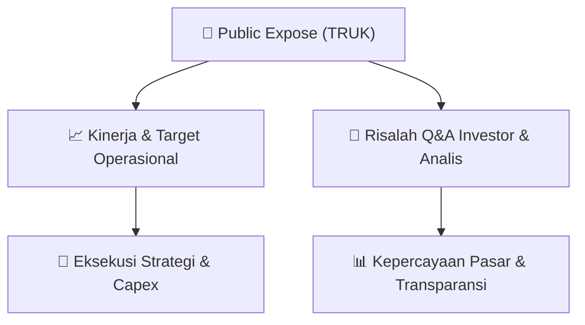

# 📢 Laporan Intelijen Paparan Publik (Public Expose) - [[TRUK]]
🏢 **Emiten**: `[[TRUK]]` | 📅 **Tanggal Pelaksanaan**: `2026-08-19` | 📑 **Dokumen**: `Public Expose lamp1`
⬅️ [[knowledge-base/daily-digests/Daily_Digest_20260819|Kembali ke Daily Digest]] | 🎛️ [[Dashboard|Ke Dashboard Utama]]

---

## 📌 1. Ringkasan Eksekutif & Paparan Direksi
> [!NOTE]
> PT Guna Timur Raya Tbk (TRUK) menyelenggarakan Public Expose Insidentil pada Selasa, 18 Agustus 2026 pukul 10.00 WIB secara daring melalui Zoom. Acara dihadiri oleh Direktur Firman Muliansyah dan Komisaris Carolina Kusuma, dengan presentasi disampaikan oleh M. Adiwijaya K. Materi mencakup profil perseroan, kinerja, pergerakan harga saham, dan rencana usaha. Sesi tanya jawab diikuti oleh Bapak Daniel yang mempertanyakan fundamental di balik lonjakan harga dan volume saham TRUK pada 3 Agustus 2026 di tengah tren penurunan pendapatan dan ekuitas selama 3 tahun terakhir serta tekanan makro, keselarasan rencana pengembangan usaha dengan bisnis inti dan tata kelola risiko, serta mekanisme pencegahan asimetri informasi dan indikasi insider trading terkait lonjakan harga sebelum penghentian sementara oleh BEI. Manajemen menjawab bahwa lonjakan harga murni volatile market dan mekanisme pasar, belum ada rencana diversifikasi ke sektor lain, dan tidak melihat indikasi insider trading, dengan komitmen melanjutkan keterbukaan informasi kepada publik.

#### 🎯 Guidance Operasional & Target Strategis
- Manajemen menyatakan belum ada rencana diversifikasi ke sektor lain di luar transportasi/logistik. Pengembangan usaha yang direncanakan masih berada pada tahap awal dan akan tetap sejalan dengan visi dan misi perseroan di bidang transportasi, dengan kemungkinan pengembangan di sektor logistik atau kargo sendiri. Tidak disampaikan target kinerja kuantitatif, alokasi belanja modal (capex), atau rencana ekspansi spesifik dalam paparan publik ini. Fokus utama perseroan adalah menjaga kepatuhan keterbukaan informasi dan menjalankan bisnis inti transportasi/logistik.

## 📊 2. Matriks Indikator Operasional & Parameter Kunci
| Parameter Utama | Nilai / Keterangan Resmi |
| :--- | :--- |
| **Nama Emiten** | `PT Guna Timur Raya Tbk (TRUK)` |
| **Tanggal Public Expose Insidentil** | `Selasa, 18 Agustus 2026` |
| **Tempat Pelaksanaan** | `Online Zoom` |
| **Direksi yang Hadir** | `Firman Muliansyah (Direktur), Carolina Kusuma (Komisaris)` |
| **Pembawa Presentasi** | `M. Adiwijaya K.` |
| **Materi Disampaikan via e-Reporting** | `Tanggal 14 Agustus 2026, Nomor 039/GTR-DIR/VIII/2026` |
| **Lonjakan Harga Saham TRUK** | `3 Agustus 2026` |
| **Penyebab Lonjakan Menurut Manajemen** | `Volatile market/mekanisme pasar, bukan fundamental` |
| **Tren Kinerja 3 Tahun Terakhir** | `Penurunan pendapatan dan ekuitas` |
| **Tekanan Ekonomi Makro** | `Suku bunga dan kebijakan pajak sektor logistik` |
| **Rencana Diversifikasi Usaha** | `Belum ada, fokus pada transportasi/logistik` |
| **Indikasi Insider Trading** | `Tidak ada indikasi menurut manajemen` |
| **Mekanisme Pencegahan Asimetri Informasi** | `Penyampaian keterbukaan informasi kepada publik secara berkelanjutan` |
| **Karakteristik Saham TRUK** | `Kapitalisasi pasar tidak terlalu besar` |

---

## 💬 3. Risalah Tanya Jawab (Q&A Session)
### ❓ Pertanyaan 1 (Bapak Daniel)
**Pertanyaan**: Bagaimana faktor fundamental yang mendasari pembacaan manajemen atas lonjakan harga dan volume saham TRUK pada 3 Agustus 2026, di tengah tren penurunan pendapatan dan ekuitas selama 3 tahun terakhir serta tekanan ekonomi makro seperti suku bunga dan kebijakan pajak sektor logistik?

**Jawaban Manajemen**: Lonjakan saham ini murni volatile market. Kemungkinan beberapa pihak mengambil kesempatan dengan membeli saham dan mengangkat harganya. Biasanya mereka bermain dengan saham-saham yang kapitalisasinya tidak terlalu besar sehingga bisa menggoreng saham. Ini hanya mekanisme pasar dan perseroan tidak bisa mencegah orang untuk masuk membeli saham TRUK. Murni mekanisme pasar dan tidak terkait dengan fundamental.

> [!TIP]
> **Implikasi Bagi Investor**: Kenaikan harga saham tidak didukung oleh perbaikan fundamental. Investor perlu mewaspadai volatilitas tinggi dan potensi permainan pasar pada saham berkapitalisasi kecil seperti TRUK.

### ❓ Pertanyaan 2 (Bapak Daniel)
**Pertanyaan**: Bagaimana manajemen memastikan langkah pengembangan usaha tetap sejalan dengan kompetensi dan kesiapan tata kelola risiko perseroan, apakah masih dalam koridor bisnis inti transportasi/logistik atau ada wacana diversifikasi ke sektor baru, mengingat rencana pengembangan bisnis yang disebutkan masih tahap awal?

**Jawaban Manajemen**: Perusahaan belum ada rencana diversifikasi ke sektor lain. Mungkin di sektor logistik atau kargo sendiri akan ada pengembangan, namun tetap sejalan dengan visi dan misi perusahaan yaitu di bidang transportasi.

> [!TIP]
> **Implikasi Bagi Investor**: Risiko diversifikasi keluar dari bisnis inti relatif rendah. Fokus perseroan tetap pada transportasi dan logistik, tetapi rencana pengembangan masih awal sehingga kontribusinya terhadap kinerja belum dapat dipastikan.

### ❓ Pertanyaan 3 (Bapak Daniel)
**Pertanyaan**: Apa mekanisme internal perseroan untuk mencegah asimetri informasi antara manajemen/pemegang saham utama dengan investor publik, misalnya kebijakan pembatasan transaksi saham oleh insider, mengingat lonjakan harga saham terjadi tepat sebelum penghentian sementara oleh BEI?

**Jawaban Manajemen**: Perusahaan tidak melihat ada indikasinya insider trading. Untuk mencegah asimetri informasi antara manajemen dengan investor publik, perusahaan akan terus menyampaikan keterbukaan informasi yang perlu disampaikan kepada publik.

> [!TIP]
> **Implikasi Bagi Investor**: Tidak diungkapkan kebijakan pembatasan transaksi insider secara spesifik. Mitigasi asimetri informasi mengandalkan kepatuhan terhadap kewajiban keterbukaan informasi, sehingga investor perlu memantau transparansi dan kepatuhan perseroan ke depan.

## 📌 4. Peta Jalur Strategis & Roadmap

---

## 🔗 Knowledge Graph
- [[knowledge-base/daily-digests/Daily_Digest_20260819|📄 Daily Digest 2026-08-19]]
- [[knowledge-base/calendars/Action_Calendar|🗓️ Kalender Terpusat Aksi Korporasi]]
- [[Dashboard|🎛️ Kembali ke Dashboard Utama]]