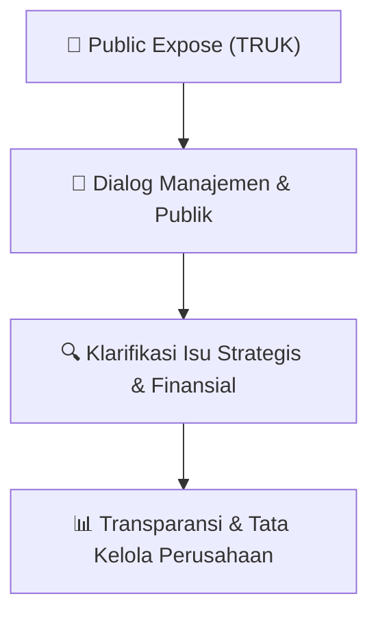

# 🎤 Laporan Hasil Public Expose: [TRUK]

🏢 **Emiten**: `TRUK` | 📅 **Tanggal Pelaksanaan**: `2026-08-19` | ❓ **Total Pertanyaan**: `3 Pertanyaan`
⬅️ [[knowledge-base/daily-digests/TRUK_20260819|Kembali ke Daily Digest]] | 🎛️ [[Dashboard/TRUK|Ke Dashboard Emiten]]

> [!IMPORTANT]
> Dokumen ini memuat seluruh risalah hasil pelaksanaan dan sesi tanya jawab (Q&A) Public Expose TRUK. Informasi dicatat secara verbatim guna memberikan analisis sentimen dan arah kebijakan manajemen bagi investor.

---

## ℹ️ 1. Informasi Penyelenggaraan & Kehadiran

| Parameter | Detail Pelaksanaan |
|---|---|
| **Nomor Surat** | 041/GTR-DIR/VIII/2026 |
| **Perihal** | Laporan Hasil Public Expose Insidentil |
| **Waktu Pengumuman** | 19-08-2026 13:30 |
| **Jumlah Kehadiran Peserta** | Penyampaian Hasil Public Expose |
| **Lampiran Berkas** | `1` |

---

## 💬 2. Risalah Tanya Jawab Manajemen & Investor (3 Pertanyaan)

### ❓ Pertanyaan #1

> **Penanya**: *Investor / Analis Publik*

```text
Pertanyaan:
1. Direktur  
: Firman Muliansyah 
2. Komisaris 
: Carolina Kusuma 
 
Acara Public Expose Insidentil dibagi menjadi 2 (dua) sesi ,yaitu :
```

💡 **Jawaban & Klarifikasi Manajemen**:

> *Teks tanggapan manajemen tidak tersedia*

---

### ❓ Pertanyaan #1

> **Penanya**: *Investor / Analis Publik*

```text
Pertanyaan:
1. Sesi pertama adalah presentasi mengenai Profil, kinerja Perseroan, Pergerakan Harga Saham dan Rencana Usaha 
Perseroan yang di bawakan oleh Perwakilan Perseroan Bapak M. Adiwijaya K. 
Materi acara Public Expose yang disampaikan sesuai dengan yang telah disampaikan kepada PT Bursa Efek 
Indonesia via e-reporting tanggal 14 Agustus 2026, Nomor 039/GTR-DIR/VIII/2026. 
2. Sesi kedua adalah sesi Tanya jawab. 
 
Berikut adalah pertanyaan yang diajukan dan jawaban yang diberikan oleh Direksi dan Management Perseroan :
➢ Bapak Daniel
Pertanyaan :
```

💡 **Jawaban & Klarifikasi Manajemen**:

> *Teks tanggapan manajemen tidak tersedia*

---

### ❓ Pertanyaan #1

> **Penanya**: *Investor / Analis Publik*

```text
Pertanyaan:
1. Data manajemen slide 8 dan 9 bahwa bagaimana faktor fundamental yang mendasarinya dari manajemen 
membaca lonjakan harga dan volume saham TRUK pada 3 Agustus 2026 yang dimana di tengah tren 
penurunan pendapatan dan ekuitas selama 3 tahun terakhir, serta tekanan ekonomi makro seperti suku 
bunga dan kebijakan pajak sektor logistik ? 
2. Data manajemen slide 5, 7, 10 bahwa bagaimana manajemen memastikan langkah ini tetap sejalan 
dengan kompetensi dan kesiapan tata kelola risiko Perseroan dengan ini masih dalam koridor bisnis inti 
transportasi/logistik, atau ada wacana diversifikasi ke sektor baru walaupun rencana pengembangan bisnis 
yang disebutkan masih tahap awal ? 
3. Data manajemen slide 3, 6, 9 bahwa apa mekanisme internal Perseroan untuk mencegah asimetri 
informasi antara manajemen/pemegang saham utama dengan investor publik, misalnya kebijakan 
pembatasan transaksi saham oleh insider dimana mengingat lonjakan harga saham terjadi tepat sebelum 
penghentian sementara oleh BEI ?
Jawaban : 
1. Lonjakan saham ini murni volatile market, kemungkinan beberapa pihak mengambil kesempatan dengan 
membeli saham dan mengangkat harganya. Biasanya mereka bermain dengan saham-saham yang 
kapitalisasinya tidak terlalu besar jadi mereka bisa bermain di situ untuk menggoreng sahamnya, jadi ini hanya 
mekanisme pasar dan kita tidak bisa kita mencegah orang untuk masuk membeli saham TRUK. Murni 
mekanisme pasar dan tidak terkait dengan fundamental. 
2. Perusahaan belum ada rencana diversifikasi ke sektor lain, mungkin di sektor logistik atau kargo sendiri akan 
ada pengembangan namun tetap sejalan dengan visi dan misi Perusahaan yaitu dibidang transportasi.  
3. Perusahaan tidak melihat ada indikasinya Insider Trading. Jadi, untuk mencegah asimetri informasi antara 
Management dengan Investor Publik Perusahaan akan terus menyampaikan keterbukaan Informasi yang perlu 
disampaikan kepada Publik.
Demikian laporan penyelenggaraan Public Expose Insidentil ini kami sampaikan, atas perhatian dan kerjasamanya kami 
ucapkan terima kasih. 
 
Jakarta, 19 Agustus 2026 
PT Guna Timur Raya Tbk. 
 
 
 
 
Budi Gunawan 
Direktur Utama
```

💡 **Jawaban & Klarifikasi Manajemen**:

> *Teks tanggapan manajemen tidak tersedia*

---

## 📌 3. Peta Jalur Transparansi & Kepercayaan Pasar



---

*Dokumen diolah otomatis oleh **Swarm Intelijen Pasar Modal Indonesia** pada 2026-10-12 16:50 WIB.*