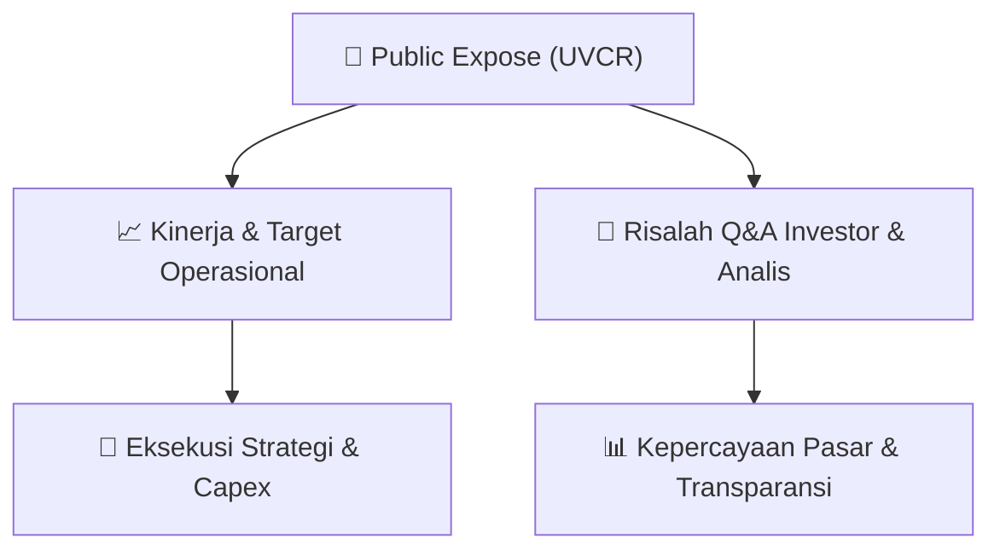

# 📢 Laporan Intelijen Paparan Publik (Public Expose) - [[UVCR]]
🏢 **Emiten**: `[[UVCR]]` | 📅 **Tanggal Pelaksanaan**: `2026-08-27` | 📑 **Dokumen**: `Public Expose lamp1`
⬅️ [[knowledge-base/daily-digests/Daily_Digest_20260827|Kembali ke Daily Digest]] | 🎛️ [[Dashboard|Ke Dashboard Utama]]

---

## 📌 1. Ringkasan Eksekutif & Paparan Direksi
> [!NOTE]
> PT Trimegah Karya Pratama Tbk (UVCR) menyampaikan rencana pelaksanaan Public Expose Tahunan 2026 secara elektronik pada Kamis, 10 September 2026 pukul 15.00-16.00 WIB melalui IDX Public Expose Live 2026. Pembicara adalah Hady Kuswanto (Direktur Utama) dan Riky Boy H. Permata (Direktur). Agenda: Update Perseroan, informasi fitur, pengembangan inovasi dan kerjasama yang telah dilakukan Perseroan.

#### 🎯 Guidance Operasional & Target Strategis
- Tidak tersedia dalam dokumen karena dokumen hanya merupakan surat pemberitahuan rencana pelaksanaan Public Expose, belum memuat paparan materi atau guidance.

## 📊 2. Matriks Indikator Operasional & Parameter Kunci
| Parameter Utama | Nilai / Keterangan Resmi |
| :--- | :--- |
| **Tanggal Public Expose** | `Kamis, 10 September 2026` |
| **Waktu** | `15.00-16.00 WIB` |
| **Tempat** | `IDX Public Expose Live 2026 (online)` |
| **Pembicara** | `Hady Kuswanto (Direktur Utama), Riky Boy H. Permata (Direktur)` |
| **Agenda** | `Update Perseroan, informasi fitur, pengembangan inovasi dan kerjasama yang telah dilakukan Perseroan` |
| **Nomor Surat** | `047/SK/COE/TKP-REG/VIII/2026` |
| **Tanggal Surat** | `Jakarta, 27 Agustus 2026` |

---

## 💬 3. Risalah Tanya Jawab (Q&A Session)
`Materi presentasi Public Expose / Risalah Q&A terlampir dalam dokumen resmi bursa.`

## 📌 4. Peta Jalur Strategis & Roadmap

---

## 🔗 Knowledge Graph
- [[knowledge-base/daily-digests/Daily_Digest_20260827|📄 Daily Digest 2026-08-27]]
- [[knowledge-base/calendars/Action_Calendar|🗓️ Kalender Terpusat Aksi Korporasi]]
- [[Dashboard|🎛️ Kembali ke Dashboard Utama]]