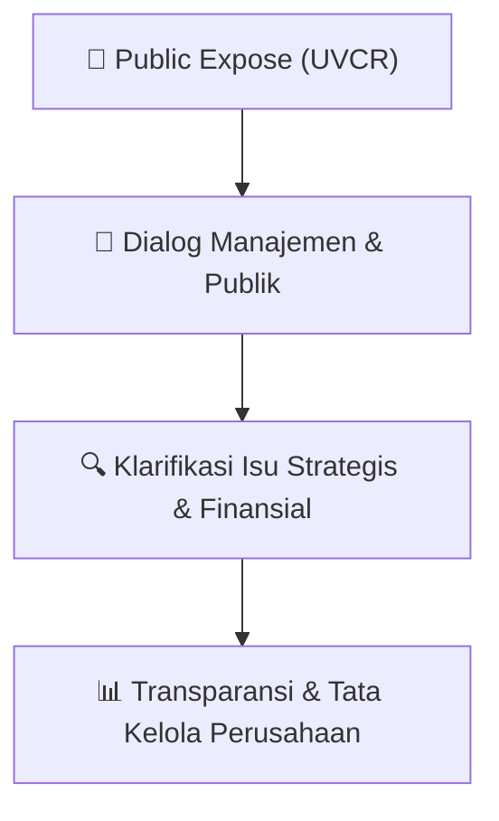

# 🎤 Laporan Hasil Public Expose: [UVCR]

🏢 **Emiten**: `UVCR` | 📅 **Tanggal Pelaksanaan**: `2026-09-11` | ❓ **Total Pertanyaan**: `1 Pertanyaan`
⬅️ [[knowledge-base/daily-digests/UVCR_20260911|Kembali ke Daily Digest]] | 🎛️ [[Dashboard/UVCR|Ke Dashboard Emiten]]

> [!IMPORTANT]
> Dokumen ini memuat seluruh risalah hasil pelaksanaan dan sesi tanya jawab (Q&A) Public Expose UVCR. Informasi dicatat secara verbatim guna memberikan analisis sentimen dan arah kebijakan manajemen bagi investor.

---

## ℹ️ 1. Informasi Penyelenggaraan & Kehadiran

| Parameter | Detail Pelaksanaan |
|---|---|
| **Nomor Surat** | 017/SK/LGL/TKP-IDX/IX/2026 |
| **Perihal** | Laporan Hasil Public Expose Tahunan |
| **Waktu Pengumuman** | 11-09-2026 13:47 |
| **Jumlah Kehadiran Peserta** | Penyampaian Hasil Public Expose |
| **Lampiran Berkas** | `1` |

---

## 💬 2. Risalah Tanya Jawab Manajemen & Investor (1 Pertanyaan)

### ❓ Pertanyaan #1

> **Penanya**: *Investor / Analis Publik*

```text
Pertanyaan:
1. 
Kinerja Keuangan - Ditanyakan oleh
Ridwan di Jakarta
Pendapatan 
Ultra 
Voucher 
pada
semester I 2026 tumbuh 42,5%,
sementara laba bersih meningkat lebih
dari 600%. Apa faktor utama yang
mendorong pertumbuhan tersebut,
dan apakah Perseroan melihat tren
peningkatan profitabilitas ini dapat
dipertahankan hingga akhir 2026? Dan
bagaimana 
perusahaan bisa tetap
menjaga margin pertumbuhan yang
positif?
Baik, terima kasih Pak Fajar. Izin saya coba
menjawab 
nanti 
apabila 
Pak 
Hady 
ada
tambahan 
kami 
persilakan. 
Dari 
sisi
pendapatan, 
sangat 
betul 
sekali 
kami
mengalami peningkatan 40% bila dibandingkan
dengan tahun lalu dan juga itu menyebabkan
juga kita memiliki berbagai macam strategi dari
sisi marketing dan juga dari sisi cost efisiensi
yang dilakukan dari perseran. Sehingga kalau
dilihat dari laba bersih bukan cuma dari sisi
gross profit tapi juga efisiensi dari operasional.
kami bisa meningkatkan laba bersih kita
meningkat 600% dibandingkan di 2025. Jadi
walaupun dengan tantangan ekonomi yang ada,
kami melihat ini masih banyak peluang di mana
market sangat membutuhkan teaser atau
semacam insentif baik dari sisi merchant
ataupun dari sisi corporate atau brand site atau
B2B. Sehingga solusi voucher dan loyalty ini
sangat 
powerful 
digunakan 
oleh 
seluruh
industri. Baik itu adalah FMCG, Banking,
otomotif, FMCG semuanya menggunakan dan
membutuhkan solusi gifting, voucher dan
loyalty. Ini yang membuat kita semakin agresif
lagi untuk masuk ke dalam market. Dan ini yang
membuat kita semakin confident di 2026 ini kita
pasti akan tetap mempertahankan revenue kita,
laba profit kita, dan juga net profit atau laba
bersih kita juga akan meningkat dibandingkan
dengan 2025 lalu.
```

💡 **Jawaban & Klarifikasi Manajemen**:

> *Teks tanggapan manajemen tidak tersedia*

---

## 📌 3. Peta Jalur Transparansi & Kepercayaan Pasar



---

*Dokumen diolah otomatis oleh **Swarm Intelijen Pasar Modal Indonesia** pada 2026-10-12 16:50 WIB.*