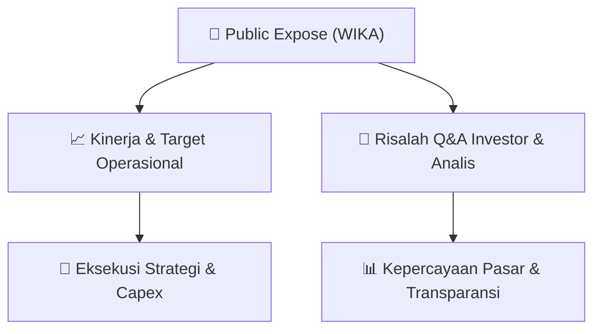

# 📢 Laporan Intelijen Paparan Publik (Public Expose) - [[WIKA]]
🏢 **Emiten**: `[[WIKA]]` | 📅 **Tanggal Pelaksanaan**: `2026-09-17` | 📑 **Dokumen**: `Public Expose lamp1`
⬅️ [[knowledge-base/daily-digests/Daily_Digest_20260917|Kembali ke Daily Digest]] | 🎛️ [[Dashboard|Ke Dashboard Utama]]

---

## 📌 1. Ringkasan Eksekutif & Paparan Direksi
> [!NOTE]
> PT Wijaya Karya (Persero) Tbk (WIKA) menyampaikan informasi rencana penyelenggaraan Public Expose Tahunan 2026. Acara akan dilaksanakan pada Kamis, 01 Oktober 2026, pukul 10.00–11.00 WIB secara daring melalui tautan https://bit.ly/PubexWIKA2026, Zoom Meeting ID 806 358 0453, dan passcode pubexwika. Public Expose akan dihadiri oleh Direksi Perseroan. Materi Public Expose Tahunan akan disampaikan paling lambat pada tanggal 01 Oktober 2026 melalui situs web Bursa Efek Indonesia. Pemberitahuan ini merujuk pada Peraturan Nomor I-E tentang Kewajiban Penyampaian Informasi.

#### 🎯 Guidance Operasional & Target Strategis
- Dokumen ini tidak memuat target kinerja, capex, ekspansi, atau guidance operasional. Informasi yang tersedia hanya berupa rencana penyelenggaraan Public Expose Tahunan 2026, jadwal, kanal daring, kehadiran Direksi, dan komitmen penyampaian materi melalui situs web BEI paling lambat 01 Oktober 2026.

## 📊 2. Matriks Indikator Operasional & Parameter Kunci
| Parameter Utama | Nilai / Keterangan Resmi |
| :--- | :--- |
| **Emiten** | `PT Wijaya Karya (Persero) Tbk (WIKA)` |
| **Perihal** | `Informasi Rencana Penyelenggaraan Public Expose Tahun 2026` |
| **Hari/Tanggal** | `Kamis, 01 Oktober 2026` |
| **Waktu** | `Pukul 10.00 – 11.00 WIB` |
| **Tempat** | `Secara daring pada tautan https://bit.ly/PubexWIKA2026` |
| **Zoom Meeting ID** | `806 358 0453` |
| **Passcode** | `pubexwika` |
| **Kehadiran** | `Direksi Perseroan` |
| **Penyampaian Materi** | `Paling lambat tanggal 01 Oktober 2026 melalui situs web Bursa Efek Indonesia` |
| **Dasar Regulasi** | `Peraturan Nomor I-E tentang Kewajiban Penyampaian Informasi, Lampiran Keputusan Direksi PT Bursa Efek Indonesia Nomor Kep-00015/BEI/01-2021 tanggal 29 Januari 2021` |
| **Penandatangan** | `Ngatemin, Corporate Secretary` |
| **Nomor Surat** | `SE.01.00/A.CORSEC.00307/2026` |
| **Tanggal Surat** | `17 September 2026` |

---

## 💬 3. Risalah Tanya Jawab (Q&A Session)
`Materi presentasi Public Expose / Risalah Q&A terlampir dalam dokumen resmi bursa.`

## 📌 4. Peta Jalur Strategis & Roadmap

---

## 🔗 Knowledge Graph
- [[knowledge-base/daily-digests/Daily_Digest_20260917|📄 Daily Digest 2026-09-17]]
- [[knowledge-base/calendars/Action_Calendar|🗓️ Kalender Terpusat Aksi Korporasi]]
- [[Dashboard|🎛️ Kembali ke Dashboard Utama]]