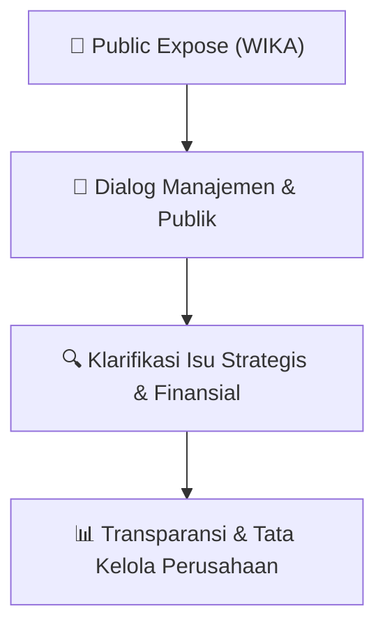

# 🎤 Laporan Hasil Public Expose: [WIKA]

🏢 **Emiten**: `WIKA` | 📅 **Tanggal Pelaksanaan**: `2026-10-06` | ❓ **Total Pertanyaan**: `5 Pertanyaan`
⬅️ [[knowledge-base/daily-digests/WIKA_20261006|Kembali ke Daily Digest]] | 🎛️ [[Dashboard/WIKA|Ke Dashboard Emiten]]

> [!IMPORTANT]
> Dokumen ini memuat seluruh risalah hasil pelaksanaan dan sesi tanya jawab (Q&A) Public Expose WIKA. Informasi dicatat secara verbatim guna memberikan analisis sentimen dan arah kebijakan manajemen bagi investor.

---

## ℹ️ 1. Informasi Penyelenggaraan & Kehadiran

| Parameter | Detail Pelaksanaan |
|---|---|
| **Nomor Surat** | SE.01.00/A.CORSEC.00325/2026 |
| **Perihal** | Laporan Hasil Public Expose Tahunan |
| **Waktu Pengumuman** | 06-10-2026 05:10 |
| **Jumlah Kehadiran Peserta** | Penyampaian Hasil Public Expose |
| **Lampiran Berkas** | `1` |

---

## 💬 2. Risalah Tanya Jawab Manajemen & Investor (5 Pertanyaan)

### ❓ Pertanyaan #1

> **Penanya**: *Investor / Analis Publik*

```text
Pertanyaan:
1. rosyantw.a.5989 
 
 
      Pertanyaan 
: 
Hingga akhir tahun 2026 WIKA menyasar perolehan 
kontrak baru berapa? Dan ke proyek apa?   
 
      Jawaban 
: 
Target perolehan kontrak baru WIKA hingga akhir tahun 
2026 yang tertuang dalam RKAP adalah sebesar 
Rp21,4 triliun. Perolehan tersebut diarahkan untuk 
mendukung proyek strategis pemerintah, antara lain 
Program Sekolah Rakyat, Sekolah Terintegrasi, dan 
optimasi lahan serta proyek EPCC yang saat ini menjadi 
kontributor terbesar. Selain itu, WIKA juga tengah 
menyasar sejumlah proyek pasar hijau (green market) 
di Indonesia. Di pasar luar negeri, WIKA menggarap 
proyek di Timor Leste serta penyediaan beton (supply 
beton) di Manila. 
 
2. Daniel
Pertanyaan 
: 
1. Mengapa diversifikasi ke sektor diluar kompetensi 
konstruksi 
belum 
mampu 
mengurangi 
ketergantungan 
WIKA 
terhadap 
proyek 
pemerintah/BUMN, padahal visi perusahaan ingin
untuk mencapai kesepakatan dengan perbankan, 
serta kepada pemegang sukuk dan obligasi melalui 
Wali Amanat yang dilakukan melalui RUPO dan 
RUPSU. Selain itu WIKA juga akan terus fokus 
meningkatkan operation excellence pada seluruh 
proyek berjalan. Dengan kemampuan tersebut, WIKA 
diharapkan dapat menghasilkan EBITDA sebesar 
Rp850 
miliar 
yang 
dapat 
digunakan 
untuk 
menyelesaikan kewajiban kepada pemegang obligasi 
sukuk dan perbankan, serta pemenuhan kebutuhan 
operasional. Melalui strategi tersebut, manajemen 
meyakini bahwa WIKA mampu menyelesaikan 
kewajiban jangka panjangnya. Komunikasi dengan 
seluruh pemangku kepentingan terkait juga terus 
dilakukan secara intensif.
```

💡 **Jawaban & Klarifikasi Manajemen**:

> *Teks tanggapan manajemen tidak tersedia*

---

### ❓ Pertanyaan #3

> **Penanya**: *Investor / Analis Publik*

```text
Pertanyaan:
3. indriyatnifitria5248 
 
 
     Pertanyaan 
: 
Bagaimana proses pengalihan Whoosh? apakah benar 
diambil alih oleh kementerian keuangan? Bagaimana 
posisi neraca WIKA jika terjadi pengalihan? 
 
    Jawaban 
: 
Hingga saat ini Perseroan terus menjalin komunikasi 
dan koordinasi intensif dengan Danantara terkait 
perkembangan proses pengalihan pengelolaan KCIC ke 
Kementerian Keuangan. Kami akan menyampaikan 
informasi lebih lanjut terkait perkembangan aksi 
korporasi 
tersebut 
kepada 
seluruh 
pemangku 
kepentingan sesuai dengan ketentuan yang berlaku.  
4. anggrainitriwasti547 
 
 
     Pertanyaan 
: 
⁠Apakah hasil divestasi bisa memperbaiki posisi 
keuangan WIKA/salah satunya untuk menyelesaikan 
kewajiban hutang WIKA? Kapan WIKA di unsuspend 
bursa? 
 
    Jawaban 
: 
Hasil divestasi tentunya sangat dapat memperbaiki 
kondisi keuangan WIKA, untuk itu Perseroan terus 
berkomunikasi dengan para pemangku kepentingan, 
termasuk Danantara dan Kementerian Keuangan terkait 
hal tersebut. WIKA juga saat ini fokus menyelesaikan 
kewajiban serta terus menjalin komunikasi kepada 
kreditur perbankan dan pemegang obligasi sukuk untuk 
memperoleh dukungan atas pemenuhan kewajiban 
keuangan melalui proses restrukturisasi komprehensif. 
Sehingga 
dengan 
tercapainya 
restrukturisasi 
komprehensif, 
saham 
WIKA 
dapat 
kembali 
diperdagangkan di pasar modal.
```

💡 **Jawaban & Klarifikasi Manajemen**:

> *Teks tanggapan manajemen tidak tersedia*

---

### ❓ Pertanyaan #5

> **Penanya**: *Investor / Analis Publik*

```text
Pertanyaan:
5. Diajengputriyuniar 
     Pertanyaan 
: 
Direksi mengatakan bahwa saat ini tengah berfokus 
dalam meningkatkan ESG WIKA. Apa manfaat 
keunggulan ESG tersebut bagi WIKA saat ini dan di 
masa mendatang? 
 
     Jawaban 
: 
Kajian konsultan bisnis terhadap proyeksi bisnis 
konstruksi hingga tahun 2030 menunjukan bahwa 
pertumbuhan segmen konstruksi akan sangat baik pada 
industri EPCC. Di sektor EPCC, banyak investor asing 
berminat masuk dan mensyaratkan standar ESG yang 
tinggi, bahkan mereka cenderung lebih memilih imbal 
hasil yang lebih rendah selama perusahaan memiliki 
praktik dan nilai ESG tinggi. Dengan demikian, ESG 
menjadi isu strategis karena pasar ke depan akan hadir 
dengan ESG sebagai salah satu persyaratan, dan WIKA 
beruntung karena sudah memiliki praktik ESG baik, 
terbukti dari skor ESG Perseroan dari S&P Global 
sebesar 64/100, peringkat 13 dari 234 perusahaan 
global, 5 dari 149 perusahaan Asia Pasifik dan 1 di 
Indonesia untuk sektor construction & engineering.
Praktik ESG baik membuka peluang berkaitan dengan 
green financing. Proyek yang berorientasi ESG, sesuai 
ketentuan, akan didukung OJK untuk memperoleh 
pendanaan hijau. Hal ini telah terbukti pada investasi 
WIKA di WIKA Tirta Jatiluhur, yang semula dikenakan 
bunga 11% untuk pendanaan belanja modal (capex), 
kini turun menjadi 6,5% setelah memperoleh green 
financing, karena proyek tersebut selaras dengan nilai 
SDGs. Dampaknya sangat besar, baik secara sosial 
maupun bisnis. Dengan demikian, ESG memberikan 
dua manfaat penting bagi WIKA, yaitu akses pasar dan 
pendanaan hijau.
```

💡 **Jawaban & Klarifikasi Manajemen**:

> *Teks tanggapan manajemen tidak tersedia*

---

### ❓ Pertanyaan #6

> **Penanya**: *Investor / Analis Publik*

```text
Pertanyaan:
6. yo-sg7bf 
 
 
     Pertanyaan 
: 
Bagaimana WIKA merespons isu bencana alam? 
Apakah WIKA memiliki produk yang siap dipakai? 
     Jawaban 
: 
Saat ini Indonesia berada dalam kondisi rawan 
bencana, salah satunya gempa bumi. Melalui proyek-
proyek pemerintah, WIKA sebagai pelaku konstruksi 
turut mengambil peran di wilayah yang terdampak. Di 
sisi lain, WIKA memiliki keunggulan berupa produk 
rumah tahan gempa bernama WHome yang diproduksi 
oleh WIKA Beton. WHome dapat dibangun dalam 
hitungan hari, dan saat ini sedang dikembangkan 
bersama BRIN agar memiliki ketahanan yang lebih baik
terhadap gempa. Produk ini menjadi peluang bagi WIKA 
untuk dimanfaatkan dalam merespons kebutuhan 
hunian pascabencana, dan sudah dapat diproduksi 
serta digunakan dalam jumlah besar. 
 
7. AmadMs-x3v
Pertanyaan 
: 
Bagaimana perkembangan rencana restrukturisasi yang 
tengah dilakukan WIKA? 
 
     Jawaban 
: 
WIKA memiliki kewajiban utang berbunga kepada 
perbankan serta pemegang sukuk dan obligasi, dan 
keduanya saat ini sedang dalam proses restrukturisasi 
komprehensif. 
Restrukturisasi 
komprehensif 
ini 
diperlukan karena kemampuan keuangan WIKA yang 
bertumpu pada bisnis inti, yaitu konstruksi. Meskipun 
EBITDA positif, kewajiban WIKA induk mencapai sekitar 
Rp27 triliun dan secara konsolidasi sekitar Rp30 triliun, 
sementara WIKA harus dapat tetap berjalan secara 
berkelanjutan (going concern). Karena itu WIKA harus 
melakukan restrukturisasi komprehensif.
Dalam prosesnya, WIKA telah berkomunikasi secara 
intensif dengan perbankan serta pemegang sukuk dan 
obligasi, dan upaya tersebut mendapat apresiasi yang 
baik dari para pemangku kepentingan. WIKA juga 
berkomunikasi intensif dengan Danantara selaku 
pemegang saham, yang memberikan dukungan positif 
untuk menyehatkan WIKA. Danantara, WIKA dan 
kreditur berupaya memperbaiki kondisi ini bersama-
sama. Manajemen berharap pada kuartal IV 2026, 
WIKA dapat menunjukan kinerja fundamental keuangan 
yang 
baik, 
yang 
menggambarkan 
kemampuan 
keuangan 
dari 
bisnis 
inti 
yang 
ada, 
sehingga 
memberikan nilai tambah bagi seluruh pemangku 
kepentingan.
```

💡 **Jawaban & Klarifikasi Manajemen**:

> *Teks tanggapan manajemen tidak tersedia*

---

### ❓ Pertanyaan #8

> **Penanya**: *Investor / Analis Publik*

```text
Pertanyaan:
8. @nikkiramadhanii
Pertanyaan 
: 
Seperti apa bentuk dukungan Danantara kepada WIKA 
dalam langkah Penyehatan Perusahaan?
Jawaban 
: 
Hingga saat ini Perseroan telah mendapatkan 
dukungan berupa upaya percepatan streamlining. 
 
Perseroan juga terus menjalin komunikasi dengan 
Danantara 
untuk 
memperoleh 
dukungan 
yang
dibutuhkan 
terutama 
untuk 
mengupayakan 
keberhasilan restrukturisasi WIKA melalui MRA. 
 
Perseroan memandang dukungan Danantara sebagai 
faktor penting dalam memperkuat penyehatan dan 
fundamental 
WIKA. 
Perseroan 
akan 
terus 
menyampaikan 
perkembangan 
dukungan 
yang 
diperoleh melalui keterbukaan informasi sesuai 
ketentuan yang berlaku kepada publik.
Total Peserta Pubex WIKA tahun 2026 Melalui Kanal Youtube
```

💡 **Jawaban & Klarifikasi Manajemen**:

> *Teks tanggapan manajemen tidak tersedia*

---

## 📌 3. Peta Jalur Transparansi & Kepercayaan Pasar



---

*Dokumen diolah otomatis oleh **Swarm Intelijen Pasar Modal Indonesia** pada 2026-10-12 16:50 WIB.*