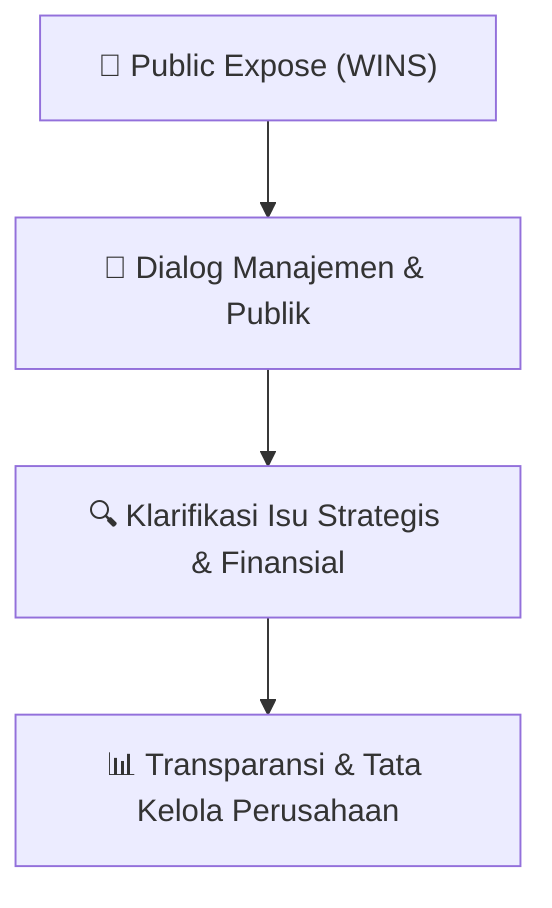

# 🎤 Laporan Hasil Public Expose: [WINS]

🏢 **Emiten**: `WINS` | 📅 **Tanggal Pelaksanaan**: `2026-08-14` | ❓ **Total Pertanyaan**: `1 Pertanyaan`
⬅️ [[knowledge-base/daily-digests/WINS_20260814|Kembali ke Daily Digest]] | 🎛️ [[Dashboard/WINS|Ke Dashboard Emiten]]

> [!IMPORTANT]
> Dokumen ini memuat seluruh risalah hasil pelaksanaan dan sesi tanya jawab (Q&A) Public Expose WINS. Informasi dicatat secara verbatim guna memberikan analisis sentimen dan arah kebijakan manajemen bagi investor.

---

## ℹ️ 1. Informasi Penyelenggaraan & Kehadiran

| Parameter | Detail Pelaksanaan |
|---|---|
| **Nomor Surat** | 2129/A.20/VIII/2026/WINS.277 |
| **Perihal** | Laporan Hasil Public Expose Tahunan |
| **Waktu Pengumuman** | 14-08-2026 17:28 |
| **Jumlah Kehadiran Peserta** | Penyampaian Hasil Public Expose |
| **Lampiran Berkas** | `2` |

---

## 💬 2. Risalah Tanya Jawab Manajemen & Investor (1 Pertanyaan)

### ❓ Pertanyaan #2

> **Penanya**: *Investor / Analis Publik*

```text
Pertanyaan:
2. 
Mengenai contract coverage sebelum akuisisi Fast Offshore, Perseroan 
mencatat nilai contracts on hand sebesar US$ 58 juta, di mana sekitar 
sepertiganya memiliki durasi lebih dari satu tahun. Namun, mayoritas 
dari high tier vessel dan masih berada dalam kontrak jangka pendek. 
 
          Hal ini terutama disebabkan oleh tahap siklus yang masih berada pada
fase awal. Sebagian besar pekerjaan yang kita lihat saat ini berasal dari 
survei seismik serta eksplorasi, yang sifatnya berdurasi pendek, dimana 
umumnya hanya beberapa bulan. Meskipun demikian, ada beberapa 
kontrak yang saat ini sedang dalam proses tender dan diperkirakan akan 
selesai pada akhir tahun ini atau awal tahun depan. Kontrak-kontrak baru 
ini diproyeksikan berdurasi jangka panjang, yaitu sekitar 3 hingga 5 tahun. 
 
3. 
Banyak aktivitas yang terjadi disana, secara khusus mengenai kegiatan 
pengeboran, fase pengeboran saat ini sedang mengalami penurunan 
aktivitas karena salah satu rig akan menyelesaikan masa kontraknya. Rig 
pengganti diperkirakan baru akan masuk dan beroperasi menjelang akhir 
tahun. 
 
Aktivitas diproyeksikan akan kembali meningkat mendekati akhir tahun. 
Memang 
terjadi 
penundaan, 
namun 
dalam 
bisnis 
upstream 
keterlambatan seperti ini merupakan hal yang biasa terjadi dan bukan 
masalah mendasar. 
 
Di sisi lain, penting untuk dicatat bahwa Selat Makassar merupakan 
wilayah perairan terdalam di Indonesia. Oleh karena itu, kapal dan 
operasi yang digunakan di wilayah tersebut sangat sensitif terhadap 
spesifikasi teknis, terutama untuk DP. Meskipun terdapat penundaan, 
secara realistis terdapat probabilitas yang sangat tinggi bahwa aktivitas 
operasional akan kembali melonjak menjelang akhir tahun. 
 
4. 
Mengenai tarif sewa, tarif sewa di Indonesia secara umum lebih rendah 
jika dibandingkan dengan negara-negara lain. Namun, angkanya secara 
perlahan mulai membaik. 
 
Di sisi lain, terjadi sedikit penurunan aktivitas di Malaysia. Ketika aktivitas 
di Malaysia kembali meningkat, Perseroan memperkirakan tarif sewa 
secara regional akan naik. 
 
Secara umum, kondisi tarif sewa saat ini memang tidak sangat tinggi, 
namun juga tidak sangat rendah. Meski sempat terdapat lonjakan pada 
kapal baru, Perseroan melihat masih ada ruang untuk kenaikan tarif sewa 
seiring dengan peningkatan permintaan dan tingkat penawaran yang 
terus berkembang. 
 
8 
Aditya 
Prayoga
PT Phintraco 
Sekuritas
Pertanyaan: 
1. 
Berapa kisaran usia kapal yang akan diakuisisi? 
2. 
Apakah pembelian kapal second-hand tersebut akan didanai melalui kas 
internal, fasilitas pendanaan bank, atau kombinasi keduanya? 
3. 
Terkait dengan tarif sewa kapal, apakah boleh di share terkait dengan 
berapa rata-rata tarif sewa kapal untuk segmen high-tier dan low-tier saat 
ini? 
4. 
Terkait rencana pembangunan kapal baru, apakah Perseroan akan lebih 
berfokus pada segmen high-tier atau low-tier?
```

💡 **Jawaban & Klarifikasi Manajemen**:

> *Teks tanggapan manajemen tidak tersedia*

---

## 📌 3. Peta Jalur Transparansi & Kepercayaan Pasar



---

*Dokumen diolah otomatis oleh **Swarm Intelijen Pasar Modal Indonesia** pada 2026-10-12 16:50 WIB.*