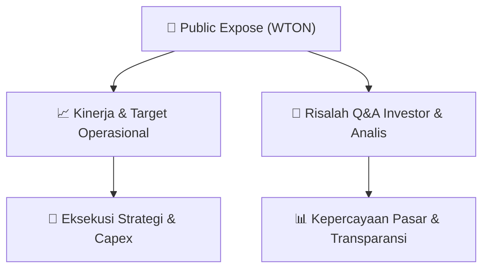

# 📢 Laporan Intelijen Paparan Publik (Public Expose) - [[WTON]]
🏢 **Emiten**: `[[WTON]]` | 📅 **Tanggal Pelaksanaan**: `2026-08-20` | 📑 **Dokumen**: `Public Expose lamp1`
⬅️ [[knowledge-base/daily-digests/Daily_Digest_20260820|Kembali ke Daily Digest]] | 🎛️ [[Dashboard|Ke Dashboard Utama]]

---

## 📌 1. Ringkasan Eksekutif & Paparan Direksi
> [!NOTE]
> PT Wijaya Karya Beton Tbk (WTON) menyampaikan pemberitahuan rencana penyelenggaraan Public Expose Tahunan 2026 yang akan dilaksanakan pada Selasa, 9 September 2026 pukul 15.00-16.00 WIB melalui platform Public Expose Live 2026 di website pubexlive.idx.co.id. Materi Public Expose akan disampaikan melalui www.idxnet.co.id paling lambat 4 September 2026, sedangkan hasil Public Expose paling lambat 14 September 2026.

#### 🎯 Guidance Operasional & Target Strategis
- Dokumen ini hanya berisi pemberitahuan jadwal Public Expose dan tidak memuat target kinerja, rencana ekspansi, alokasi belanja modal, maupun guidance operasional.

## 📊 2. Matriks Indikator Operasional & Parameter Kunci
| Parameter Utama | Nilai / Keterangan Resmi |
| :--- | :--- |
| **Nama Emiten** | `PT Wijaya Karya Beton Tbk` |
| **Kode Saham** | `WTON` |
| **Jenis Acara** | `Public Expose Tahunan 2026` |
| **Hari dan Tanggal** | `Selasa, 9 September 2026` |
| **Waktu** | `15.00 - 16.00 WIB` |
| **Tempat** | `Public Expose Live 2026` |
| **Alamat Tautan** | `pubexlive.idx.co.id` |
| **Batas Penyampaian Materi** | `4 September 2026 melalui www.idxnet.co.id` |
| **Batas Penyampaian Hasil** | `14 September 2026 melalui www.idxnet.co.id` |
| **Penandatangan** | `Ignatius Harry Sumartono, Corporate Secretary` |

---

## 💬 3. Risalah Tanya Jawab (Q&A Session)
`Materi presentasi Public Expose / Risalah Q&A terlampir dalam dokumen resmi bursa.`

## 📌 4. Peta Jalur Strategis & Roadmap

---

## 🔗 Knowledge Graph
- [[knowledge-base/daily-digests/Daily_Digest_20260820|📄 Daily Digest 2026-08-20]]
- [[knowledge-base/calendars/Action_Calendar|🗓️ Kalender Terpusat Aksi Korporasi]]
- [[Dashboard|🎛️ Kembali ke Dashboard Utama]]