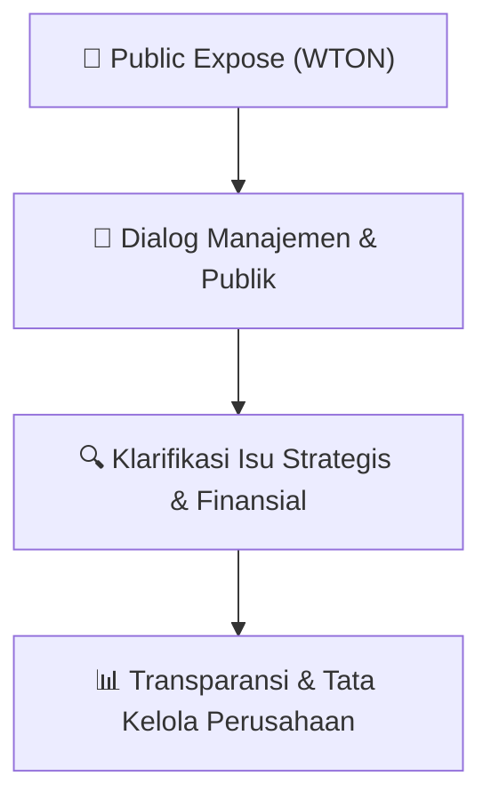

# 🎤 Laporan Hasil Public Expose: [WTON]

🏢 **Emiten**: `WTON` | 📅 **Tanggal Pelaksanaan**: `2026-09-11` | ❓ **Total Pertanyaan**: `12 Pertanyaan`
⬅️ [[knowledge-base/daily-digests/WTON_20260911|Kembali ke Daily Digest]] | 🎛️ [[Dashboard/WTON|Ke Dashboard Emiten]]

> [!IMPORTANT]
> Dokumen ini memuat seluruh risalah hasil pelaksanaan dan sesi tanya jawab (Q&A) Public Expose WTON. Informasi dicatat secara verbatim guna memberikan analisis sentimen dan arah kebijakan manajemen bagi investor.

---

## ℹ️ 1. Informasi Penyelenggaraan & Kehadiran

| Parameter | Detail Pelaksanaan |
|---|---|
| **Nomor Surat** | SE.01.01/WB-0A.0946/2026. |
| **Perihal** | Laporan Hasil Public Expose Tahunan |
| **Waktu Pengumuman** | 11-09-2026 19:30 |
| **Jumlah Kehadiran Peserta** | Penyampaian Hasil Public Expose |
| **Lampiran Berkas** | `2` |

---

## 💬 2. Risalah Tanya Jawab Manajemen & Investor (12 Pertanyaan)

### ❓ Pertanyaan #1

> **Penanya**: *Investor / Analis Publik*

```text
Pertanyaan:
1. Kuntjara, selaku Direktur Utama;
```

💡 **Jawaban & Klarifikasi Manajemen**:

> *Teks tanggapan manajemen tidak tersedia*

---

### ❓ Pertanyaan #2

> **Penanya**: *Investor / Analis Publik*

```text
Pertanyaan:
2. Rija Judaswara, selaku Direktur Pemasaran dan Pengembangan;
```

💡 **Jawaban & Klarifikasi Manajemen**:

> *Teks tanggapan manajemen tidak tersedia*

---

### ❓ Pertanyaan #3

> **Penanya**: *Investor / Analis Publik*

```text
Pertanyaan:
3. Syailendra Ogan, selaku Direktur Keuangan, Human Capital dan Manajemen
Risiko;
```

💡 **Jawaban & Klarifikasi Manajemen**:

> *Teks tanggapan manajemen tidak tersedia*

---

### ❓ Pertanyaan #4

> **Penanya**: *Investor / Analis Publik*

```text
Pertanyaan:
4. Verly Widiantoro, selaku Direktur Teknik dan Produksi; dan
```

💡 **Jawaban & Klarifikasi Manajemen**:

> *Teks tanggapan manajemen tidak tersedia*

---

### ❓ Pertanyaan #5

> **Penanya**: *Investor / Analis Publik*

```text
Pertanyaan:
5. Ignatius Harry Sumartono, selaku Corporate Secretary.
Public Expose Live 2026 ini dimoderatori oleh Fajar Wayong yang ditunjuk oleh Indonesia
Stock Exchange (IDX).
Pemaparan tentang Perseroan disampaikan oleh Ignatius Harry Sumartono selaku
Corporate Secretary dengan poin-poin sebagai berikut:
• Pemutaran video Company Profile;
• Paparan tentang gambaran umum Perseroan;
• Paparan ikhtisar keuangan per Juli 2026;
• Paparan strategi WIKA Beton; dan
• Paparan inisiasi ESG di WIKA Beton.
Selanjutnya, sesi Tanya Jawab dilakukan setelah pemaparan materi disampaikan.
Adapun kutipan pertanyaan dan ringkasan jawaban yang disampaikan adalah sebagai
berikut:
```

💡 **Jawaban & Klarifikasi Manajemen**:

> *Teks tanggapan manajemen tidak tersedia*

---

### ❓ Pertanyaan #1

> **Penanya**: *Investor / Analis Publik*

```text
Pertanyaan:
1. Nama: William Adriel
Pertanyaan: Segmen manakah yang mampu menopang laba Perseroan untuk
Tahun Buku 2026?
Jawaban:
(Kuntjara – Direktur Utama): Dilihat dari sektornya, WIKA Beton berkontribusi
pada sektor infrastruktur, railway, energi, mining, dan sektor lainnya. Kalau terkait
perolehan dari revenue, revenue terbesar masih tetap diperoleh dari sektor
infrastruktur. Akan tetapi, kalau terkait kemampulabaan atau margin yang lebih
baik, WIKA Beton mendapatkannya dari sektor yang lain. Meskipun memerlukan
sales atau revenue yang besar, WIKA Beton juga membutuhkan margin yang baik.
WIKA Beton adalah industri dengan karakteristik fixed cost yang tinggi sehingga
di satu sisi, WIKA Beton juga memerlukan proyek yang volumenya besar
walaupun marginnya kecil guna mengisi utilisasi pabrik yang menekan atau
memikul fixed cost agar tidak terjadi inefisiensi. Jadi, WIKA Beton memainkan
strategi untuk tetap mengoptimalkan produktivitas pabrik yang sektor terbesarnya
berasal dari sektor infrastruktur. Walaupun marginnya tipis karena persaingan
yang ketat, WIKA Beton tetap mengambil pesanan atau proyek tersebut. Akan
tetapi, di sektor-sektor yang lain seperti energi atau railway, walaupun market-nya
tidak terlalu besar, namun persaingannya tidak ketat sehingga menghasilkan
kontribusi margin yang lebih baik.
```

💡 **Jawaban & Klarifikasi Manajemen**:

> *Teks tanggapan manajemen tidak tersedia*

---

### ❓ Pertanyaan #2

> **Penanya**: *Investor / Analis Publik*

```text
Pertanyaan:
2. Nama: Weereda Chuncuansugkom
Pertanyaan: Pada kuartal II 2026, net profit margin Perseroan tercatat sebesar
0,07%. Langkah konkrit apa saja yang diambil manajemen dalam rangka strategi
"Bring Back Our Glory" untuk meningkatkan kembali profitabilitas dan margin laba
bersih di semester II 2026?
Jawaban:
(Kuntjara - Direktur Utama): Angka net profit margin 0,07% itu adalah nilai bottom
line. Namun, apabila dilihat dari gross profit margin, target kami sebenarnya
berada di kisaran 6%. Penurunan hingga 0,07% pada bottom line terutama
disebabkan oleh tingkat sales yang tidak terlalu tinggi seiring dengan kondisi
industri konstruksi yang sedang mengalami kontraksi, sementara WIKA Beton
memikul biaya usaha berupa fixed cost yang relatif stabil di kisaran 3–4%. Hal
tersebut yang paling menekan bottom line.
Upaya yang WIKA Beton lakukan agar kinerja pada semester II dapat membaik
adalah melalui langkah-langkah transformasi, seperti penggabungan unit, lean
organisation, kemudian mencoba memulihkan impairment, atau piutang-piutang
yang sudah berumur lama.
(Syailendra Ogan - Direktur Keuangan, Human Capital dan Manajemen
Risiko): Dari sisi keuangan, WIKA Beton juga melakukan perbaikan terhadap
rasio perputaran piutang dan persediaan untuk menghadapi kondisi industri yang
masih turbulen.
Dari sisi operasional, WIKA Beton juga melakukan perbaikan sistem operasional
dan melakukan inovasi untuk memperbaiki efisiensi di 13 pabrik yang WIKA Beton
miliki. dengan harapan kapasitas produksi yang terisi sehingga inefisiensi yang
mungkin terjadi dapat ditekan. Harapannya ke depan tidak terjadi inefisiensi
dengan produktivitas produksi di bawah 50%.
```

💡 **Jawaban & Klarifikasi Manajemen**:

> *Teks tanggapan manajemen tidak tersedia*

---

### ❓ Pertanyaan #3

> **Penanya**: *Investor / Analis Publik*

```text
Pertanyaan:
3. Nama: Abdul
Pertanyaan: Teknologi atau produk baru apa yang sedang dikembangkan WIKA
Beton dan kapan diharapkan mulai menambah laba perusahaan?
Jawaban:
(Verly Widiantoro – Direktur Teknik dan Produksi): WIKA Beton memiliki
inovasi baru, salah satunya WHome. Adapun inovasi pada WHome dapat dilihat
dari sisi produk dan prosesnya.
a. Dari sisi produk (Rumah WHome): WIKA Beton memiliki produk rumah
pracetak bernama Rumah WHome dengan empat fitur unggulan, yaitu: (1) fitur
kecepatan, di mana struktur bangunan dapat selesai dalam 2 hari dan lengkap
dengan kondisi furnished dalam 10–15 hari; (2) ketahanan terhadap gempa;
(3) fitur bisa tumbuh, yaitu dapat dikembangkan ke atas atau ke samping; dan
(4) Rumah green, yang menggunakan bahan ramah lingkungan yang
memanfaatkan waste.
b. Dari sisi Inovasi Proses: Pelanggan dapat menggunakan produk WIKA Beton
lebih cepat. Jika sebelumnya beton standar membutuhkan waktu 14-28 hari,
sekarang melalui produk next generation produk yang dihasilkan dapat
langsung dikirim dan digunakan hanya dalam waktu 5 hari. Selain itu, ada
produk beton lain seperti beton Geopolimer, beton AAC, dan beton fast screed,
yaitu beton yang diperuntukkan untuk perbaikan sehingga siap digunakan
hanya dalam waktu 8 jam pada berbagai proyek.
```

💡 **Jawaban & Klarifikasi Manajemen**:

> *Teks tanggapan manajemen tidak tersedia*

---

### ❓ Pertanyaan #4

> **Penanya**: *Investor / Analis Publik*

```text
Pertanyaan:
4. Nama: Yustia
Pertanyaan: Bagaimana strategi WIKA Beton dalam mengidentifikasi proyek yang
menguntungkan dan pembayaran yang lancar?
Jawaban:
(Rija Judaswara - Direktur Pemasaran dan Pengembangan): WIKA Beton
melakukan identifikasi proyek mulai dari sumber dana, potensi calon
kontraktornya, dan melakukan assessment terhadap beberapa aspek risiko. WIKA
Beton selalu disiplin dalam melakukan assessment risiko tersebut sehingga
proyek-proyek yang diperoleh adalah proyek yang berkualitas bagus baik dari sisi
margin maupun kepastian pembayaran.
```

💡 **Jawaban & Klarifikasi Manajemen**:

> *Teks tanggapan manajemen tidak tersedia*

---

### ❓ Pertanyaan #5

> **Penanya**: *Investor / Analis Publik*

```text
Pertanyaan:
5. Nama: Ningrum
Pertanyaan: Apa keunggulan WIKA Beton yang belum banyak diketahui investor?
Kemajuan apa yang bisa dinantikan pemegang saham dalam setahun ke depan?
Jawaban:
(Kuntjara – Direktur Utama): Banyak inovasi yang telah WIKA Beton hasilkan
yang belum dijual atau diekspos ke pasar karena teknologi di industri beton mudah
ditiru. Salah satu inovasi yang sudah disampaikan adalah teknologi beton yang
dapat dikirim dan dipasang dengan cepat, hanya membutuhkan waktu 5 hari,
dibandingkan sebelumnya yang membutuhkan waktu 14–28 hari. Keunggulan ini
menjadi salah satu inovasi yang belum dapat ditiru oleh kompetitor. Selain itu, dari
sektor ESG (Environmental, Social, and Governance), skor ESG WIKA Beton saat
ini berada di angka 71, yang masuk ke dalam 13% Top ranking terbaik di tingkat
global untuk Sektor Manufaktur Industri, Top ke-1 Sektor Material Konstruksi
Indonesia Top ke-2 di tingkat Perusahaan Terbuka Indonesia, Top ke-3 di BUMN
Indonesia, dan Top ke-4 di seluruh Industri Indonesia. Capaian ini juga menjadi
pembeda utama WIKA Beton dengan industri sejenis.
```

💡 **Jawaban & Klarifikasi Manajemen**:

> *Teks tanggapan manajemen tidak tersedia*

---

### ❓ Pertanyaan #6

> **Penanya**: *Investor / Analis Publik*

```text
Pertanyaan:
6. Nama: Achmad Zainuddin
Pertanyaan:
a. Apa saja proyek-proyek yang dibidik oleh WIKA Beton pada 2027 dan adakah
proyek khusus yang di target?
b. Bagaimana realisasi kontrak baru di tahun ini?
Jawaban:
(Kuntjara – Direktur Utama):
a. Sasaran proyek WIKA Beton di 2027 adalah proyek-proyek yang sejalan
dengan program strategis pemerintah seperti Giant Sea Wall, pengembangan
gas di Maluku, hilirisasi Smelter Grade Alumina, serta kelanjutan proyek
infrastruktur konvensional seperti jalan tol di wilayah Jakarta.
(Rija Judaswara - Direktur Pemasaran dan Pengembangan)
b. Realisasi kontrak baru per Juli 2026 telah mencapai Rp2,27 triliun, dari data
proyek yang sedang dalam proses penawaran dan negosiasi di berbagai sektor
terdapat sasaran sekitar 1,5 triliun. Hal ini menjadi momentum positif untuk
mencapai target akhir tahun di kisaran Rp3,8 hingga Rp4 triliun.
```

💡 **Jawaban & Klarifikasi Manajemen**:

> *Teks tanggapan manajemen tidak tersedia*

---

### ❓ Pertanyaan #7

> **Penanya**: *Investor / Analis Publik*

```text
Pertanyaan:
7. Nama: Dilla
Pertanyaan: Bagaimana WIKA Beton membagi keuntungan untuk dividen dan
pengembangan usaha sambil memastikan uang operasional tetap cukup?
Jawaban:
(Syailendra Ogan - Direktur Keuangan, Human Capital dan Manajemen
Risiko): WIKA Beton adalah perusahaan yang mengacu pada bisnis, di mana
tujuan utamanya adalah menghasilkan laba. Komitmen kami selama ini adalah
selalu membagikan dividen secara rutin dengan kisaran 10% hingga 30%. Guna
menjaga kecukupan dana untuk dividen, WIKA Beton memastikan bahwa cash
flow operasional selalu positif yang menunjukkan bahwa pengelolaan perusahaan
berjalan dengan baik. Dalam hal berinvestasi, WIKA Beton mengombinasikan
cash flow operasional dan cash flow investasi agar penjumlahannya positif. Artinya
dana untuk investasi tidak menggunakan dana pinjaman tetapi memanfaatkan
dana yang ada di WIKA Beton sehingga kedepan diharapkan dapat memberikan
dividen terbaik untuk para investor.
```

💡 **Jawaban & Klarifikasi Manajemen**:

> *Teks tanggapan manajemen tidak tersedia*

---

## 📌 3. Peta Jalur Transparansi & Kepercayaan Pasar



---

*Dokumen diolah otomatis oleh **Swarm Intelijen Pasar Modal Indonesia** pada 2026-10-12 16:50 WIB.*