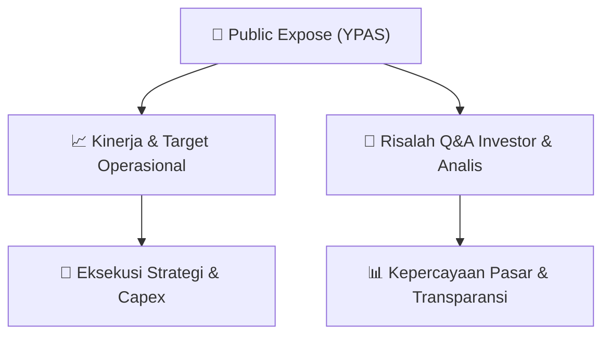

# 📢 Laporan Intelijen Paparan Publik (Public Expose) - [[YPAS]]
🏢 **Emiten**: `[[YPAS]]` | 📅 **Tanggal Pelaksanaan**: `2026-08-31` | 📑 **Dokumen**: `Public Expose lamp2`
⬅️ [[knowledge-base/daily-digests/Daily_Digest_20260831|Kembali ke Daily Digest]] | 🎛️ [[Dashboard|Ke Dashboard Utama]]

---

## 📌 1. Ringkasan Eksekutif & Paparan Direksi
> [!NOTE]
> Dokumen ini merupakan daftar hadir Public Expose Insidentil PT Yanaprima Hastapersada Tbk yang diselenggarakan pada Jumat, 28 Agustus 2026 pukul 10.00 WIB melalui tautan Google Meet. Dokumen hanya memuat tabel kehadiran berisi nama, jabatan/pemegang saham, dan nomor kontak peserta. Tidak terdapat materi paparan publik, pembahasan kinerja, strategi, atau data operasional emiten dalam dokumen ini.

#### 🎯 Guidance Operasional & Target Strategis
- Tidak tersedia dalam dokumen. Dokumen tidak memuat target kinerja, rencana ekspansi, alokasi belanja modal (capex), proyeksi pendapatan, atau guidance operasional emiten.

## 📊 2. Matriks Indikator Operasional & Parameter Kunci
| Parameter Utama | Nilai / Keterangan Resmi |
| :--- | :--- |
| **Tanggal Public Expose** | `Jumat, 28 Agustus 2026` |
| **Waktu Public Expose** | `10.00 WIB` |
| **Tautan Public Expose** | `https://meet.google.com/xzh-nwqb-ufm` |

---

## 💬 3. Risalah Tanya Jawab (Q&A Session)
`Materi presentasi Public Expose / Risalah Q&A terlampir dalam dokumen resmi bursa.`

## 📌 4. Peta Jalur Strategis & Roadmap

---

## 🔗 Knowledge Graph
- [[knowledge-base/daily-digests/Daily_Digest_20260831|📄 Daily Digest 2026-08-31]]
- [[knowledge-base/calendars/Action_Calendar|🗓️ Kalender Terpusat Aksi Korporasi]]
- [[Dashboard|🎛️ Kembali ke Dashboard Utama]]