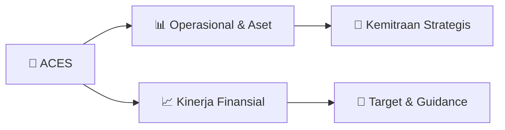

# 📊 Materi Public Expose: [ACES]

🏢 **Emiten**: `ACES` | 📅 **Tanggal Pelaksanaan**: `2026-08-27` | 📑 **Total Slide**: `1 Slide`
⬅️ [[knowledge-base/daily-digests/ACES_20260827|Kembali ke Daily Digest]] | 🎛️ [[Dashboard/ACES|Ke Dashboard Emiten]]

> [!NOTE]
> Ringkasan materi presentasi resmi Public Expose ACES yang disampaikan oleh manajemen kepada investor dan bursa. Seluruh poin strategis, matriks operasional, dan angka kinerja diekstrak langsung dari slide deck resmi.

---

## 📅 1. Jadwal & Metadata Penyelenggaraan

| Parameter | Detail Informasi |
|---|---|
| **Nomor Surat Pengantar** | 043a/IR-FIN/AHI/8/26 |
| **Perihal Pengumuman** | Rencana Penyelenggaraan Public Expose Tahunan |
| **Waktu Pelaksanaan** | 10 September 2026 14:00 |
| **Lokasi / Media** | Public Expose Live 2026 yang tercantum pada website idx.co.id |
| **Lampiran Resmi** | `1` |

## 📋 2. Agenda Paparan Publik

1. No: 043/IR-FIN/AHI/8/26
2. Kepada Yth.
3. Direktur Penilaian Perusahaan
4. PT Bursa Efek Indonesia
5. Gedung Bursa Efek Indonesia Tower 1
6. Jl. Jend. Sudirman Kav 52-53
7. Jakarta Selatan 12190
8. Perihal: Rencana Penyelenggaraan Public Expose Tahun 2026 PT Aspirasi Hidup Indonesia Tbk
9. Dengan hormat,
10. Dalam rangka memenuhi ketentuan Surat Keputusan Direksi PT Bursa Efek Indonesia Nomor Кер00087/BEI/12-2025 tentang
11. Peraturan No. I-E : Kewajiban Penyampaian Informasi, dengan ini kami informasikan bahwa PT Aspirasi Hidup Indonesia Tbk
12. ("Perseroan") akan berpartisipasi dalam kegiatan Public Expose Live 2026 dalam Rangka 49 Tahun Diaktifkannya Kembali Pasar Modal
13. Indonesia, yang diselenggarakan oleh PT Bursa Efek Indonesia secara virtual, pada:
14. Hari, Tanggal
15. : Kamis, 10 September 2026
16. Waktu
17. : 14.00 – 15.00 WIB
18. Tempat
19. : Public Expose Live 2026
20. yang tercantum pada website idx.co.id
21. Agenda
22. : 1. Laporan Kinerja Semester I Tahun 2026
23. 2. Prospek dan Strategi Usaha
24. Pembicara yang akan hadir mewakili Perseroan dalam Public Expose Live 2026 adalah:
25. Bapak Gregory Sugyono Widjaja selaku Direktur
26. 2. Bapak Billy Utama Suria selaku Head of Investor Relations
27. Sehubungan dengan hal tersebut, Perseroan akan menyampaikan materi Public Expose Live 2026 selambat-lambatnya 3 (tiga) Hari
28. Bursa sebelum tanggal penyelenggaraan, yaitu pada hari Senin, 7 September 2026.
29. Demikian kami sampaikan. Atas perhatian dan kerja sama yang baik, kami ucapkan terima kasih.
30. Hormat kami,
31. PT Aspirasi Hidup Indonesia Tbk
32. Billy U. Suria
33. Sekretaris Perusahaan dan Hubungan Investor

## 🏢 3. Profil & Pilar Portofolio Bisnis

## 🏗️ 4. Kinerja Operasional & Portofolio Aset

*Detail aset operasional terlampir pada dokumen slide resmi.*

## 📈 5. Kinerja Keuangan & Posisi Finansial

## 🧭 6. Inisiatif Strategis, Kolaborasi, & Kemitraan

*Strategi usaha difokuskan pada penguatan fundamental dan ekspansi operasional.*

## 🎯 7. Target Pertumbuhan & Guidance Manajemen

*Target pertumbuhan ditetapkan mengacu pada prospek industri dan kondisi makroekonomi terkini.*

## 🗺️ 8. Peta Jalur Strategis & Eksekusi

## 📑 9. Daftar Indeks Slide Presentasi

| Slide # | Judul / Topik Slide | Ringkasan Konten |
|---|---|---|
| Slide 1 | **Jakarta, 27 Agustus 2026** | No: 043/IR-FIN/AHI/8/26 Kepada Yth. Direktur Penilaian Perusahaan |

---

*Dokumen diolah otomatis oleh **Swarm Intelijen Pasar Modal Indonesia** pada 2026-10-12 16:41 WIB.*