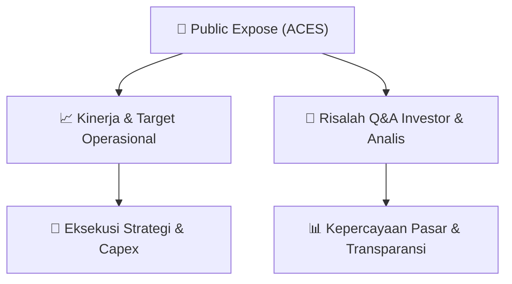

# 📢 Laporan Intelijen Paparan Publik (Public Expose) - [[ACES]]
🏢 **Emiten**: `[[ACES]]` | 📅 **Tanggal Pelaksanaan**: `2026-08-27` | 📑 **Dokumen**: `Public Expose`
⬅️ [[knowledge-base/daily-digests/Daily_Digest_20260827|Kembali ke Daily Digest]] | 🎛️ [[Dashboard|Ke Dashboard Utama]]

---

## 📌 1. Ringkasan Eksekutif & Paparan Direksi
> [!NOTE]
> PT Aspirasi Hidup Indonesia Tbk (ACES) menyampaikan koreksi atas surat nomor 043/IR-FIN/AHI/8/26 tanggal 27 Agustus 2026 mengenai rencana Public Expose Tahunan. Perseroan akan menyelenggarakan Public Expose Live 2026 pada 10 September 2026 pukul 14:00 melalui website idx.co.id, dengan agenda laporan kinerja semester I 2026 serta prospek dan strategi usaha. Dokumen merupakan pemberitahuan resmi elektronik tanpa tanda tangan.

#### 🎯 Guidance Operasional & Target Strategis
- Dokumen tidak memuat target kinerja, guidance, ekspansi, atau capex. Informasi hanya sebatas rencana pelaksanaan Public Expose Tahunan dengan agenda pembahasan kinerja semester I 2026 dan prospek/strategi usaha.

## 📊 2. Matriks Indikator Operasional & Parameter Kunci
| Parameter Utama | Nilai / Keterangan Resmi |
| :--- | :--- |
| **Nama Perusahaan** | `PT Aspirasi Hidup Indonesia Tbk` |
| **Kode Emiten** | `ACES` |
| **Nomor Surat** | `043a/IR-FIN/AHI/8/26` |
| **Perihal** | `Rencana Penyelenggaraan Public Expose Tahunan` |
| **Tempat** | `Public Expose Live 2026 yang tercantum pada website idx.co.id` |
| **Hari/Tanggal** | `10 September 2026` |
| **Waktu** | `14:00` |
| **Agenda** | `1. Laporan Kinerja Semester I Tahun 2026; 2. Prospek dan Strategi Usaha` |
| **Tahun Buku** | `2026` |
| **Nama Pengirim** | `Billy Utama Suria` |
| **Jabatan** | `Head of Corporate Secretary & Investor Relation` |
| **Tanggal dan Waktu Surat** | `27-08-2026 17:06` |

---

## 💬 3. Risalah Tanya Jawab (Q&A Session)
`Materi presentasi Public Expose / Risalah Q&A terlampir dalam dokumen resmi bursa.`

## 📌 4. Peta Jalur Strategis & Roadmap

---

## 🔗 Knowledge Graph
- [[knowledge-base/daily-digests/Daily_Digest_20260827|📄 Daily Digest 2026-08-27]]
- [[knowledge-base/calendars/Action_Calendar|🗓️ Kalender Terpusat Aksi Korporasi]]
- [[Dashboard|🎛️ Kembali ke Dashboard Utama]]