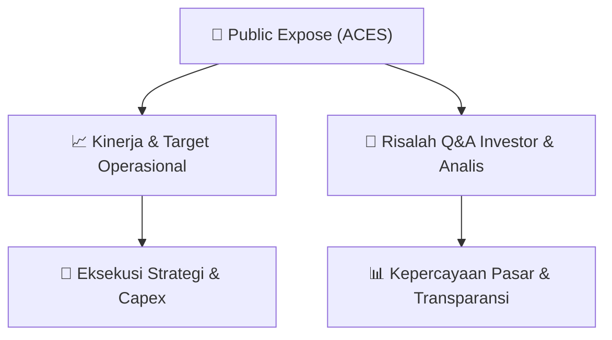

# 📢 Laporan Intelijen Paparan Publik (Public Expose) - [[ACES]]
🏢 **Emiten**: `[[ACES]]` | 📅 **Tanggal Pelaksanaan**: `2026-09-11` | 📑 **Dokumen**: `Public Expose`
⬅️ [[knowledge-base/daily-digests/Daily_Digest_20260911|Kembali ke Daily Digest]] | 🎛️ [[Dashboard|Ke Dashboard Utama]]

---

## 📌 1. Ringkasan Eksekutif & Paparan Direksi
> [!NOTE]
> PT Aspirasi Hidup Indonesia Tbk (ACES) menyelenggarakan Public Expose Tahunan pada 07 September 2026, dengan laporan hasil disampaikan pada 11 September 2026. Acara dihadiri 74 peserta (tidak termasuk manajemen dan karyawan). Paparan ini merupakan agenda keterbukaan informasi tahunan perusahaan kepada investor dan publik, dengan fokus pada kinerja operasional, strategi bisnis, dan prospek ke depan. Dokumen yang tersedia hanya memuat laporan administratif penyelenggaraan acara, sementara detail materi paparan dan Q&A tercantum dalam lampiran terpisah.

#### 🎯 Guidance Operasional & Target Strategis
- Informasi rinci mengenai target kinerja, ekspansi, dan capex tidak tersedia dalam dokumen utama karena hanya memuat laporan administratif penyelenggaraan Public Expose. Detail guidance operasional dan katalis pertumbuhan perusahaan tercantum dalam lampiran 'ACES - Laporan Hasil Pubex 2026.pdf' yang tidak disertakan dalam teks. Investor disarankan merujuk pada lampiran resmi tersebut untuk mendapatkan informasi lengkap mengenai rencana ekspansi, belanja modal, dan target kinerja emiten.

## 📊 2. Matriks Indikator Operasional & Parameter Kunci
| Parameter Utama | Nilai / Keterangan Resmi |
| :--- | :--- |
| **Tanggal Penyelenggaraan Public Expose** | `07 September 2026` |
| **Tanggal Pelaporan Hasil Public Expose** | `11 September 2026` |
| **Jumlah Peserta Hadir (di luar manajemen/karyawan)** | `74 orang` |
| **Nomor Surat Pengantar Materi** | `045/IR-FIN/AHI/9/26` |
| **Nomor Surat Laporan Hasil** | `046/IR-FIN/AHI/9/26` |
| **Pejabat Pelapor** | `Billy Utama Suria - Head of Corporate Secretary & Investor Relation` |

---

## 💬 3. Risalah Tanya Jawab (Q&A Session)
### ❓ Pertanyaan 1 (Tidak tercantum dalam dokumen)
**Pertanyaan**: Tidak ada sesi tanya jawab yang terdokumentasi dalam teks utama laporan. Seluruh detail Q&A antara manajemen dengan investor/analis tercantum dalam lampiran 'ACES - Laporan Hasil Pubex 2026.pdf'.

**Jawaban Manajemen**: Tidak tersedia dalam dokumen utama. Jawaban manajemen atas pertanyaan investor/analis tercantum dalam lampiran resmi laporan Public Expose.

> [!TIP]
> **Implikasi Bagi Investor**: Investor perlu mengakses lampiran resmi laporan untuk mendapatkan wawasan mengenai pandangan manajemen terhadap kinerja, prospek bisnis, dan strategi perusahaan ke depan.

## 📌 4. Peta Jalur Strategis & Roadmap

---

## 🔗 Knowledge Graph
- [[knowledge-base/daily-digests/Daily_Digest_20260911|📄 Daily Digest 2026-09-11]]
- [[knowledge-base/calendars/Action_Calendar|🗓️ Kalender Terpusat Aksi Korporasi]]
- [[Dashboard|🎛️ Kembali ke Dashboard Utama]]