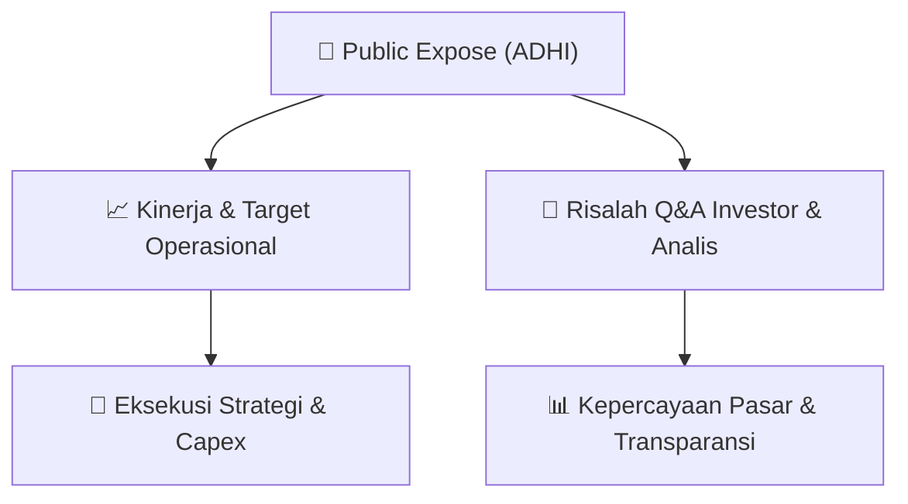

# 📢 Laporan Intelijen Paparan Publik (Public Expose) - [[ADHI]]
🏢 **Emiten**: `[[ADHI]]` | 📅 **Tanggal Pelaksanaan**: `2026-08-26` | 📑 **Dokumen**: `Public Expose`
⬅️ [[knowledge-base/daily-digests/Daily_Digest_20260826|Kembali ke Daily Digest]] | 🎛️ [[Dashboard|Ke Dashboard Utama]]

---

## 📌 1. Ringkasan Eksekutif & Paparan Direksi
> [!NOTE]
> PT Adhi Karya (Persero) Tbk. (ADHI) menyampaikan surat pemberitahuan rencana Public Expose Tahunan untuk Tahun Buku 2026. Acara akan diselenggarakan pada 09 September 2026 pukul 16:00 melalui Public Expose Live 2026 di website idx.co.id. Agenda meliputi Laporan Kinerja Semester I 2026, Prospek & Strategi Usaha, dan lain-lain. Dokumen ini hanya merupakan pemberitahuan resmi dan belum memuat data kinerja, laporan keuangan, maupun tanya jawab.

#### 🎯 Guidance Operasional & Target Strategis
- Belum tersedia dalam dokumen ini. Agenda Public Expose mencakup Prospek & Strategi Usaha, sehingga guidance resmi diperkirakan disampaikan pada saat acara 09 September 2026.

## 📊 2. Matriks Indikator Operasional & Parameter Kunci
| Parameter Utama | Nilai / Keterangan Resmi |
| :--- | :--- |
| **Emiten** | `PT Adhi Karya (Persero) Tbk.` |
| **Kode Emiten** | `ADHI` |
| **Nomor Surat** | `347/SP-VIII/2026` |
| **Perihal** | `Rencana Penyelenggaraan Public Expose Tahunan` |
| **Tahun Buku** | `2026` |
| **Tanggal Public Expose** | `09 September 2026` |
| **Waktu** | `16:00` |
| **Tempat** | `Public Expose Live 2026 di website idx.co.id` |
| **Agenda 1** | `Laporan Kinerja Semester I Tahun 2026` |
| **Agenda 2** | `Prospek & Strategi Usaha` |
| **Agenda 3** | `Lain-lain` |
| **Corporate Secretary** | `Siswanto` |
| **Tanggal dan Waktu Surat** | `26-08-2026 13:56` |
| **Alamat** | `Jalan Raya Pasar Minggu Km. 18 Jakarta 12510` |
| **Telepon** | `021-7975312` |
| **Fax** | `021-7975311` |
| **Website** | `www.adhi.co.id` |

---

## 💬 3. Risalah Tanya Jawab (Q&A Session)
`Materi presentasi Public Expose / Risalah Q&A terlampir dalam dokumen resmi bursa.`

## 📌 4. Peta Jalur Strategis & Roadmap

---

## 🔗 Knowledge Graph
- [[knowledge-base/daily-digests/Daily_Digest_20260826|📄 Daily Digest 2026-08-26]]
- [[knowledge-base/calendars/Action_Calendar|🗓️ Kalender Terpusat Aksi Korporasi]]
- [[Dashboard|🎛️ Kembali ke Dashboard Utama]]