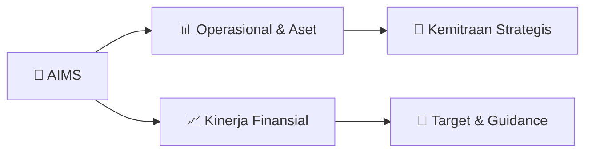

# 📊 Materi Public Expose: [AIMS]

🏢 **Emiten**: `AIMS` | 📅 **Tanggal Pelaksanaan**: `2026-09-03` | 📑 **Total Slide**: `1 Slide`
⬅️ [[knowledge-base/daily-digests/AIMS_20260903|Kembali ke Daily Digest]] | 🎛️ [[Dashboard/AIMS|Ke Dashboard Emiten]]

> [!NOTE]
> Ringkasan materi presentasi resmi Public Expose AIMS yang disampaikan oleh manajemen kepada investor dan bursa. Seluruh poin strategis, matriks operasional, dan angka kinerja diekstrak langsung dari slide deck resmi.

---

## 📅 1. Jadwal & Metadata Penyelenggaraan

| Parameter | Detail Informasi |
|---|---|
| **Nomor Surat Pengantar** | 001.SPR.PUBEX-AIMS.IX.2026 |
| **Perihal Pengumuman** | Rencana Penyelenggaraan Public Expose Tahunan |
| **Waktu Pelaksanaan** | 17 September 2026 11:00 |
| **Lokasi / Media** | Chora 1 & 2, Level 2 The Tribrata, Darmawangsa  Jakarta, Jl. |
| **Lampiran Resmi** | `1` |

## 📋 2. Agenda Paparan Publik

1. Petogogan, Kebayoran Baru
2. Jakarta Selatan 12170
3. www.aimsinvestama.com
4. Jakarta, 03 September 2026
5. : 001/SPR.PUBEX-AIMS/IX/2026
6. Perihal
7. : Pemberitahuan Rencana Public Expose
8. Kepada Yth.
9. Direksi PT. Bursa Efek Indonesia
10. Indonesia Stock Exchange Building
11. Jl. Jend Sudirman Kav. 52-53
12. Jakarta 12190
13. Dengan hormat,
14. Mengacu kepada Peraturan Pencatatan Nomor I-E tentang Kewajiban Penyampaian Informasi
15. Butir V mengenai kewajiban Public Expose, maka melalui surat ini kami informasikan bahwa PT
16. Artha Mahiya Investama Tbk (“AIMS”) akan melakukan Public Expose yang akan di
17. selenggarakan pada:
18. Hari/Tanggal
19. :   Kamis, 17 September 2026;
20. Waktu
21. :  Pukul 11:00 WIB s/d selesai;
22. Tempat
23. :   -  Chora 1 & 2, Level 2 The Tribrata, Darmawangsa  Jakarta, Jl. Darmawangsa
24. III No.2, RT.2/RW.1, Kelurahan Pulo, Kecamatan Kebayoran Baru, Jakarta
25. Selatan, Daerah Khusus Ibukota Jakarta 12160; dan
26. -  Video Conference melalui aplikasi eASY.KSEI.
27. Agenda
28. :  1. Kinerja keuangan dan kondisi bisnis Perseroan;
29. 2. Rencana bisnis ke depan;
30. 3. Analisa manajemen terkait dengan pergerakan harga saham Perseroan.
31. Public expose ini rencananya akan dihadiri oleh Jajaran Komisaris dan Direksi Perseroan.
32. Demikian kami sampaikan atas perhatian dan kerjasamanya kami ucapkan terima kasih.
33. Hormat Kami,
34. Anton Hidayat
35. Corporate Secretary

## 🏢 3. Profil & Pilar Portofolio Bisnis

## 🏗️ 4. Kinerja Operasional & Portofolio Aset

*Detail aset operasional terlampir pada dokumen slide resmi.*

## 📈 5. Kinerja Keuangan & Posisi Finansial

## 🧭 6. Inisiatif Strategis, Kolaborasi, & Kemitraan

*Strategi usaha difokuskan pada penguatan fundamental dan ekspansi operasional.*

## 🎯 7. Target Pertumbuhan & Guidance Manajemen

*Target pertumbuhan ditetapkan mengacu pada prospek industri dan kondisi makroekonomi terkini.*

## 🗺️ 8. Peta Jalur Strategis & Eksekusi

## 📑 9. Daftar Indeks Slide Presentasi

| Slide # | Judul / Topik Slide | Ringkasan Konten |
|---|---|---|
| Slide 1 | **Jl. Cipaku 1, No.3** | Petogogan, Kebayoran Baru Jakarta Selatan 12170 www.aimsinvestama.com |

---

*Dokumen diolah otomatis oleh **Swarm Intelijen Pasar Modal Indonesia** pada 2026-10-12 16:41 WIB.*