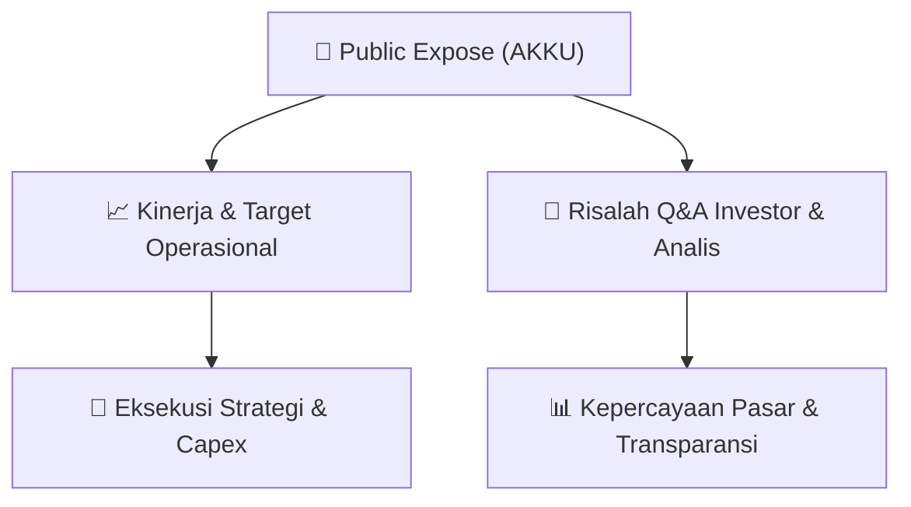

# 📢 Laporan Intelijen Paparan Publik (Public Expose) - [[AKKU]]
🏢 **Emiten**: `[[AKKU]]` | 📅 **Tanggal Pelaksanaan**: `2026-09-02` | 📑 **Dokumen**: `Public Expose`
⬅️ [[knowledge-base/daily-digests/Daily_Digest_20260902|Kembali ke Daily Digest]] | 🎛️ [[Dashboard|Ke Dashboard Utama]]

---

## 📌 1. Ringkasan Eksekutif & Paparan Direksi
> [!NOTE]
> Dokumen yang tersedia merupakan surat resmi PT Anugerah Kagum Karya Utama Tbk (AKKU) perihal Laporan Hasil Public Expose Tahunan yang disampaikan kepada Bursa Efek Indonesia pada 2 September 2026. Surat merujuk pada rencana penyelenggaraan Public Expose No. 013/AKKU-PUBEX/VI/2026 tanggal 12 Juni 2026. Dalam acara Public Expose tersebut, peserta eksternal yang hadir tercatat sebanyak 4 orang, tidak termasuk manajemen dan karyawan Perseroan. Dokumen lampiran laporan Public Expose tidak memuat rincian materi paparan, indikator keuangan, strategi, atau tanya jawab dengan peserta.

#### 🎯 Guidance Operasional & Target Strategis
- Tidak terdapat informasi katalis, target kinerja, rencana ekspansi, belanja modal, maupun guidance operasional yang dapat diekstrak dari dokumen yang tersedia. Dokumen hanya berupa surat penyampaian hasil Public Expose tanpa rincian substansi paparan publik.

## 📊 2. Matriks Indikator Operasional & Parameter Kunci
| Parameter Utama | Nilai / Keterangan Resmi |
| :--- | :--- |
| **Jumlah peserta Public Expose eksternal** | `4 orang` |
| **Tanggal penyelenggaraan Public Expose** | `12 Juni 2026` |
| **Tanggal penyampaian laporan hasil Public Expose** | `2 September 2026` |

---

## 💬 3. Risalah Tanya Jawab (Q&A Session)
`Materi presentasi Public Expose / Risalah Q&A terlampir dalam dokumen resmi bursa.`

## 📌 4. Peta Jalur Strategis & Roadmap

---

## 🔗 Knowledge Graph
- [[knowledge-base/daily-digests/Daily_Digest_20260902|📄 Daily Digest 2026-09-02]]
- [[knowledge-base/calendars/Action_Calendar|🗓️ Kalender Terpusat Aksi Korporasi]]
- [[Dashboard|🎛️ Kembali ke Dashboard Utama]]