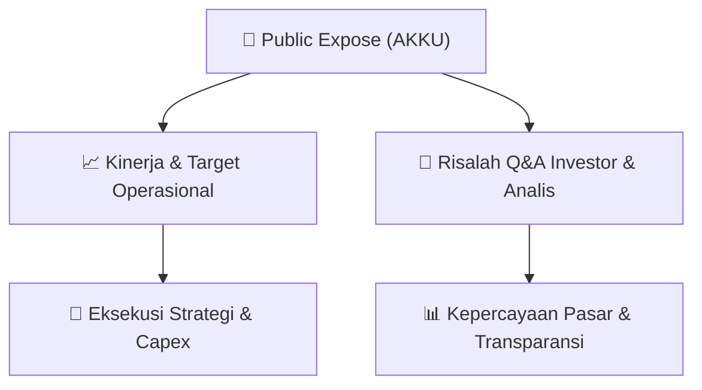

# 📢 Laporan Intelijen Paparan Publik (Public Expose) - [[AKKU]]
🏢 **Emiten**: `[[AKKU]]` | 📅 **Tanggal Pelaksanaan**: `2026-09-04` | 📑 **Dokumen**: `Public Expose`
⬅️ [[knowledge-base/daily-digests/Daily_Digest_20260904|Kembali ke Daily Digest]] | 🎛️ [[Dashboard|Ke Dashboard Utama]]

---

## 📌 1. Ringkasan Eksekutif & Paparan Direksi
> [!NOTE]
> Dokumen merupakan pengumuman rencana Public Expose Insidentil PT Anugerah Kagum Karya Utama Tbk (AKKU) yang disampaikan oleh Corporate Secretary Irwan Suryadi pada 4 September 2026. Public Expose akan diselenggarakan pada 18 September 2026 pukul 14:00 di Apartemen Grand Asia Afrika, Jl. Karapitan No. 1, Paledang, Kec. Lengkong, Kota Bandung, Jawa Barat. Agenda utama adalah Keterbukaan Informasi atas Suspensi Saham Perseroan. Pelaksanaan Public Expose bersifat insidentil atas permintaan Otoritas Jasa Keuangan (OJK).

#### 🎯 Guidance Operasional & Target Strategis
- Dokumen tidak memuat target kinerja, proyeksi keuangan, rencana ekspansi, belanja modal, atau guidance operasional. Satu-satunya katalis yang dapat diidentifikasi adalah rencana keterbukaan informasi terkait suspensi saham AKKU pada Public Expose 18 September 2026.

## 📊 2. Matriks Indikator Operasional & Parameter Kunci
| Parameter Utama | Nilai / Keterangan Resmi |
| :--- | :--- |
| **Nama Emiten** | `PT Anugerah Kagum Karya Utama Tbk` |
| **Kode Emiten** | `AKKU` |
| **Nomor Surat** | `002/AKKU-PUBEX/IX/2026` |
| **Perihal** | `Rencana Penyelenggaraan Public Expose Insidentil` |
| **Latar Belakang Pelaksanaan** | `Permintaan Otoritas Jasa Keuangan (OJK)` |
| **Tanggal Public Expose** | `18 September 2026` |
| **Waktu Public Expose** | `14:00` |
| **Tempat Public Expose** | `Apartemen Grand Asia Afrika, Jl. Karapitan No. 1, Paledang, Kec. Lengkong, Kota Bandung, Jawa Barat 40261` |
| **Agenda Public Expose** | `Keterbukaan Informasi atas Suspensi Saham Perseroan` |
| **Corporate Secretary** | `Irwan Suryadi` |
| **Tanggal dan Waktu Pengumuman** | `04-09-2026 16:43` |
| **Kontak Perusahaan** | `Telepon: 022-2035013, Fax: 022-2035013, kagumgroup.com` |

---

## 💬 3. Risalah Tanya Jawab (Q&A Session)
`Materi presentasi Public Expose / Risalah Q&A terlampir dalam dokumen resmi bursa.`

## 📌 4. Peta Jalur Strategis & Roadmap

---

## 🔗 Knowledge Graph
- [[knowledge-base/daily-digests/Daily_Digest_20260904|📄 Daily Digest 2026-09-04]]
- [[knowledge-base/calendars/Action_Calendar|🗓️ Kalender Terpusat Aksi Korporasi]]
- [[Dashboard|🎛️ Kembali ke Dashboard Utama]]