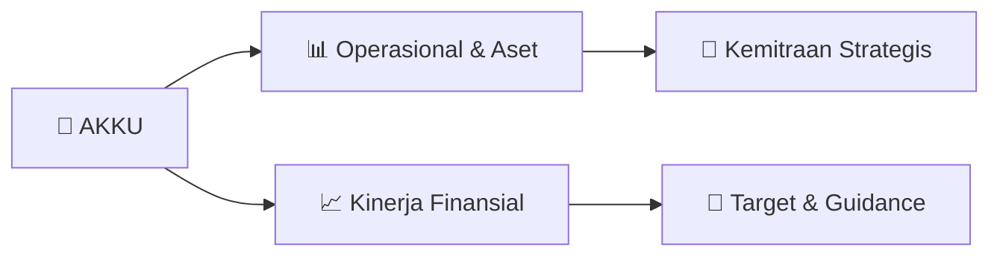

# 📊 Materi Public Expose: [AKKU]

🏢 **Emiten**: `AKKU` | 📅 **Tanggal Pelaksanaan**: `2026-09-04` | 📑 **Total Slide**: `1 Slide`
⬅️ [[knowledge-base/daily-digests/AKKU_20260904|Kembali ke Daily Digest]] | 🎛️ [[Dashboard/AKKU|Ke Dashboard Emiten]]

> [!NOTE]
> Ringkasan materi presentasi resmi Public Expose AKKU yang disampaikan oleh manajemen kepada investor dan bursa. Seluruh poin strategis, matriks operasional, dan angka kinerja diekstrak langsung dari slide deck resmi.

---

## 📅 1. Jadwal & Metadata Penyelenggaraan

| Parameter | Detail Informasi |
|---|---|
| **Nomor Surat Pengantar** | 002/AKKU-PUBEX/IX/2026 |
| **Perihal Pengumuman** | Rencana Penyelenggaraan Public Expose Insidentil |
| **Waktu Pelaksanaan** | 18 September 2026 14:00 |
| **Lokasi / Media** | Apartemen Grand Asia Afrika, |
| **Lampiran Resmi** | `1` |

## 📋 2. Agenda Paparan Publik

1. Grand Asia Afrika Residence
2. Commercial Area A-10
3. Jl. Karapitan No. 1, Paledang, Lengkong
4. Bandung, West Java 40261
5. PENGUMUMAN RENCANA PENYELENGGARAAN
6. PAPARAN PUBLIK (PUBLIC EXPOSES) INSIDENTIL
7. PT ANUGERAH KAGUM KARYA UTAMA Tbk
8. Dalam rangka memenuhi Peraturan BEI No.00015/BEI/01-2021 Pasal III.3 mengenai Perubahan
9. Peraturan Nomor I-E Tentang Kewajiban Penyampaian Informasi – Kewajiban Public Expose, bersama
10. ini kami sampaikan Pengumuman mengenai rencana untuk menyelenggarakan Public Expose Insidentil
11. yang akan diselenggarakan pada:
12. Hari/Tanggal
13. : Jumat/ 18 September 2026
14. Waktu
15. : 10.30 WIB s/d Selesai
16. Tempat
17. : Apartemen Grand Asia Afrika,
18. Jl. Karapitan No. 1, Paledang, Kec. Lengkong, Kota
19. Bandung, Jawa Barat 40261.
20. Agenda
21. : Keterbukaan Informasi atas Suspensi Saham Perseroan
22. Demikian kami sampaikan, atas perhatiannya kami ucapkan terima kasih.
23. Bandung, 4 September 2026
24. Hormat kami,
25. PT Anugerah Kagum Karya Utama Tbk
26. Irwan Suryadi
27. Direktur Utama

## 🏢 3. Profil & Pilar Portofolio Bisnis

## 🏗️ 4. Kinerja Operasional & Portofolio Aset

*Detail aset operasional terlampir pada dokumen slide resmi.*

## 📈 5. Kinerja Keuangan & Posisi Finansial

## 🧭 6. Inisiatif Strategis, Kolaborasi, & Kemitraan

*Strategi usaha difokuskan pada penguatan fundamental dan ekspansi operasional.*

## 🎯 7. Target Pertumbuhan & Guidance Manajemen

*Target pertumbuhan ditetapkan mengacu pada prospek industri dan kondisi makroekonomi terkini.*

## 🗺️ 8. Peta Jalur Strategis & Eksekusi

## 📑 9. Daftar Indeks Slide Presentasi

| Slide # | Judul / Topik Slide | Ringkasan Konten |
|---|---|---|
| Slide 1 | **PT Anugerah Kagum Karya Utama Tbk.** | Grand Asia Afrika Residence Commercial Area A-10 Jl. Karapitan No. 1, Paledang, Lengkong |

---

*Dokumen diolah otomatis oleh **Swarm Intelijen Pasar Modal Indonesia** pada 2026-10-12 16:41 WIB.*