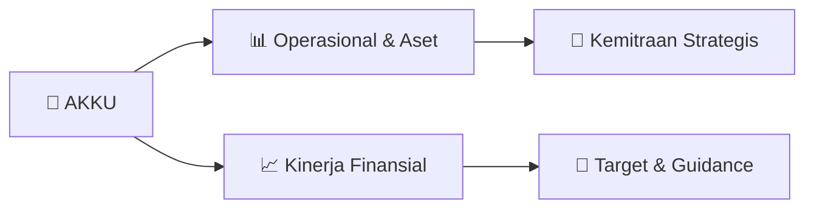

# 📊 Materi Public Expose: [AKKU]

🏢 **Emiten**: `AKKU` | 📅 **Tanggal Pelaksanaan**: `2026-09-15` | 📑 **Total Slide**: `18 Slide`
⬅️ [[knowledge-base/daily-digests/AKKU_20260915|Kembali ke Daily Digest]] | 🎛️ [[Dashboard/AKKU|Ke Dashboard Emiten]]

> [!NOTE]
> Ringkasan materi presentasi resmi Public Expose AKKU yang disampaikan oleh manajemen kepada investor dan bursa. Seluruh poin strategis, matriks operasional, dan angka kinerja diekstrak langsung dari slide deck resmi.

---

## 📅 1. Jadwal & Metadata Penyelenggaraan

| Parameter | Detail Informasi |
|---|---|
| **Nomor Surat Pengantar** | 006/AKKU-PUBEX/IX/2026 |
| **Perihal Pengumuman** | Penyampaian Materi Public Expose Insidentil |
| **Waktu Pelaksanaan** | 2026-09-15 15-09-2026 16:11 |
| **Lokasi / Media** | Aplikasi Zoom / Daring |
| **Lampiran Resmi** | `1` |

## 📋 2. Agenda Paparan Publik

1. Sekilas Perseroan
2. Informasi Keuangan
3. Penjelasan Perseroan atas Opini Audit
4. Tanya Jawab

## 🏢 3. Profil & Pilar Portofolio Bisnis

> SEKILAS PERSEROAN

> VISI DAN MISI
Visi Menjadi Perusahaan bertaraf Internasional dalam Industri
Pariwisata berbasiskan perhotelan dan properti.
Misi
Menciptakan pertumbuhan usaha pengelolaan perhotelan dan
properti yang berkesinambungan dengan memberikan solusi dan
keuntungan yang terbaik bagi pemegang saham, pelanggan,
dan lingkungan. SEKILAS PERSEROAN

> PROFIL PERSEROAN
Berdiri pada Tahun 2001 dengan nama PT Aneka Kemasindo dengan usaha utamanya adalah produsen kemasan plastik.
Menjadi Perusahaan Terbuka dan melakukan penawaran umum perdana saham Perseroan pada tanggal 18 Oktober
2004.
Mendapatkan pernyataan efektif dari BAPEPAM untuk melakukan penawaran umum perdana saham atas 80.000.000
(delapan puluh juta) saham Perseroan kepada masyarakat dengan nilai Rp100.- (seratus rupiah) per saham.
Perseroan telah mencatatkan seluruh sahamnya di Bursa Efek Indonesia (BEI) pada tanggal 1 Nopember 2004.
Mengganti namanya menjadi PT Alam Karya Unggul, Tbk. serta mengubah bidang usaha menjadi Perdagangan Umum
dan Jasa.
Mengakuisisi PT Permata Nusantara Hotelindo, sebuah Perusahaan yang bergerak di bidang Jasa Manajemen/Pengelola
Hotel pada bulan Juni 2015.
Mengganti namanya menjadi PT Anugerah Kagum Karya Utama, Tbk. disertai dengan perubahan logo, susunan pengurus
dan domisili pada Oktober 2016.
Pada 25 Nopember 2016, Perseroan telah melaksanakan Penawaran Umum Terbatas I (PUT I) dengan Hak Memesan Efek
Terlebih Dahulu (HMETD), sehingga jumlah saham Perseroan adalah sebanyak 6.449.463.636 saham. Melalui PUT I ini,
Pemegang Saham Pengendali Perseroan adalah PT Eka Mandiri Anugerah Sejahtera (EMAS).
SEKILAS PERSEROAN

> NILAI – NILAI PERSEROAN
 Integritas
Setiap insan PT Anugerah Kagum Karya Utama dan entitas anak perusahaan berpegang teguh pada kejujuran dan
berlandaskan moral setiap kegiatan usaha.
 Teamwork
Setiap insan PT Anugerah Kagum Karya Utama dan entitas anak perusahaan berpegang teguh pada kejujuran dan
berlandaskan moral setiap kegiatan usaha
 Professionalism
Setiap insan PT Anugerah Kagum Karya Utama dan entitas anak perusahaan berpegang teguh pada kejujuran dan
berlandaskan moral setiap kegiatan usaha.
 Innovation
Setiap insan PT Anugerah Kagum Karya Utama dan entitas anak perusahaan berpegang teguh pada kejujuran dan
berlandaskan moral setiap kegiatan usaha.
 Excellence
Setiap insan PT Anugerah Kagum Karya Utama dan entitas anak harus mempunyai prinsip yang unggul dalam segala
bidang untuk memasuki persaingan global dan pasar bebas dunia.
SEKILAS PERSEROAN

> KOMPOSISI PEMEGANG SAHAM
SEKILAS PERSEROAN
• PT Renaldijaya Ekainti
• PT Bintang Bersinar Cemerlang
• PT Gema Busana Raya
• PT Korek Api Guna Mandiri
• Masyarakat
Nama Pemegang Saham
Jumlah Saham
PT Renaldijaya Ekainti
1.036.756.100
PT Bintang Bersinar Cemerlang
721.187.100
PT Gema Busana Raya
394.611.900
PT Korek Api Guna Mandiri
358.795.300 Masyarakat
3.938.113.236
Jumlah Saham 6.449.463.636

> STRUKTUR PERSEROAN SEKILAS PERSEROAN
PT Anugerah Kagum Karya
Utama Tbk
PT Kagum Maha Karya Jaya
PT Permata Nusantara Hotelindo
PT Kamala Khan Maha Investasi
PT Kagum Maha Karya Jaya
PT Kagum Maha Karya Jaya
PT Kagum Maha Karya Jaya

## 🏗️ 4. Kinerja Operasional & Portofolio Aset

> LAPORAN POSISI KEUANGAN
PER 30 JUNI 2026 DAN 31 DESEMBER 2025
(DALAM JUTAAN RUPIAH)
INFORMASI KEUANGAN Uraian
30 Jun 2026
31 Des 2025
Kenaikan (Penurunan) % Aset Aset Lancar 655.708 656.186 (478) (0,00%)
Aset Tidak Lancar
38.919 38.914 0,00% Jumlah Aset 694.627 695.100 (473) (0,00%) Liabilitas
Liabilitas Jangka Pendek
232.276 229.469
2.807
0,01%
Liabilitas Jangka Panjang
71.881 71.792 0,00% Jumlah Liabilitas 304.158 301.262
2.896
0,00% Ekuitas Jumlah Ekuitas 390.469 393.838 815 0,20%
Jumlah Liabilitas dan Ekuitas
694.627 695.100
2.463
0,35%
-
100.000 200.000 300.000 400.000 500.000 600.000 700.000 Aset Lancar Aset Tidak Lancar Liabilitas Jangka Pendek Liabilitas Jangka Panjang Ekuitas
30 Jun 2026
31 Des 2025

> PENJELASAN PERSEROAN ATAS OPINI
DISCLAIMER TAHUN BUKU 31 DESEMBER 2025
PENJELASAN PERSEROAN
Pada Laporan Keuangan Perseroan untuk tahun buku 31 Desember 2025, Perseroan diberikan
opini Tidak Menyatakan Pendapat oleh Auditor Kantor Akuntan Publik Ruslim & Ruslim. Alasan
Auditor memberikan opini tersebut dikarenkan Auditor tidak mendapat cukup bukti atas pos-pos
dalam Laporan Keuangan seperti, Kas dan Setara Kas, Piutang Usaha, Piutang Lain-lain,
Persediaan, Uang Muka, Aset Tetap, Aset Lain-lain, Utang Usaha, Utang Lain-lain, Biaya yang
Masih Harus Dibayar, Utang Bank, Beban Usaha, dan Pendapatan (Beban) Lain-lain

## 📈 5. Kinerja Keuangan & Posisi Finansial

## 🧭 6. Inisiatif Strategis, Kolaborasi, & Kemitraan

*Strategi usaha difokuskan pada penguatan fundamental dan ekspansi operasional.*

## 🎯 7. Target Pertumbuhan & Guidance Manajemen

*Target pertumbuhan ditetapkan mengacu pada prospek industri dan kondisi makroekonomi terkini.*

## 🗺️ 8. Peta Jalur Strategis & Eksekusi

## 📑 9. Daftar Indeks Slide Presentasi

| Slide # | Judul / Topik Slide | Ringkasan Konten |
|---|---|---|
| Slide 1 | **PUBLIC EXPOSE INSIDENTIL** | PT ANUGERAH KAGUM KARYA UTAMA TBK 18 SEPTEMBER 2026 |
| Slide 2 | **SUSUNAN PENGURUS** | Dharmithea Kiemas Hamidy Presiden Komisaris Wilhelmina |
| Slide 3 | **LATAR BELAKANG SUSPENSI SAHAM** | Pada tanggal 1 April 2026, melalui pengumuman PT Bursa Efek Indonesia (Bursa) No. Peng-SPT- 00002/BEI.PP1/04-2026 mengumumkan bahwa Perdagangan Efek P |
| Slide 4 | **SUSUNAN ACARA** | Sekilas Perseroan Informasi Keuangan Penjelasan Perseroan atas Opini Audit |
| Slide 5 | **SEKILAS PERSEROAN** |  |
| Slide 6 | **VISI DAN MISI** | Visi Menjadi Perusahaan |
| Slide 7 | **PROFIL PERSEROAN** | Berdiri pada Tahun 2001 dengan nama PT Aneka Kemasindo dengan usaha utamanya adalah produsen kemasan plastik. Menjadi Perusahaan Terbuka dan melakuk |
| Slide 8 | **NILAI – NILAI PERSEROAN** |  Integritas Setiap insan PT Anugerah Kagum Karya Utama dan entitas anak perusahaan berpegang teguh pada kejujuran dan |
| Slide 9 | **KOMPOSISI PEMEGANG SAHAM** | SEKILAS PERSEROAN • PT Renaldijaya Ekainti • PT Bintang Bersinar Cemerlang |
| Slide 10 | **STRUKTUR PERSEROAN** | SEKILAS PERSEROAN PT Anugerah Kagum Karya Utama Tbk |
| Slide 11 | **INFORMASI KEUANGAN** |  |
| Slide 12 | **PENDAPATAN USAHA** | INFORMASI KEUANGAN 3.450.000.000 3.500.000.000 |
| Slide 13 | **LAPORAN POSISI KEUANGAN** | PER 30 JUNI 2026 DAN 31 DESEMBER 2025 (DALAM JUTAAN RUPIAH) INFORMASI KEUANGAN |
| Slide 14 | **LAPORAN LABA RUGI** | PER 30 JUNI 2026 DAN 30 JUNI 2025 (DALAM JUTAAN RUPIAH) INFORMASI KEUANGAN |
| Slide 15 | **PENJELASAN PERSEROAN ATAS OPINI** | DISCLAIMER TAHUN BUKU 31 DESEMBER 2025 PENJELASAN PERSEROAN Pada Laporan Keuangan Perseroan untuk tahun buku 31 Desember 2025, Perseroan diberikan |
| Slide 16 | **PENJELASAN PERSEROAN ATAS OPINI WAJAR DENGAN** | PENGECUALIAN PERIODE 30 JUNI 2026 PENJELASAN PERSEROAN Pada Laporan Keuangan Perseroan untuk periode 30 Juni 2026, Perseroan diberikan opini Wajar |
| Slide 17 | **TANYA JAWAB** |  |
| Slide 18 | **TERIMA KASIH** |  |

---

*Dokumen diolah otomatis oleh **Swarm Intelijen Pasar Modal Indonesia** pada 2026-10-12 16:41 WIB.*