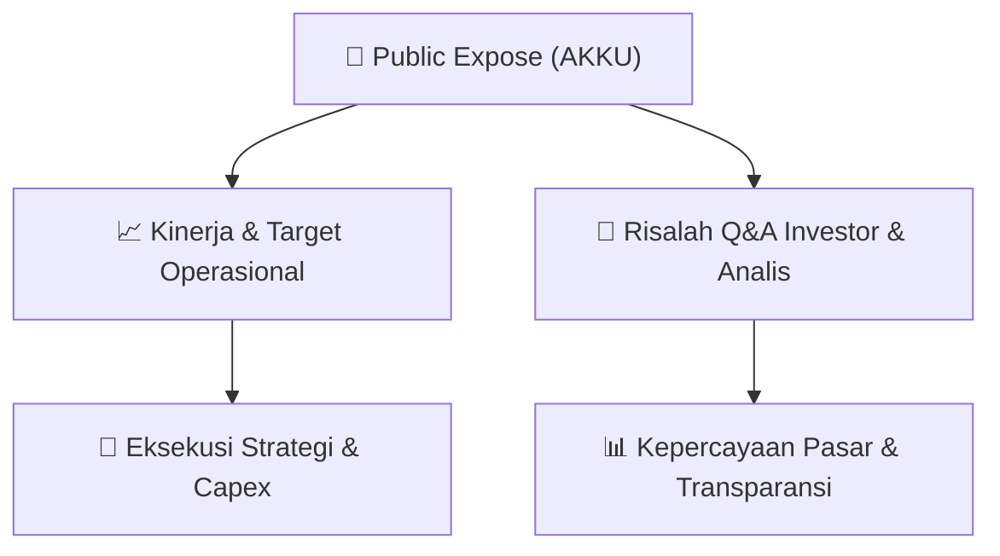

# 📢 Laporan Intelijen Paparan Publik (Public Expose) - [[AKKU]]
🏢 **Emiten**: `[[AKKU]]` | 📅 **Tanggal Pelaksanaan**: `2026-09-15` | 📑 **Dokumen**: `Public Expose`
⬅️ [[knowledge-base/daily-digests/Daily_Digest_20260915|Kembali ke Daily Digest]] | 🎛️ [[Dashboard|Ke Dashboard Utama]]

---

## 📌 1. Ringkasan Eksekutif & Paparan Direksi
> [!NOTE]
> PT Anugerah Kagum Karya Utama Tbk (AKKU) menyelenggarakan Public Expose Insidentil pada 15 September 2026 secara sukarela (voluntary), bukan atas permintaan Bursa Efek Indonesia (BEI) maupun Otoritas Jasa Keuangan (OJK). Paparan ini merupakan tindak lanjut dari surat pemberitahuan No. 002/AKKU-PUBEX/IX/2026 tanggal 04 September 2026. Materi paparan disampaikan oleh Corporate Secretary, Irwan Suryadi, dengan alamat kantor di Grand Asia Afrika Residence, Commercial Area A-10, Jl. Karapitan No. 1, Paledang. Dokumen yang diunggah hanya berisi pengumuman administratif penyampaian materi, tanpa memuat detail isi paparan, laporan kinerja, atau materi presentasi itu sendiri.

#### 🎯 Guidance Operasional & Target Strategis
- Tidak terdapat informasi mengenai target kinerja, ekspansi, capex, atau panduan operasional (guidance) dalam dokumen ini. Dokumen hanya mengonfirmasi penyelenggaraan Public Expose Insidentil secara sukarela dan merujuk pada materi paparan yang dilampirkan secara terpisah (file 'Paparan Publik 2026 - AKKU Insidental.pdf'). Investor perlu merujuk pada lampiran materi paparan untuk mendapatkan informasi fundamental dan prospek perusahaan.

## 📊 2. Matriks Indikator Operasional & Parameter Kunci
| Parameter Utama | Nilai / Keterangan Resmi |
| :--- | :--- |
| **Jenis Paparan** | `Public Expose Insidentil (Incidental)` |
| **Dasar Pelaksanaan** | `Sukarela (Voluntary), bukan permintaan BEI atau OJK` |
| **Tanggal Pengumuman Rencana** | `04 September 2026 (Surat No. 002/AKKU-PUBEX/IX/2026)` |
| **Tanggal Penyampaian Materi** | `15 September 2026, pukul 16:11 WIB` |
| **Nomor Surat Penyampaian** | `006/AKKU-PUBEX/IX/2026` |
| **Nama Emiten** | `PT Anugerah Kagum Karya Utama Tbk (AKKU)` |
| **Pejabat Penandatangan** | `Irwan Suryadi (Corporate Secretary)` |
| **Lampiran Dokumen** | `1 file: 'Paparan Publik 2026 - AKKU Insidental.pdf'` |

---

## 💬 3. Risalah Tanya Jawab (Q&A Session)
### ❓ Pertanyaan 1 (Tidak tersedia (dokumen tidak memuat sesi tanya jawab))
**Pertanyaan**: Tidak ada pertanyaan yang tercantum dalam dokumen ini.

**Jawaban Manajemen**: Tidak ada jawaban manajemen yang tercantum dalam dokumen ini.

> [!TIP]
> **Implikasi Bagi Investor**: Tidak ada implikasi investasi yang dapat dianalisis dari dokumen ini karena tidak memuat konten paparan maupun sesi Q&A. Investor disarankan menunggu risalah resmi Public Expose atau menghubungi investor relations perusahaan.

## 📌 4. Peta Jalur Strategis & Roadmap

---

## 🔗 Knowledge Graph
- [[knowledge-base/daily-digests/Daily_Digest_20260915|📄 Daily Digest 2026-09-15]]
- [[knowledge-base/calendars/Action_Calendar|🗓️ Kalender Terpusat Aksi Korporasi]]
- [[Dashboard|🎛️ Kembali ke Dashboard Utama]]