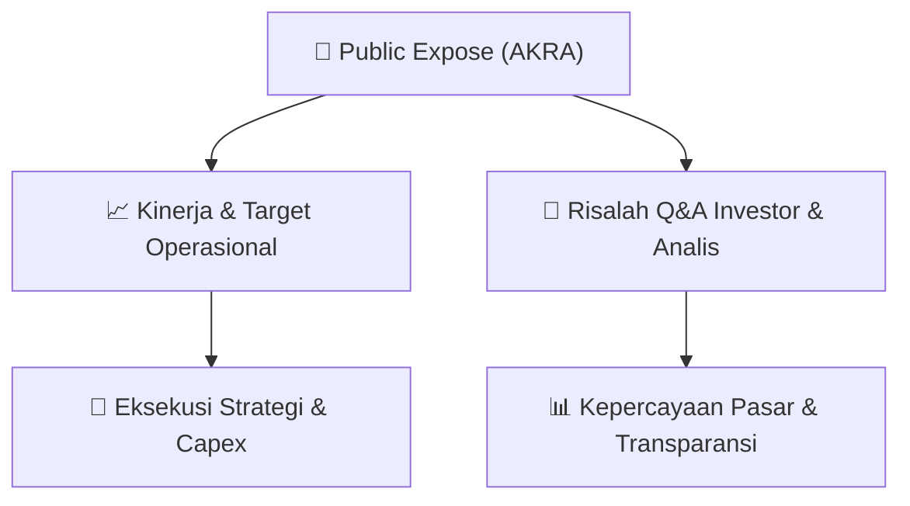

# 📢 Laporan Intelijen Paparan Publik (Public Expose) - [[AKRA]]
🏢 **Emiten**: `[[AKRA]]` | 📅 **Tanggal Pelaksanaan**: `2026-09-11` | 📑 **Dokumen**: `Public Expose`
⬅️ [[knowledge-base/daily-digests/Daily_Digest_20260911|Kembali ke Daily Digest]] | 🎛️ [[Dashboard|Ke Dashboard Utama]]

---

## 📌 1. Ringkasan Eksekutif & Paparan Direksi
> [!NOTE]
> PT AKR Corporindo Tbk. (AKRA) menyelenggarakan Public Expose Tahunan pada tanggal 03 September 2026, sesuai dengan surat pemberitahuan No. 072/L-AKR-CS/2026. Acara ini dihadiri oleh 100 peserta (tidak termasuk manajemen dan karyawan). Hasil paparan publik ini disampaikan secara resmi melalui surat No. 079/L-AKR-CS/2026 yang diterbitkan pada 11 September 2026. Dokumen ini merupakan laporan hasil penyampaian materi paparan publik tahunan yang mencakup kinerja dan rencana strategis perusahaan.

#### 🎯 Guidance Operasional & Target Strategis
- Dokumen yang tersedia hanya berisi pengumuman administratif mengenai penyelenggaraan dan hasil Public Expose Tahunan. Tidak terdapat rincian spesifik mengenai target kinerja, ekspansi, atau capex dalam lampiran yang disediakan. Informasi lebih lanjut mengenai guidance operasional perusahaan tidak tercantum dalam dokumen ini.

## 📊 2. Matriks Indikator Operasional & Parameter Kunci
| Parameter Utama | Nilai / Keterangan Resmi |
| :--- | :--- |
| **Tanggal Penyelenggaraan Public Expose** | `03 September 2026` |
| **Jumlah Peserta Hadir** | `100 orang` |
| **Nomor Surat Pemberitahuan** | `072/L-AKR-CS/2026` |
| **Nomor Surat Hasil Public Expose** | `079/L-AKR-CS/2026` |
| **Tanggal Penerbitan Laporan** | `11 September 2026` |
| **Corporate Secretary** | `Arum P. Handayani` |

---

## 💬 3. Risalah Tanya Jawab (Q&A Session)
`Materi presentasi Public Expose / Risalah Q&A terlampir dalam dokumen resmi bursa.`

## 📌 4. Peta Jalur Strategis & Roadmap

---

## 🔗 Knowledge Graph
- [[knowledge-base/daily-digests/Daily_Digest_20260911|📄 Daily Digest 2026-09-11]]
- [[knowledge-base/calendars/Action_Calendar|🗓️ Kalender Terpusat Aksi Korporasi]]
- [[Dashboard|🎛️ Kembali ke Dashboard Utama]]