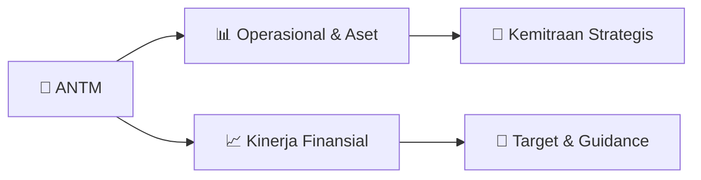

# 📊 Materi Public Expose: [ANTM]

🏢 **Emiten**: `ANTM` | 📅 **Tanggal Pelaksanaan**: `2026-08-27` | 📑 **Total Slide**: `1 Slide`
⬅️ [[knowledge-base/daily-digests/ANTM_20260827|Kembali ke Daily Digest]] | 🎛️ [[Dashboard/ANTM|Ke Dashboard Emiten]]

> [!NOTE]
> Ringkasan materi presentasi resmi Public Expose ANTM yang disampaikan oleh manajemen kepada investor dan bursa. Seluruh poin strategis, matriks operasional, dan angka kinerja diekstrak langsung dari slide deck resmi.

---

## 📅 1. Jadwal & Metadata Penyelenggaraan

| Parameter | Detail Informasi |
|---|---|
| **Nomor Surat Pengantar** | 5103/692/DCS/2026 |
| **Perihal Pengumuman** | Rencana Penyelenggaraan Public Expose Tahunan |
| **Waktu Pelaksanaan** | 10 September 2026 16:00 |
| **Lokasi / Media** | Public Expose Live 2026 yang tercantum pada website |
| **Lampiran Resmi** | `1` |

## 📋 2. Agenda Paparan Publik

1. Gedung ANTAM Tower A
2. Jl. Letjen. TB Simatupang No.1
3. Lingkar Selatan, Tanjung Barat Jakarta Selatan 12530
4. corsec@antam.com
5. www.antam.com
6. CORSEC
7. CGC & C
8. CORFIN
9. 26 Agustus 2026
10. Nomor
11. : 5103/692/DCS/2026
12. Perihal
13. : Rencana Penyelenggaraan Public Expose Tahunan PT ANTAM (Persero) Tbk Tahun 2026
14. Lampiran
15. :   -
16. Yang Terhormat,
17. Direksi
18. PT Bursa Efek Indonesia
19. Indonesia Stock Exchange Building, 1
20. st Tower
21. Jalan Jenderal Sudirman, Kavling 52 -53
22. Jakarta Selatan 12190
23. Up. Direktur Penilaian Perusahaan
24. Mengacu pada
25. ketentuan
26. Keputusan Direksi PT Bursa Efek Indonesia
27. No. Kep-00087/BEI/12-2025 tanggal 12 Desember 2025 tentang Peraturan Nomor I
28. -E tentang Kewajiban
29. Penyampaian Informasi , bersama ini kami sampaikan informasi Rencana Penyelenggaraan
30. Public Expose
31. Tahunan PT ANTAM (Persero) Tbk (“Perusahaan ”) Tahun 2026 yang tergabung dengan Public Expose Live
32. 2026 PT Bursa Efek Indonesia sebagai berikut:
33. Hari / Tanggal
34. :  Kamis / 10 September 2026
35. Tempat
36. :  Public Expose Live 2026
37. yang tercantum pada website www.idx.co.id
38. Waktu
39. :  Pukul 16.00 WIB – selesai
40. Agenda
41. :  1. Paparan Kinerja Semester I Tahun 2026
42. 2. Press Conference
43. Pembicara
44. :  Perwakilan Manajemen Perusahaan
45. Demikian kami sampaikan. Atas perhatian yang diberikan, kami ucapkan terima kasih.
46. Corporate Secretary Division Head
47. Wisnu Danandi Haryanto

## 🏢 3. Profil & Pilar Portofolio Bisnis

## 🏗️ 4. Kinerja Operasional & Portofolio Aset

*Detail aset operasional terlampir pada dokumen slide resmi.*

## 📈 5. Kinerja Keuangan & Posisi Finansial

## 🧭 6. Inisiatif Strategis, Kolaborasi, & Kemitraan

*Strategi usaha difokuskan pada penguatan fundamental dan ekspansi operasional.*

## 🎯 7. Target Pertumbuhan & Guidance Manajemen

*Target pertumbuhan ditetapkan mengacu pada prospek industri dan kondisi makroekonomi terkini.*

## 🗺️ 8. Peta Jalur Strategis & Eksekusi

## 📑 9. Daftar Indeks Slide Presentasi

| Slide # | Judul / Topik Slide | Ringkasan Konten |
|---|---|---|
| Slide 1 | **PT ANTAM (Persero) Tbk** | Gedung ANTAM Tower A Jl. Letjen. TB Simatupang No.1 Lingkar Selatan, Tanjung Barat Jakarta Selatan 12530 |

---

*Dokumen diolah otomatis oleh **Swarm Intelijen Pasar Modal Indonesia** pada 2026-10-12 16:41 WIB.*