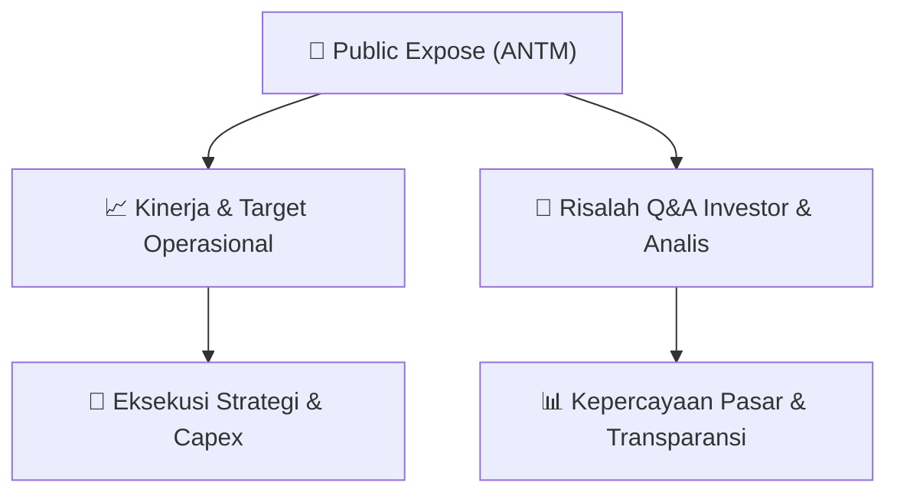

# 📢 Laporan Intelijen Paparan Publik (Public Expose) - [[ANTM]]
🏢 **Emiten**: `[[ANTM]]` | 📅 **Tanggal Pelaksanaan**: `2026-08-27` | 📑 **Dokumen**: `Public Expose`
⬅️ [[knowledge-base/daily-digests/Daily_Digest_20260827|Kembali ke Daily Digest]] | 🎛️ [[Dashboard|Ke Dashboard Utama]]

---

## 📌 1. Ringkasan Eksekutif & Paparan Direksi
> [!NOTE]
> PT ANTAM (Persero) Tbk mengumumkan rencana penyelenggaraan Public Expose Tahunan untuk tahun buku yang berakhir pada 2026. Acara akan diselenggarakan secara live melalui website www.idx.co.id pada tanggal 10 September 2026 pukul 16:00. Agenda utama adalah paparan kinerja semester I tahun 2026 dan press conference. Pengumuman disampaikan oleh Corporate Secretary Division Head, Wisnu Danandi Haryanto, pada 27 Agustus 2026.

#### 🎯 Guidance Operasional & Target Strategis
- Belum tersedia informasi mengenai target kinerja, ekspansi, atau belanja modal (capex) dalam dokumen ini. Dokumen hanya merupakan pemberitahuan rencana public expose, sehingga guidance operasional dan katalis akan disampaikan pada saat acara berlangsung.

## 📊 2. Matriks Indikator Operasional & Parameter Kunci
| Parameter Utama | Nilai / Keterangan Resmi |
| :--- | :--- |
| **Nama Perusahaan** | `PT ANTAM (Persero) Tbk` |
| **Kode Emiten** | `ANTM` |
| **Nomor Surat** | `5103/692/DCS/2026` |
| **Tanggal Public Expose** | `10 September 2026` |
| **Waktu Public Expose** | `16:00` |
| **Tempat Public Expose** | `Public Expose Live 2026 melalui website www.idx.co.id` |
| **Agenda** | `1. Paparan Kinerja Semester I Tahun 2026; 2. Press Conference` |
| **Tanggal Pengumuman** | `27 Agustus 2026` |
| **Pejabat Pengumuman** | `Wisnu Danandi Haryanto, Corporate Secretary Division Head` |

---

## 💬 3. Risalah Tanya Jawab (Q&A Session)
`Materi presentasi Public Expose / Risalah Q&A terlampir dalam dokumen resmi bursa.`

## 📌 4. Peta Jalur Strategis & Roadmap

---

## 🔗 Knowledge Graph
- [[knowledge-base/daily-digests/Daily_Digest_20260827|📄 Daily Digest 2026-08-27]]
- [[knowledge-base/calendars/Action_Calendar|🗓️ Kalender Terpusat Aksi Korporasi]]
- [[Dashboard|🎛️ Kembali ke Dashboard Utama]]