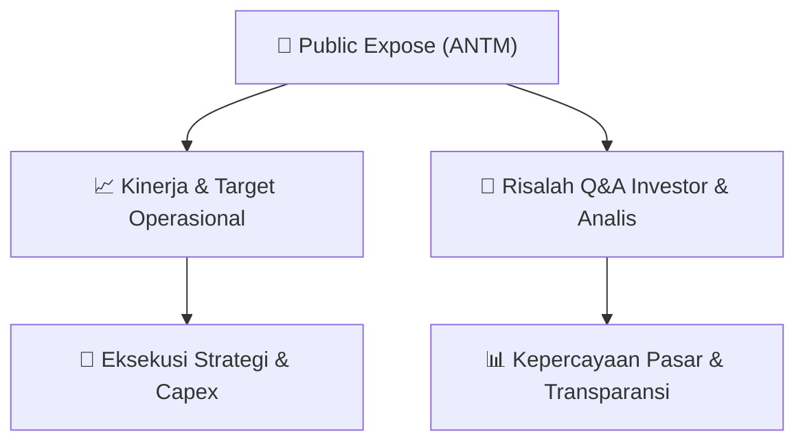

# 📢 Laporan Intelijen Paparan Publik (Public Expose) - [[ANTM]]
🏢 **Emiten**: `[[ANTM]]` | 📅 **Tanggal Pelaksanaan**: `2026-09-15` | 📑 **Dokumen**: `Public Expose`
⬅️ [[knowledge-base/daily-digests/Daily_Digest_20260915|Kembali ke Daily Digest]] | 🎛️ [[Dashboard|Ke Dashboard Utama]]

---

## 📌 1. Ringkasan Eksekutif & Paparan Direksi
> [!NOTE]
> PT ANTAM (Persero) Tbk (ANTM) menyelenggarakan Public Expose Tahunan pada tanggal 07 September 2026, berdasarkan surat pemberitahuan No. 5199/692/DCS/2026. Acara ini dihadiri oleh 130 peserta (tidak termasuk manajemen dan karyawan). Laporan hasil Public Expose disampaikan oleh Corporate Secretary Division Head, Wisnu Danandi Haryanto, dan diumumkan melalui sistem pelaporan elektronik pada 15 September 2026. Paparan ini merupakan forum komunikasi antara manajemen ANTM dengan investor, analis, dan publik untuk menyampaikan kinerja, strategi, serta menjawab pertanyaan terkait operasional perusahaan.

#### 🎯 Guidance Operasional & Target Strategis
- Dokumen yang tersedia hanya berisi laporan administratif penyelenggaraan Public Expose dan tidak memuat detail materi paparan, target kinerja, ekspansi, atau capex secara spesifik. Informasi mengenai katalis dan guidance tidak dapat diekstraksi dari dokumen ini karena lampiran materi paparan (5583 - Laporan Pubex Live 2026.pdf) tidak disertakan dalam teks yang diberikan. Investor disarankan merujuk pada materi paparan resmi yang diunggah di website BEI atau situs ANTM untuk mendapatkan detail guidance operasional.

## 📊 2. Matriks Indikator Operasional & Parameter Kunci
| Parameter Utama | Nilai / Keterangan Resmi |
| :--- | :--- |
| **Tanggal Penyelenggaraan Public Expose** | `07 September 2026` |
| **Jumlah Peserta Hadir** | `130 orang (tidak termasuk manajemen dan karyawan)` |
| **Nomor Surat Pemberitahuan** | `5199/692/DCS/2026` |
| **Nomor Surat Laporan Hasil** | `5583/692/DCS/2026` |
| **Tanggal Pelaporan** | `15 September 2026` |
| **Pejabat Pelapor** | `Wisnu Danandi Haryanto - Corporate Secretary Division Head` |

---

## 💬 3. Risalah Tanya Jawab (Q&A Session)
### ❓ Pertanyaan 1 (Tidak tersedia dalam dokumen)
**Pertanyaan**: Tidak tersedia dalam dokumen - teks yang diberikan hanya berisi laporan administratif penyelenggaraan Public Expose, tanpa memuat transkrip sesi tanya jawab.

**Jawaban Manajemen**: Tidak tersedia dalam dokumen - materi paparan dan jawaban manajemen tidak disertakan dalam teks yang diberikan.

> [!TIP]
> **Implikasi Bagi Investor**: Tidak dapat ditentukan - investor perlu mengakses lampiran materi paparan resmi (5583 - Laporan Pubex Live 2026.pdf) untuk mendapatkan informasi Q&A dan implikasinya terhadap keputusan investasi.

## 📌 4. Peta Jalur Strategis & Roadmap

---

## 🔗 Knowledge Graph
- [[knowledge-base/daily-digests/Daily_Digest_20260915|📄 Daily Digest 2026-09-15]]
- [[knowledge-base/calendars/Action_Calendar|🗓️ Kalender Terpusat Aksi Korporasi]]
- [[Dashboard|🎛️ Kembali ke Dashboard Utama]]