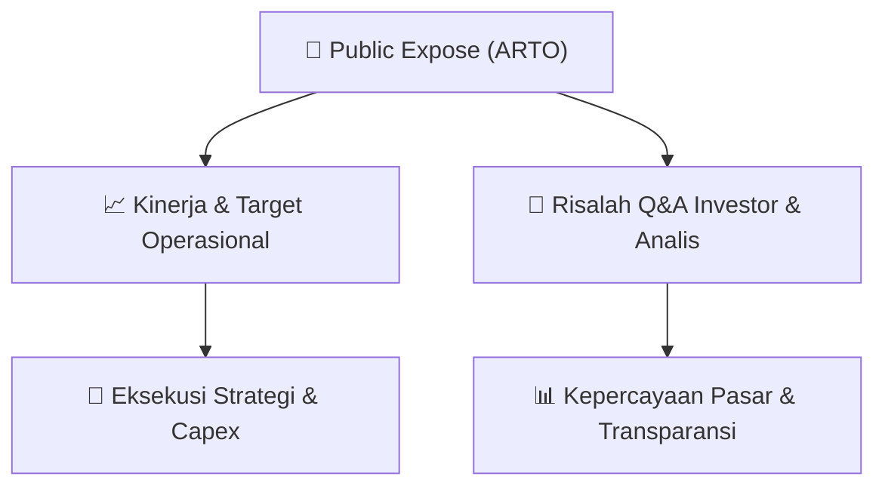

# 📢 Laporan Intelijen Paparan Publik (Public Expose) - [[ARTO]]
🏢 **Emiten**: `[[ARTO]]` | 📅 **Tanggal Pelaksanaan**: `2026-08-27` | 📑 **Dokumen**: `Public Expose`
⬅️ [[knowledge-base/daily-digests/Daily_Digest_20260827|Kembali ke Daily Digest]] | 🎛️ [[Dashboard|Ke Dashboard Utama]]

---

## 📌 1. Ringkasan Eksekutif & Paparan Direksi
> [!NOTE]
> PT Bank Jago Tbk (ARTO) mengumumkan rencana penyelenggaraan Public Expose Tahunan untuk tahun buku yang berakhir pada 2025. Acara akan dilaksanakan pada 10 September 2026 pukul 11:00 WIB melalui platform Public Expose Live 2026 di situs IDX. Agenda utama meliputi pemaparan kinerja keuangan per Juni 2026 dan perkembangan bisnis perseroan.

#### 🎯 Guidance Operasional & Target Strategis
- Tidak terdapat guidance kinerja, target ekspansi, atau rencana capex yang diungkapkan dalam dokumen ini. Dokumen hanya merupakan pemberitahuan resmi jadwal public expose.

## 📊 2. Matriks Indikator Operasional & Parameter Kunci
| Parameter Utama | Nilai / Keterangan Resmi |
| :--- | :--- |
| **Nama Perusahaan** | `PT Bank Jago Tbk.` |
| **Kode Emiten** | `ARTO` |
| **Jenis Acara** | `Public Expose Tahunan` |
| **Tahun Buku** | `2025` |
| **Tanggal Pelaksanaan** | `10 September 2026` |
| **Waktu** | `11:00 WIB` |
| **Tempat** | `Public Expose Live 2026 (https://www.idx.co.id/id/investor/public-expose-live/)` |
| **Agenda 1** | `Kinerja Keuangan Juni 2026` |
| **Agenda 2** | `Perkembangan Bisnis Perseroan` |
| **Nama Pejabat** | `Tjit Siat Fun, Corporate Secretary/Direktur Kepatuhan` |

---

## 💬 3. Risalah Tanya Jawab (Q&A Session)
`Materi presentasi Public Expose / Risalah Q&A terlampir dalam dokumen resmi bursa.`

## 📌 4. Peta Jalur Strategis & Roadmap

---

## 🔗 Knowledge Graph
- [[knowledge-base/daily-digests/Daily_Digest_20260827|📄 Daily Digest 2026-08-27]]
- [[knowledge-base/calendars/Action_Calendar|🗓️ Kalender Terpusat Aksi Korporasi]]
- [[Dashboard|🎛️ Kembali ke Dashboard Utama]]