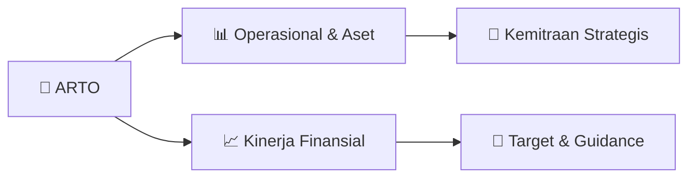

# 📊 Materi Public Expose: [ARTO]

🏢 **Emiten**: `ARTO` | 📅 **Tanggal Pelaksanaan**: `2026-08-27` | 📑 **Total Slide**: `1 Slide`
⬅️ [[knowledge-base/daily-digests/ARTO_20260827|Kembali ke Daily Digest]] | 🎛️ [[Dashboard/ARTO|Ke Dashboard Emiten]]

> [!NOTE]
> Ringkasan materi presentasi resmi Public Expose ARTO yang disampaikan oleh manajemen kepada investor dan bursa. Seluruh poin strategis, matriks operasional, dan angka kinerja diekstrak langsung dari slide deck resmi.

---

## 📅 1. Jadwal & Metadata Penyelenggaraan

| Parameter | Detail Informasi |
|---|---|
| **Nomor Surat Pengantar** | S.526/JAGO-COMP/VIII/2026 |
| **Perihal Pengumuman** | Rencana Penyelenggaraan Public Expose Tahunan |
| **Waktu Pelaksanaan** | 10 September 2026 11:00 |
| **Lokasi / Media** | Public Expose Live 2026 |
| **Lampiran Resmi** | `1` |

## 📋 2. Agenda Paparan Publik

1. ​Nomor​
2. ​:​​S.526/JAGO-COMP/VIII/2026​
3. ​Lampiran​
4. ​:​​-​
5. ​Perihal​
6. ​:​​Rencana​​Penyelenggaraan​​Public​​Expose​​Tahunan​​2026​​/​​Announcement​​of​​the​
7. ​Plan​​to​​Convene​​the​​2026​​Annual​​Public​​Expose​
8. ​Kepada​​Yth,​
9. ​Divisi​​Penilaian​​Perusahaan​
10. ​PT​​Bursa​​Efek​​Indonesia​
11. ​Indonesia​​Stock​​Exchange​​Building​​Tower​​I​
12. ​Jl.​​Jend.​​Sudirman​​Kav​​52-53​​Jakarta​​12190​
13. ​To:​
14. ​Company​​Assessment​​Division​
15. ​PT​​Bursa​​Efek​​Indonesia​
16. ​Indonesia​​Stock​​Exchange​​Building​​Tower​​I​
17. ​Jl.​​Jend.​​Sudirman​​Kav​​52-53,​​Jakarta​​12190​
18. ​Dengan​​Hormat,​
19. ​Untuk​ ​memenuhi​ ​Ketentuan​ ​III.3​ ​Peraturan​​No.​​I-E​
20. ​tentang​
21. ​Kewajiban​
22. ​Penyampaian​
23. ​Informasi​
24. ​(Keputusan​​Direksi​​PT​​Bursa​​Efek​​Indonesia​​Nomor​
25. ​Kep-00087/BEI/12-2025​ ​Tahun​ ​2025),​ ​bersama​ ​ini​
26. ​kami​
27. ​menyampaikan​
28. ​rencana​
29. ​penyelenggaraan​
30. ​Public​ ​Expose​ ​Tahunan​ ​dengan​ ​rincian​ ​sebagai​
31. ​berikut​​:​
32. ​Dear​​Sir/Madam,​
33. ​In​​compliance​​with​​Provision​​III.3​​of​​Rule​​Number​
34. ​I-E​​on​​Obligation​​of​​Information​​Disclosure​​(Decree​
35. ​Of​ ​The​ ​Board​ ​Of​ ​Directors​ ​Of​ ​Indonesia​ ​Stock​
36. ​Exchange​ ​Kep-00087/BEI/12-2025)​ ​,​ ​we​ ​hereby​
37. ​submit​​the​​plan​​for​​our​​2026​​Annual​​Public​​Expose,​
38. ​with​​the​​following​​details:​
39. ​Hari/Tanggal:​
40. ​Kamis,​​10​​September​​2026​
41. ​Waktu:​
42. ​11.00​​-​​12.00​​Waktu​​Indonesia​​Barat​
43. ​Tempat:​
44. ​Public​​Expose​​Live​​2026​
45. ​https://www.idx.co.id/id/investor/public-expose-live/​
46. ​Agenda:​
47. ​1.​ ​Kinerja​​Keuangan​​Juni​​2026.​
48. ​2.​ ​Perkembangan​​Bisnis​​Perseroan.​
49. ​Narasumber:​
50. ​1.​ ​Direktur​​Finance​​&​​Operations​​Supranoto​
51. ​Prajogo​
52. ​2.​ ​Investor​​Relations​​&​​Market​​Intelligence​
53. ​Theodore​​Siregar.​
54. ​Day/Date:​
55. ​Thursday,​​September​​10,​​2026​
56. ​Time:​
57. ​11.00​​-​​12.00​​Western​​Indonesia​​Time​
58. ​Venue:​
59. ​Public​​Expose​​Live​​2026​
60. ​https://www.idx.co.id/id/investor/public-expose-live/​
61. ​Agenda:​
62. ​1.​ ​Financial​​Performance​​as​​of​​June​​2026.​
63. ​2.​ ​Corporate​​Business​​Development.​
64. ​Speakers:​
65. ​1.​ ​Finance​​&​​Operations​​Director​​Supranoto​
66. ​Prajogo​
67. ​2.​ ​Investor​​Relations​​&​​Market​​Intelligence​
68. ​Theodore​​Siregar.​
69. ​Demikian​ ​informasi​ ​yang​ ​kami​ ​sampaikan.​ ​Kami​
70. ​mengucapkan​ ​terima​ ​kasih​ ​atas​ ​perhatian​ ​yang​
71. ​diberikan.​
72. ​We​​hereby​​submit​​this​​information.​​Thank​​you​​for​
73. ​your​​kind​​attention.​
74. ​Hormat​​kami​​/​​Sincerely​
75. ​PT​​Bank​​Jago​​Tbk.​
76. ​Tjit​​Siat​​Fun​
77. ​Direktur​​Kepatuhan/Corporate​​Secretary​

## 🏢 3. Profil & Pilar Portofolio Bisnis

## 🏗️ 4. Kinerja Operasional & Portofolio Aset

*Detail aset operasional terlampir pada dokumen slide resmi.*

## 📈 5. Kinerja Keuangan & Posisi Finansial

## 🧭 6. Inisiatif Strategis, Kolaborasi, & Kemitraan

*Strategi usaha difokuskan pada penguatan fundamental dan ekspansi operasional.*

## 🎯 7. Target Pertumbuhan & Guidance Manajemen

*Target pertumbuhan ditetapkan mengacu pada prospek industri dan kondisi makroekonomi terkini.*

## 🗺️ 8. Peta Jalur Strategis & Eksekusi

## 📑 9. Daftar Indeks Slide Presentasi

| Slide # | Judul / Topik Slide | Ringkasan Konten |
|---|---|---|
| Slide 1 | **​Jakarta,​​27​​Agustus​ ​2026​** | ​Nomor​ ​:​​S.526/JAGO-COMP/VIII/2026​ ​Lampiran​ |

---

*Dokumen diolah otomatis oleh **Swarm Intelijen Pasar Modal Indonesia** pada 2026-10-12 16:41 WIB.*