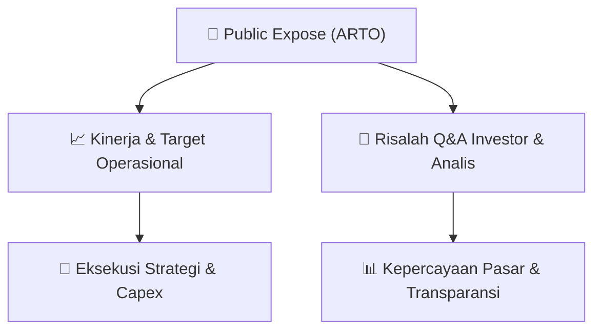

# 📢 Laporan Intelijen Paparan Publik (Public Expose) - [[ARTO]]
🏢 **Emiten**: `[[ARTO]]` | 📅 **Tanggal Pelaksanaan**: `2026-09-14` | 📑 **Dokumen**: `Public Expose`
⬅️ [[knowledge-base/daily-digests/Daily_Digest_20260914|Kembali ke Daily Digest]] | 🎛️ [[Dashboard|Ke Dashboard Utama]]

---

## 📌 1. Ringkasan Eksekutif & Paparan Direksi
> [!NOTE]
> PT Bank Jago Tbk. (ARTO) menyelenggarakan Public Expose Tahunan pada 04 September 2026 berdasarkan surat No. S550/JAGO-COMP/IX/2026, dan melaporkan hasilnya melalui surat No. S580/JAGO-COMP/IX/2026 pada 14 September 2026. Acara dihadiri oleh 60 peserta (tidak termasuk manajemen dan karyawan). Paparan ini merupakan agenda tahunan untuk menyampaikan kinerja, strategi, dan rencana perseroan kepada investor, analis, dan publik. Dokumen yang tersedia hanya memuat laporan administratif penyelenggaraan, tanpa detail materi paparan atau sesi tanya jawab yang disertakan dalam lampiran terpisah.

#### 🎯 Guidance Operasional & Target Strategis
- Dokumen yang tersedia tidak memuat rincian target kinerja, ekspansi, capex, atau isu pasar secara eksplisit. Namun, penyelenggaraan Public Expose Tahunan ini sendiri merupakan katalis informasi bagi investor untuk mendapatkan pemutakhiran strategi Bank Jago, terutama terkait perkembangan bank digital, pertumbuhan dana pihak ketiga (DPK), penyaluran kredit, dan ekosistem digital. Detail guidance operasional diperkirakan terdapat dalam lampiran laporan hasil public expose (file S580 - Laporan Hasil Pubex 2026.pdf) yang tidak disertakan dalam teks ini.

## 📊 2. Matriks Indikator Operasional & Parameter Kunci
| Parameter Utama | Nilai / Keterangan Resmi |
| :--- | :--- |
| **Tanggal Penyelenggaraan Public Expose** | `04 September 2026` |
| **Nomor Surat Penyampaian Materi** | `S550/JAGO-COMP/IX/2026` |
| **Nomor Surat Laporan Hasil Public Expose** | `S580/JAGO-COMP/IX/2026` |
| **Tanggal Laporan Hasil Public Expose** | `14 September 2026` |
| **Jumlah Peserta Hadir (di luar manajemen/karyawan)** | `60 orang` |
| **Jenis Paparan** | `Public Expose Tahunan` |
| **Pejabat Penandatangan** | `Tjit Siat Fun (Corporate Secretary/Direktur Kepatuhan)` |

---

## 💬 3. Risalah Tanya Jawab (Q&A Session)
### ❓ Pertanyaan 1 (Tidak tercantum dalam dokumen)
**Pertanyaan**: Tidak ada sesi tanya jawab yang terdokumentasi dalam teks yang tersedia. Dokumen hanya berisi laporan administratif penyelenggaraan acara.

**Jawaban Manajemen**: Tidak tersedia. Manajemen tidak menyertakan ringkasan Q&A dalam laporan ini; kemungkinan detail terdapat pada lampiran terpisah.

> [!TIP]
> **Implikasi Bagi Investor**: Investor perlu merujuk pada lampiran laporan hasil public expose (file PDF terlampir) atau siaran pers resmi Bank Jago untuk mendapatkan informasi Q&A dan detail kinerja. Ketidakhadiran Q&A dalam ringkasan ini membatasi analisis mendalam terhadap sentimen manajemen.

## 📌 4. Peta Jalur Strategis & Roadmap

---

## 🔗 Knowledge Graph
- [[knowledge-base/daily-digests/Daily_Digest_20260914|📄 Daily Digest 2026-09-14]]
- [[knowledge-base/calendars/Action_Calendar|🗓️ Kalender Terpusat Aksi Korporasi]]
- [[Dashboard|🎛️ Kembali ke Dashboard Utama]]