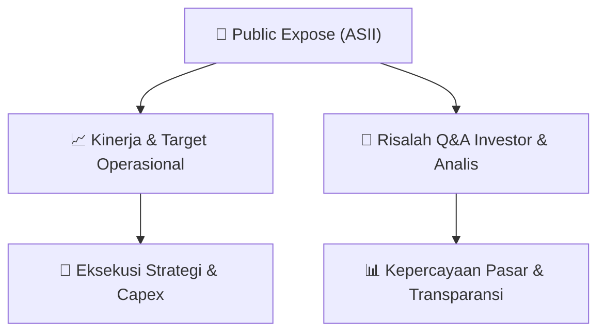

# 📢 Laporan Intelijen Paparan Publik (Public Expose) - [[ASII]]
🏢 **Emiten**: `[[ASII]]` | 📅 **Tanggal Pelaksanaan**: `2026-08-27` | 📑 **Dokumen**: `Public Expose`
⬅️ [[knowledge-base/daily-digests/Daily_Digest_20260827|Kembali ke Daily Digest]] | 🎛️ [[Dashboard|Ke Dashboard Utama]]

---

## 📌 1. Ringkasan Eksekutif & Paparan Direksi
> [!NOTE]
> Astra International Tbk (ASII) mengumumkan rencana penyelenggaraan Public Expose Tahunan untuk tahun buku 2026. Acara akan diselenggarakan pada 10 September 2026 pukul 10:00 melalui platform Public Expose Live 2026 di website idx.co.id. Agenda acara adalah pemaparan kinerja Perseroan untuk Semester I Tahun 2026. Dokumen ini merupakan pengumuman resmi yang disampaikan oleh Corporate Secretary Gita Tiffany Boer pada 27 Agustus 2026 dan tidak memuat rincian kinerja keuangan atau operasional.

#### 🎯 Guidance Operasional & Target Strategis
- Dokumen tidak memuat target kinerja, ekspansi, atau belanja modal (capex). Informasi lebih lanjut mengenai kinerja Semester I 2026 akan dipaparkan pada saat Public Expose 10 September 2026.

## 📊 2. Matriks Indikator Operasional & Parameter Kunci
| Parameter Utama | Nilai / Keterangan Resmi |
| :--- | :--- |
| **Nama Perusahaan** | `Astra International Tbk` |
| **Kode Emiten** | `ASII` |
| **Nomor Surat** | `001/IR/VIII/2026` |
| **Perihal** | `Rencana Penyelenggaraan Public Expose Tahunan` |
| **Tempat** | `Public Expose Live 2026 di website idx.co.id` |
| **Hari/Tanggal** | `10 September 2026` |
| **Waktu** | `10:00` |
| **Agenda** | `Pemaparan Kinerja Perseroan Semester I Tahun 2026` |
| **Tahun Buku** | `2026` |
| **Corporate Secretary** | `Gita Tiffany Boer` |
| **Tanggal Pengumuman** | `27-08-2026 16:31` |
| **Alamat** | `Menara Astra Lt 58-63, Jl. Jendral Sudirman Kav 5-6, Jakarta, 10220` |
| **Telepon** | `(021) 508 43 888` |
| **Fax** | `(021) 6530-4957` |
| **Website** | `www.astra.co.id` |

---

## 💬 3. Risalah Tanya Jawab (Q&A Session)
`Materi presentasi Public Expose / Risalah Q&A terlampir dalam dokumen resmi bursa.`

## 📌 4. Peta Jalur Strategis & Roadmap

---

## 🔗 Knowledge Graph
- [[knowledge-base/daily-digests/Daily_Digest_20260827|📄 Daily Digest 2026-08-27]]
- [[knowledge-base/calendars/Action_Calendar|🗓️ Kalender Terpusat Aksi Korporasi]]
- [[Dashboard|🎛️ Kembali ke Dashboard Utama]]