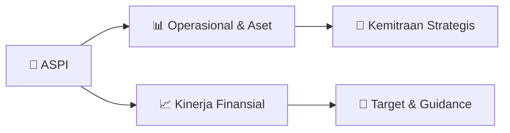

# 📊 Materi Public Expose: [ASPI]

🏢 **Emiten**: `ASPI` | 📅 **Tanggal Pelaksanaan**: `2026-09-28` | 📑 **Total Slide**: `1 Slide`
⬅️ [[knowledge-base/daily-digests/ASPI_20260928|Kembali ke Daily Digest]] | 🎛️ [[Dashboard/ASPI|Ke Dashboard Emiten]]

> [!NOTE]
> Ringkasan materi presentasi resmi Public Expose ASPI yang disampaikan oleh manajemen kepada investor dan bursa. Seluruh poin strategis, matriks operasional, dan angka kinerja diekstrak langsung dari slide deck resmi.

---

## 📅 1. Jadwal & Metadata Penyelenggaraan

| Parameter | Detail Informasi |
|---|---|
| **Nomor Surat Pengantar** | 0356ASPI |
| **Perihal Pengumuman** | Rencana Penyelenggaraan Public Expose Insidentil |
| **Waktu Pelaksanaan** | 29 September 2026 14:00 |
| **Lokasi / Media** | dilakukan secara online |
| **Lampiran Resmi** | `1` |

## 📋 2. Agenda Paparan Publik

- Pemaparan Profil & Struktur Bisnis Perseroan
- Kinerja Operasional & Keuangan
- Arah Strategi Usaha & Target Pertumbuhan
- Sesi Tanya Jawab (Q&A)

## 🏢 3. Profil & Pilar Portofolio Bisnis

## 🏗️ 4. Kinerja Operasional & Portofolio Aset

*Detail aset operasional terlampir pada dokumen slide resmi.*

## 📈 5. Kinerja Keuangan & Posisi Finansial

## 🧭 6. Inisiatif Strategis, Kolaborasi, & Kemitraan

*Strategi usaha difokuskan pada penguatan fundamental dan ekspansi operasional.*

## 🎯 7. Target Pertumbuhan & Guidance Manajemen

*Target pertumbuhan ditetapkan mengacu pada prospek industri dan kondisi makroekonomi terkini.*

## 🗺️ 8. Peta Jalur Strategis & Eksekusi

## 📑 9. Daftar Indeks Slide Presentasi

| Slide # | Judul / Topik Slide | Ringkasan Konten |
|---|---|---|
| Slide 1 | **PT ANDALAN SAKTI PRIMAINDO Tbk – Property & Real Estate Developer** | Sona Topas Tower lt.5 #501, Jl.Jend.Sudirman kav.26, Jakarta Selatan 12920, www.ansa-land.com, Tlp: +62.21.250.6789, Email: info@ansa-land.com No. 023 |

---

*Dokumen diolah otomatis oleh **Swarm Intelijen Pasar Modal Indonesia** pada 2026-10-12 16:41 WIB.*