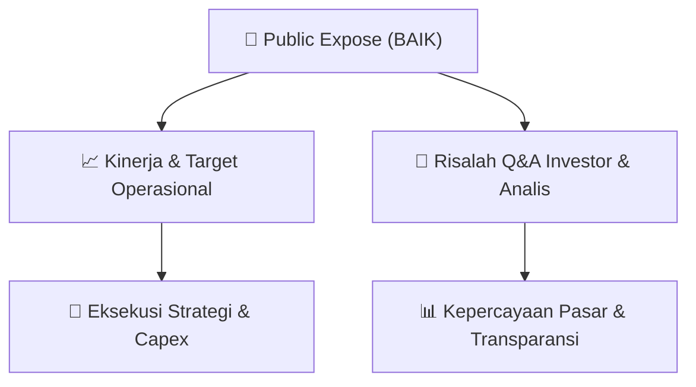

# 📢 Laporan Intelijen Paparan Publik (Public Expose) - [[BAIK]]
🏢 **Emiten**: `[[BAIK]]` | 📅 **Tanggal Pelaksanaan**: `2026-09-03` | 📑 **Dokumen**: `Public Expose`
⬅️ [[knowledge-base/daily-digests/Daily_Digest_20260903|Kembali ke Daily Digest]] | 🎛️ [[Dashboard|Ke Dashboard Utama]]

---

## 📌 1. Ringkasan Eksekutif & Paparan Direksi
> [!NOTE]
> PT Bersama Mencapai Puncak Tbk. (BAIK) menyampaikan pengumuman rencana penyelenggaraan Public Expose Insidentil yang akan dilaksanakan pada 07 September 2026 pukul 10:30. Public Expose ini dilakukan atas permintaan Otoritas Jasa Keuangan (OJK) dengan referensi surat Peng-SPT-00152/BEI.WAS/08-2026. Agenda utama adalah penjelasan kinerja Perseroan untuk Triwulan II Tahun Buku 2026. Registrasi dilakukan melalui tautan https://bit.ly/registrasiPUBEXBAIK. Pengumuman disampaikan oleh Direktur Utama Nanang Suherman pada 03 September 2026.

#### 🎯 Guidance Operasional & Target Strategis
- Dokumen ini hanya merupakan pengumuman rencana Public Expose Insidentil dan tidak memuat rincian target kinerja, proyeksi, ekspansi, belanja modal, atau guidance operasional. Informasi tersebut diharapkan disampaikan pada saat pelaksanaan Public Expose tanggal 07 September 2026.

## 📊 2. Matriks Indikator Operasional & Parameter Kunci
| Parameter Utama | Nilai / Keterangan Resmi |
| :--- | :--- |
| **Nama Perusahaan** | `PT Bersama Mencapai Puncak Tbk.` |
| **Kode Emiten** | `BAIK` |
| **Jenis Acara** | `Public Expose Insidentil` |
| **Latar Belakang Pelaksanaan** | `Permintaan Otoritas Jasa Keuangan (OJK)` |
| **Referensi Surat** | `Peng-SPT-00152/BEI.WAS/08-2026` |
| **Hari/Tanggal Pelaksanaan** | `07 September 2026` |
| **Waktu Pelaksanaan** | `10:30` |
| **Agenda** | `Penjelasan Kinerja Perseroan Triwulan II Tahun Buku 2026` |
| **Tautan Registrasi** | `https://bit.ly/registrasiPUBEXBAIK` |
| **Direktur Utama** | `Nanang Suherman` |
| **Tanggal Pengumuman** | `03-09-2026 14:22` |
| **Nomor Surat** | `0118/SPn/BMP/09/2026` |

---

## 💬 3. Risalah Tanya Jawab (Q&A Session)
`Materi presentasi Public Expose / Risalah Q&A terlampir dalam dokumen resmi bursa.`

## 📌 4. Peta Jalur Strategis & Roadmap

---

## 🔗 Knowledge Graph
- [[knowledge-base/daily-digests/Daily_Digest_20260903|📄 Daily Digest 2026-09-03]]
- [[knowledge-base/calendars/Action_Calendar|🗓️ Kalender Terpusat Aksi Korporasi]]
- [[Dashboard|🎛️ Kembali ke Dashboard Utama]]