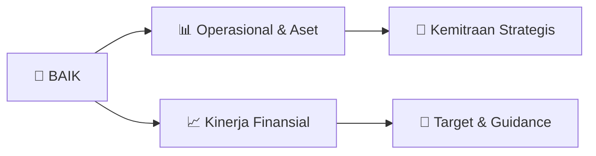

# 📊 Materi Public Expose: [BAIK]

🏢 **Emiten**: `BAIK` | 📅 **Tanggal Pelaksanaan**: `2026-09-03` | 📑 **Total Slide**: `1 Slide`
⬅️ [[knowledge-base/daily-digests/BAIK_20260903|Kembali ke Daily Digest]] | 🎛️ [[Dashboard/BAIK|Ke Dashboard Emiten]]

> [!NOTE]
> Ringkasan materi presentasi resmi Public Expose BAIK yang disampaikan oleh manajemen kepada investor dan bursa. Seluruh poin strategis, matriks operasional, dan angka kinerja diekstrak langsung dari slide deck resmi.

---

## 📅 1. Jadwal & Metadata Penyelenggaraan

| Parameter | Detail Informasi |
|---|---|
| **Nomor Surat Pengantar** | 0118/SPn/BMP/09/2026 |
| **Perihal Pengumuman** | Rencana Penyelenggaraan Public Expose Insidentil |
| **Waktu Pelaksanaan** | 07 September 2026 10:30 |
| **Lokasi / Media** | Registrasi : https://bit.ly/registrasiPUBEXBAIK |
| **Lampiran Resmi** | `1` |

## 📋 2. Agenda Paparan Publik

1. : 0118/SPn/BMP/09/2026
2. Perihal​ : Penyampaian Rencana Public Expose Insidentil PT Bersama Mencapai Puncak Tbk.
3. Kepada Yth Direktur Utama
4. PT Bursa Efek Indonesia
5. Gedung Bursa Efek Indonesia Menara I Lantai 6
6. Jl. Jend. Sudirman Kav. 52-53
7. Jakarta
8. Dengan Hormat,
9. Sehubungan dengan Pengumuman Bursa Efek Indonesia Nomor Peng-SPT-00152/BEI.WAS/08-2026
10. perihal penghentian sementara perdagangan (Suspensi) atas saham PT Bersama Mencapai Puncak
11. Tbk (BAIK), serta dalam rangka memenuhi ketentuan keterbukaan informasi sebagaimana diatur
12. dalam peraturan Bursa Efek Indonesia yang berlaku, sebagai tindak lanjut atas permintaan Bursa
13. bersama ini kami menyampaikan rencana penyelenggaraan Public Expose Insidentil PT Bersama
14. Mencapai Puncak Tbk. sebagai berikut:
15. Hari/Tanggal​
16. : Senin, 07 September 2026
17. Waktu​ ​
18. : 10.30 WIB
19. Media​ ​
20. : Online (Zoom)
21. Agenda​​
22. : Penjelasan Kinerja Perseroan Triwulan II Tahun Buku 2026
23. Link Registrasi​ : https://bit.ly/registrasiPUBEXBAIK
24. Serta dapat kami sampaikan bawa tautan (link) untuk mengikuti live zoom acara Public Expose
25. insidentil akan disampaikan melalui email kepada peserta yang telah melakukan registrasi pada tautan
26. yang telah disediakan pada pemberitahuan ini. Lebih lanjut, materi Public Expose Insidentil akan
27. kami sampaikan selambat-lambatnya pada Jumat, 04 September 2026.
28. Demikian surat penyampaian rencana penyelenggaraan Public Expose Insidentil ini kami sampaikan.
29. Atas perhatian dan kerjasama yang diberikan kami ucapkan terima kasih.
30. Hormat kami,
31. Bersama Mencapai Puncak Tbk
32. Mahendra Kumala Adi
33. Corporate Secretary

## 🏢 3. Profil & Pilar Portofolio Bisnis

## 🏗️ 4. Kinerja Operasional & Portofolio Aset

*Detail aset operasional terlampir pada dokumen slide resmi.*

## 📈 5. Kinerja Keuangan & Posisi Finansial

## 🧭 6. Inisiatif Strategis, Kolaborasi, & Kemitraan

*Strategi usaha difokuskan pada penguatan fundamental dan ekspansi operasional.*

## 🎯 7. Target Pertumbuhan & Guidance Manajemen

*Target pertumbuhan ditetapkan mengacu pada prospek industri dan kondisi makroekonomi terkini.*

## 🗺️ 8. Peta Jalur Strategis & Eksekusi

## 📑 9. Daftar Indeks Slide Presentasi

| Slide # | Judul / Topik Slide | Ringkasan Konten |
|---|---|---|
| Slide 1 | **Malang, 03 September 2026** | No​ : 0118/SPn/BMP/09/2026 Perihal​ : Penyampaian Rencana Public Expose Insidentil PT Bersama Mencapai Puncak Tbk. |

---

*Dokumen diolah otomatis oleh **Swarm Intelijen Pasar Modal Indonesia** pada 2026-10-12 16:41 WIB.*