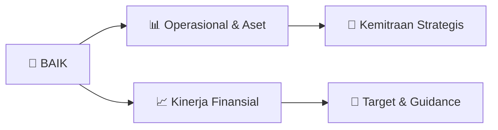

# 📊 Materi Public Expose: [BAIK]

🏢 **Emiten**: `BAIK` | 📅 **Tanggal Pelaksanaan**: `2026-09-04` | 📑 **Total Slide**: `3 Slide`
⬅️ [[knowledge-base/daily-digests/BAIK_20260904|Kembali ke Daily Digest]] | 🎛️ [[Dashboard/BAIK|Ke Dashboard Emiten]]

> [!NOTE]
> Ringkasan materi presentasi resmi Public Expose BAIK yang disampaikan oleh manajemen kepada investor dan bursa. Seluruh poin strategis, matriks operasional, dan angka kinerja diekstrak langsung dari slide deck resmi.

---

## 📅 1. Jadwal & Metadata Penyelenggaraan

| Parameter | Detail Informasi |
|---|---|
| **Nomor Surat Pengantar** | 0119/SPn/BMP/09/2026 |
| **Perihal Pengumuman** | Penyampaian Materi Public Expose Insidentil |
| **Waktu Pelaksanaan** | 2026-09-04 04-09-2026 12:02 |
| **Lokasi / Media** | Aplikasi Zoom / Daring |
| **Lampiran Resmi** | `2` |

## 📋 2. Agenda Paparan Publik

1. : 0119/SPn/BMP/09/2026
2. Perihal ​
3. : Penyampaian Materi Public Expose PT Bersama Mencapai Puncak Tbk.
4. Kepada Yth Direktur Utama
5. PT Bursa Efek Indonesia
6. Gedung Bursa Efek Indonesia Menara I Lantai 6
7. Jl. Jend. Sudirman Kav. 52-53
8. Jakarta
9. Dengan Hormat,
10. Sehubungan
11. dengan
12. Pengumuman
13. Bursa
14. Indonesia
15. Nomor
16. Peng-SPT-00152/BEI.WAS/08-2026 penghentian sementara perdagangan (Suspensi) atas
17. saham PT Bersama Mencapai Puncak Tbk (BAIK) tanggal 24 Agustus 2026 dan merujuk
18. pada surat Perseroan Nomor 0118/SPn/BMP/09/2026 tanggal 03 September 2026 perihal
19. Pemberitahuan Rencana Pelaksanaan Public Expose Insidentil, bersama ini kami sampaikan
20. materi Public Expose Insidentil Tahun 2026 yang akan diselenggarakan secara elektronik
21. pada:
22. Hari/Tanggal ​ ​
23. : Senin, 07 September 2026
24. Waktu ​​
25. : 10.30 WIB
26. Media ​​
27. : Online (Zoom)
28. Agenda ​
29. : Penjelasan Kinerja Perseroan Triwulan II Tahun Buku 2026
30. Link Registrasi ​
31. : https://bit.ly/registrasiPUBEXBAIK
32. Demikian surat penyampaian rencana penyelenggaraan Public Expose Insidentil ini kami
33. sampaikan. Atas perhatian dan kerjasama yang diberikan kami ucapkan terima kasih.
34. Hormat kami,
35. Bersama Mencapai Puncak Tbk
36. Mahendra K. Adi
37. Corporate Secretary

## 🏢 3. Profil & Pilar Portofolio Bisnis

## 🏗️ 4. Kinerja Operasional & Portofolio Aset

*Detail aset operasional terlampir pada dokumen slide resmi.*

## 📈 5. Kinerja Keuangan & Posisi Finansial

## 🧭 6. Inisiatif Strategis, Kolaborasi, & Kemitraan

*Strategi usaha difokuskan pada penguatan fundamental dan ekspansi operasional.*

## 🎯 7. Target Pertumbuhan & Guidance Manajemen

*Target pertumbuhan ditetapkan mengacu pada prospek industri dan kondisi makroekonomi terkini.*

## 🗺️ 8. Peta Jalur Strategis & Eksekusi

## 📑 9. Daftar Indeks Slide Presentasi

| Slide # | Judul / Topik Slide | Ringkasan Konten |
|---|---|---|
| Slide 1 | **Malang, 04 September 2026** | No ​ ​ : 0119/SPn/BMP/09/2026 |
| Slide 2 | **TATA TERTIB PUBLIC EXPOSE INSIDENTIL** | PT BERSAMA MENCAPAI PUNCAK TBK 1.​ Umum Public Expose Insidentil PT Bersama Mencapai Puncak Tbk 2026 |
| Slide 3 | **diperkenankan mengajukan pertanyaan dalam Bahasa Inggris pada kesempatan yang** | diberikan. 7.​ Tanya Jawab a)​ Peserta diberikan kesempatan untuk mengajukan pertanyaan dan/atau pendapat |

---

*Dokumen diolah otomatis oleh **Swarm Intelijen Pasar Modal Indonesia** pada 2026-10-12 16:41 WIB.*