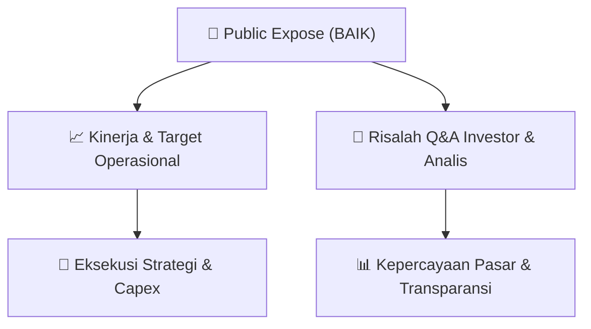

# 📢 Laporan Intelijen Paparan Publik (Public Expose) - [[BAIK]]
🏢 **Emiten**: `[[BAIK]]` | 📅 **Tanggal Pelaksanaan**: `2026-09-04` | 📑 **Dokumen**: `Public Expose`
⬅️ [[knowledge-base/daily-digests/Daily_Digest_20260904|Kembali ke Daily Digest]] | 🎛️ [[Dashboard|Ke Dashboard Utama]]

---

## 📌 1. Ringkasan Eksekutif & Paparan Direksi
> [!NOTE]
> PT Bersama Mencapai Puncak Tbk. (BAIK) menyelenggarakan Public Expose Insidentil pada 4 September 2026 secara sukarela (voluntary), bukan atas permintaan Bursa Efek Indonesia (BEI) maupun Otoritas Jasa Keuangan (OJK). Public Expose ini merupakan tindak lanjut dari pengumuman sebelumnya melalui Surat No. 0118/SPn/BMP/09/2026 tanggal 3 September 2026. Materi paparan disampaikan oleh Direktur Utama, Nanang Suherman, dan dilampirkan dalam dua dokumen PDF: Surat Pengantar dan Materi PUBEX Insidentil. Paparan ini bersifat insidentil dan tidak terkait dengan kewajiban regulasi, melainkan inisiatif perusahaan untuk memberikan informasi terkini kepada pemangku kepentingan.

#### 🎯 Guidance Operasional & Target Strategis
- Dokumen yang tersedia hanya berisi surat pengantar penyampaian materi Public Expose. Tidak terdapat rincian target kinerja, ekspansi, capex, atau guidance operasional dalam teks yang diberikan. Materi paparan sesungguhnya berada pada lampiran 'MATERI PUBEX INSIDENTIL - 0926.pdf' yang tidak disertakan dalam teks. Oleh karena itu, tidak ada informasi kuantitatif maupun kualitatif mengenai proyeksi keuangan, rencana ekspansi, atau belanja modal yang dapat diekstraksi dari dokumen ini.

## 📊 2. Matriks Indikator Operasional & Parameter Kunci
| Parameter Utama | Nilai / Keterangan Resmi |
| :--- | :--- |
| **Jenis Paparan** | `Public Expose Insidentil (Sukarela/Voluntary)` |
| **Dasar Pelaksanaan** | `Inisiatif sukarela perusahaan, bukan permintaan BEI atau OJK` |
| **Tanggal Pengumuman Awal** | `3 September 2026 (Surat No. 0118/SPn/BMP/09/2026)` |
| **Tanggal Penyampaian Materi** | `4 September 2026, 12:02 WIB` |
| **Nomor Surat** | `0119/SPn/BMP/09/2026` |
| **Narahubung / Penandatangan** | `Nanang Suherman, Direktur Utama` |
| **Alamat Perusahaan** | `Jl. Raya Regency Kav. 9 No. 5, Telepon/Fax: (0341) 4376127` |
| **Jumlah Lampiran** | `2 dokumen (Surat Pengantar dan Materi PUBEX Insidentil)` |

---

## 💬 3. Risalah Tanya Jawab (Q&A Session)
### ❓ Pertanyaan 1 (Tidak tersedia)
**Pertanyaan**: Tidak ada sesi tanya jawab yang tercantum dalam dokumen yang diberikan. Dokumen hanya berisi surat pengantar penyampaian materi Public Expose.

**Jawaban Manajemen**: Tidak ada jawaban manajemen yang dapat diekstraksi karena materi paparan dan sesi Q&A tidak disertakan dalam teks.

> [!TIP]
> **Implikasi Bagi Investor**: Investor perlu menunggu atau mengakses lampiran 'MATERI PUBEX INSIDENTIL - 0926.pdf' untuk mendapatkan informasi lengkap mengenai paparan dan potensi sesi tanya jawab. Tidak ada implikasi langsung yang dapat dinilai dari surat pengantar ini.

## 📌 4. Peta Jalur Strategis & Roadmap

---

## 🔗 Knowledge Graph
- [[knowledge-base/daily-digests/Daily_Digest_20260904|📄 Daily Digest 2026-09-04]]
- [[knowledge-base/calendars/Action_Calendar|🗓️ Kalender Terpusat Aksi Korporasi]]
- [[Dashboard|🎛️ Kembali ke Dashboard Utama]]