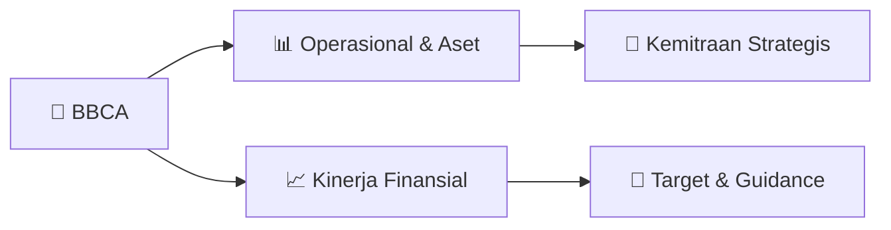

# 📊 Materi Public Expose: [BBCA]

🏢 **Emiten**: `BBCA` | 📅 **Tanggal Pelaksanaan**: `2026-08-26` | 📑 **Total Slide**: `2 Slide`
⬅️ [[knowledge-base/daily-digests/BBCA_20260826|Kembali ke Daily Digest]] | 🎛️ [[Dashboard/BBCA|Ke Dashboard Emiten]]

> [!NOTE]
> Ringkasan materi presentasi resmi Public Expose BBCA yang disampaikan oleh manajemen kepada investor dan bursa. Seluruh poin strategis, matriks operasional, dan angka kinerja diekstrak langsung dari slide deck resmi.

---

## 📅 1. Jadwal & Metadata Penyelenggaraan

| Parameter | Detail Informasi |
|---|---|
| **Nomor Surat Pengantar** | 008/CSG-IVR/2026 |
| **Perihal Pengumuman** | Rencana Penyelenggaraan Public Expose Tahunan |
| **Waktu Pelaksanaan** | 09 September 2026 16:00 |
| **Lokasi / Media** | Public Expose Live 2026 yang tercantum pada website idx.co.id |
| **Lampiran Resmi** | `0` |

## 📋 2. Agenda Paparan Publik

1. Nama Perusahaan
2. Kode Emiten
3. Lampiran
4. Perihal
5. 008/CSG-IVR/2026
6. PT Bank Central Asia Tbk.
7. Rencana Penyelenggaraan Public Expose Tahunan
8. Go To English Page
9. Perseroan melaporkan rencana Public Expose Tahunan sebagai berikut:
10. Rencana Penyelenggaraan Public Expose
11. Tahun Buku yang Berakhir pada
12. Tempat
13. : Public Expose Live 2026 yang tercantum pada website idx.co.id
14. Hari/Tanggal
15. : 09 September 2026
16. Waktu
17. 16:00
18. Agenda
19. : 1. Presentasi Perusahaan
20. 2. Konferensi Pers
21. Informasi Lain
22. Direksi yang hadir: Vera Eve Lim - Managing Director, CFO
23. Hormat Kami,
24. Demikian untuk diketahui.
25. Menara BCA, Grand Indonesia
26. Corporate Secretary
27. Nama Pengirim
28. Telepon : 021-23588000, Fax : 021-23588300, www.bca.co.id
29. PT Bank Central Asia Tbk.
30. Rudy Budiardjo
31. PT Bank Central Asia Tbk.
32. Rudy Budiardjo
33. Jabatan
34. Corporate Secretary
35. Tanggal dan Waktu
36. 26-08-2026 17:35
37. Dokumen ini merupakan dokumen resmi PT Bank Central Asia Tbk. yang tidak memerlukan tanda tangan karena
38. dihasilkan secara elektronik oleh sistem pelaporan elektronik. PT Bank Central Asia Tbk. bertanggung jawab penuh
39. atas informasi yang tertera didalam dokumen ini.
40. Issuer Name
41. Issuer Code
42. Attachment
43. Subject
44. 008/CSG-IVR/2026
45. PT Bank Central Asia Tbk.
46. General Announcement Public Expose
47. Go To Indonesian Page
48. Company announces public expose plan Annual as follows:
49. Public Expose Announcement
50. Fiscal Year
51. Place
52. : Public Expose Live 2026 yang tercantum pada website idx.co.id
53. : 09 September 2026
54. 16:00
55. Agenda
56. : 1. Company Presentation
57. 2. Press Conference
58. Other Information:
59. Board members in attendance: Vera Eve Lim - Managing Director, CFO
60. Respectfully,
61. Thus to be informed accordingly.
62. PT Bank Central Asia Tbk.
63. Rudy Budiardjo
64. Corporate Secretary
65. Rudy Budiardjo
66. Sender Name
67. PT Bank Central Asia Tbk.
68. Menara BCA, Grand Indonesia
69. Phone : 021-23588000, Fax : 021-23588300, www.bca.co.id
70. Corporate Secretary
71. Function
72. Date and Time
73. 26-08-2026 17:35
74. This is an official document of PT Bank Central Asia Tbk. that does not require a signature as it was generated
75. electronically by the electronic reporting system. PT Bank Central Asia Tbk. is fully responsible for the information

## 🏢 3. Profil & Pilar Portofolio Bisnis

## 🏗️ 4. Kinerja Operasional & Portofolio Aset

*Detail aset operasional terlampir pada dokumen slide resmi.*

## 📈 5. Kinerja Keuangan & Posisi Finansial

## 🧭 6. Inisiatif Strategis, Kolaborasi, & Kemitraan

*Strategi usaha difokuskan pada penguatan fundamental dan ekspansi operasional.*

## 🎯 7. Target Pertumbuhan & Guidance Manajemen

*Target pertumbuhan ditetapkan mengacu pada prospek industri dan kondisi makroekonomi terkini.*

## 🗺️ 8. Peta Jalur Strategis & Eksekusi

## 📑 9. Daftar Indeks Slide Presentasi

| Slide # | Judul / Topik Slide | Ringkasan Konten |
|---|---|---|
| Slide 1 | **Nomor Surat** | Nama Perusahaan Kode Emiten Lampiran |
| Slide 2 | **Letter / Announcement No.** | Issuer Name Issuer Code Attachment |

---

*Dokumen diolah otomatis oleh **Swarm Intelijen Pasar Modal Indonesia** pada 2026-10-12 16:41 WIB.*