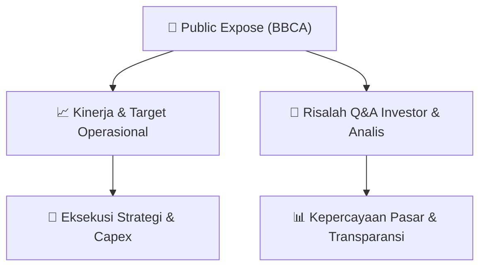

# 📢 Laporan Intelijen Paparan Publik (Public Expose) - [[BBCA]]
🏢 **Emiten**: `[[BBCA]]` | 📅 **Tanggal Pelaksanaan**: `2026-08-26` | 📑 **Dokumen**: `Public Expose`
⬅️ [[knowledge-base/daily-digests/Daily_Digest_20260826|Kembali ke Daily Digest]] | 🎛️ [[Dashboard|Ke Dashboard Utama]]

---

## 📌 1. Ringkasan Eksekutif & Paparan Direksi
> [!NOTE]
> PT Bank Central Asia Tbk (BBCA) mengumumkan rencana penyelenggaraan Public Expose Tahunan untuk tahun buku yang berakhir pada 2026. Acara akan diselenggarakan pada 09 September 2026 pukul 16:00 WIB melalui platform Public Expose Live 2026 di website idx.co.id. Agenda meliputi presentasi perusahaan dan konferensi pers. Direksi yang hadir adalah Vera Eve Lim selaku Managing Director, CFO. Pengumuman disampaikan oleh Corporate Secretary Rudy Budiardjo pada 26 Agustus 2026.

#### 🎯 Guidance Operasional & Target Strategis
- Dokumen ini hanya merupakan pengumuman rencana Public Expose dan tidak memuat rincian target kinerja, ekspansi, atau belanja modal (capex). Katalis potensial akan muncul pada saat pelaksanaan Public Expose tanggal 09 September 2026, di mana manajemen diperkirakan menyampaikan paparan kinerja dan prospek usaha.

## 📊 2. Matriks Indikator Operasional & Parameter Kunci
| Parameter Utama | Nilai / Keterangan Resmi |
| :--- | :--- |
| **Nama Perusahaan** | `PT Bank Central Asia Tbk.` |
| **Kode Emiten** | `BBCA` |
| **Nomor Surat** | `008/CSG-IVR/2026` |
| **Perihal** | `Rencana Penyelenggaraan Public Expose Tahunan` |
| **Tempat** | `Public Expose Live 2026 (website idx.co.id)` |
| **Hari/Tanggal** | `09 September 2026` |
| **Waktu** | `16:00 WIB` |
| **Agenda** | `1. Presentasi Perusahaan; 2. Konferensi Pers` |
| **Direksi yang hadir** | `Vera Eve Lim - Managing Director, CFO` |
| **Corporate Secretary** | `Rudy Budiardjo` |
| **Tanggal Pengumuman** | `26-08-2026 17:35` |

---

## 💬 3. Risalah Tanya Jawab (Q&A Session)
`Materi presentasi Public Expose / Risalah Q&A terlampir dalam dokumen resmi bursa.`

## 📌 4. Peta Jalur Strategis & Roadmap

---

## 🔗 Knowledge Graph
- [[knowledge-base/daily-digests/Daily_Digest_20260826|📄 Daily Digest 2026-08-26]]
- [[knowledge-base/calendars/Action_Calendar|🗓️ Kalender Terpusat Aksi Korporasi]]
- [[Dashboard|🎛️ Kembali ke Dashboard Utama]]