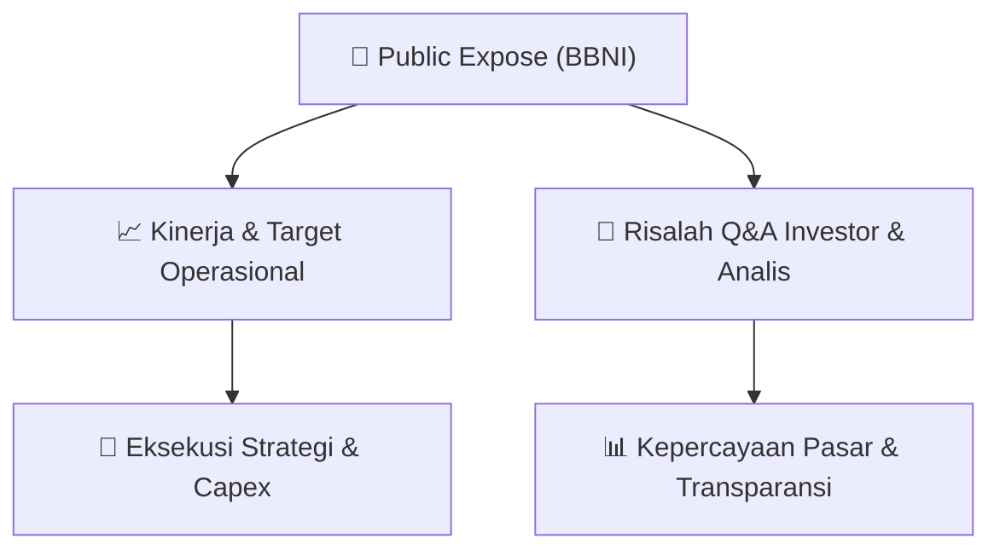

# 📢 Laporan Intelijen Paparan Publik (Public Expose) - [[BBNI]]
🏢 **Emiten**: `[[BBNI]]` | 📅 **Tanggal Pelaksanaan**: `2026-08-26` | 📑 **Dokumen**: `Public Expose`
⬅️ [[knowledge-base/daily-digests/Daily_Digest_20260826|Kembali ke Daily Digest]] | 🎛️ [[Dashboard|Ke Dashboard Utama]]

---

## 📌 1. Ringkasan Eksekutif & Paparan Direksi
> [!NOTE]
> PT Bank Negara Indonesia (Persero) Tbk (BBNI) mengumumkan rencana penyelenggaraan Public Expose Tahunan untuk Tahun Buku yang Berakhir pada 2026. Acara akan diselenggarakan pada tanggal 09 September 2026 pukul 14:00 WIB, bertempat di Public Expose Live 2026 yang tercantum pada website idx.co.id. Agenda Public Expose meliputi: (1) Laporan Kinerja Kuartal II Tahun 2026, dan (2) Prospek dan Strategi Perseroan. Pengumuman disampaikan oleh Corporate Secretary Okki Rushartomo Budiprabowo pada tanggal 26 Agustus 2026. Dokumen ini merupakan dokumen resmi elektronik yang tidak memerlukan tanda tangan.

#### 🎯 Guidance Operasional & Target Strategis
- Public Expose ini akan menjadi momen penyampaian kinerja kuartal II 2026 serta prospek dan strategi Perseroan ke depan. Namun, dalam pengumuman ini belum disampaikan target kinerja, rencana ekspansi, alokasi belanja modal (capex), atau isu pasar spesifik. Detail lebih lanjut diharapkan akan diungkapkan pada saat pelaksanaan Public Expose.

## 📊 2. Matriks Indikator Operasional & Parameter Kunci
| Parameter Utama | Nilai / Keterangan Resmi |
| :--- | :--- |
| **Nama Perusahaan** | `PT Bank Negara Indonesia (Persero) Tbk` |
| **Kode Emiten** | `BBNI` |
| **Tanggal Public Expose** | `09 September 2026` |
| **Waktu Public Expose** | `14:00 WIB` |
| **Tempat** | `Public Expose Live 2026 (website idx.co.id)` |
| **Tahun Buku** | `2026` |
| **Agenda** | `1. Laporan Kinerja Kuartal II Tahun 2026; 2. Prospek dan Strategi Perseroan` |
| **Corporate Secretary** | `Okki Rushartomo Budiprabowo` |
| **Tanggal Pengumuman** | `26 Agustus 2026` |

---

## 💬 3. Risalah Tanya Jawab (Q&A Session)
`Materi presentasi Public Expose / Risalah Q&A terlampir dalam dokumen resmi bursa.`

## 📌 4. Peta Jalur Strategis & Roadmap

---

## 🔗 Knowledge Graph
- [[knowledge-base/daily-digests/Daily_Digest_20260826|📄 Daily Digest 2026-08-26]]
- [[knowledge-base/calendars/Action_Calendar|🗓️ Kalender Terpusat Aksi Korporasi]]
- [[Dashboard|🎛️ Kembali ke Dashboard Utama]]