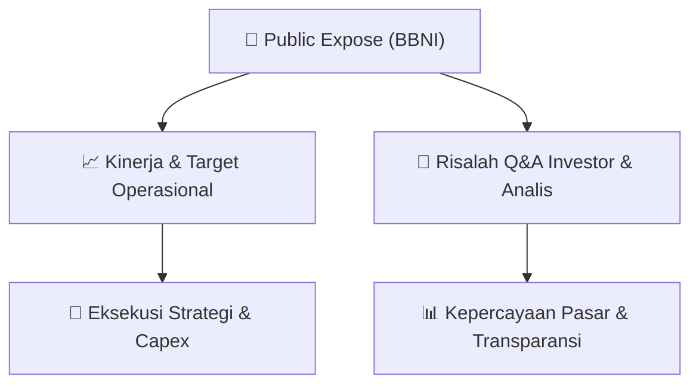

# 📢 Laporan Intelijen Paparan Publik (Public Expose) - [[BBNI]]
🏢 **Emiten**: `[[BBNI]]` | 📅 **Tanggal Pelaksanaan**: `2026-09-04` | 📑 **Dokumen**: `Public Expose`
⬅️ [[knowledge-base/daily-digests/Daily_Digest_20260904|Kembali ke Daily Digest]] | 🎛️ [[Dashboard|Ke Dashboard Utama]]

---

## 📌 1. Ringkasan Eksekutif & Paparan Direksi
> [!NOTE]
> PT Bank Negara Indonesia (Persero) Tbk (BBNI) menyampaikan materi Public Expose Tahunan melalui surat resmi No. CSE/7/8562 tertanggal 4 September 2026, merujuk pada pengumuman rencana penyelenggaraan Public Expose yang disampaikan sebelumnya melalui surat No. CSE/7/8303 tanggal 26 Agustus 2026. Dokumen ini merupakan penyampaian materi paparan publik tahunan yang akan diselenggarakan oleh BNI, ditandatangani oleh Corporate Secretary Okki Rushartomo Budiprabowo. Materi Public Expose terlampir dalam dokumen PDF terpisah (BBNI_Penyampaian Materi Public Expose 2026.pdf) yang berisi paparan kinerja dan rencana strategis perseroan. Dokumen ini bersifat administratif dan tidak memuat detail materi paparan secara langsung, melainkan hanya konfirmasi penyampaian materi resmi kepada otoritas bursa.

#### 🎯 Guidance Operasional & Target Strategis
- Dokumen ini tidak memuat rincian target kinerja, ekspansi, atau capex secara eksplisit karena hanya merupakan surat pengantar penyampaian materi Public Expose. Informasi katalis dan guidance operasional BBNI akan tersedia dalam lampiran materi Public Expose (file PDF terpisah) yang disampaikan kepada Bursa Efek Indonesia. Namun, penyelenggaraan Public Expose Tahunan ini sendiri merupakan katalis informasi bagi investor untuk mendapatkan pemaparan langsung mengenai kinerja keuangan, strategi bisnis, dan prospek BBNI ke depan dari manajemen.

## 📊 2. Matriks Indikator Operasional & Parameter Kunci
| Parameter Utama | Nilai / Keterangan Resmi |
| :--- | :--- |
| **Nomor Surat** | `CSE/7/8562` |
| **Tanggal Penyampaian** | `4 September 2026` |
| **Jenis Kegiatan** | `Public Expose Tahunan` |
| **Rujukan Surat Sebelumnya** | `No. CSE/7/8303 tanggal 26 Agustus 2026` |
| **Corporate Secretary** | `Okki Rushartomo Budiprabowo` |
| **Alamat Kantor Pusat** | `Grha BNI Lantai 24, Jl. Jenderal Sudirman Kavling 1, Jakarta Pusat 10220` |
| **Kontak** | `Tel: 021-2511946, 021-5728387; Fax: 021-2511961; www.bni.co.id` |
| **Lampiran** | `BBNI_Penyampaian Materi Public Expose 2026.pdf` |

---

## 💬 3. Risalah Tanya Jawab (Q&A Session)
### ❓ Pertanyaan 1 (Tidak tersedia dalam dokumen)
**Pertanyaan**: Dokumen ini tidak memuat sesi tanya jawab karena hanya merupakan surat pengantar penyampaian materi Public Expose kepada Bursa Efek Indonesia. Sesi Q&A akan berlangsung pada saat acara Public Expose Tahunan diselenggarakan.

**Jawaban Manajemen**: Tidak tersedia dalam dokumen. Manajemen BBNI akan memberikan jawaban langsung pada saat acara Public Expose Tahunan berlangsung.

> [!TIP]
> **Implikasi Bagi Investor**: Investor diharapkan menunggu pelaksanaan Public Expose Tahunan untuk mendapatkan informasi detail mengenai kinerja dan prospek BBNI, serta kesempatan bertanya langsung kepada manajemen.

## 📌 4. Peta Jalur Strategis & Roadmap

---

## 🔗 Knowledge Graph
- [[knowledge-base/daily-digests/Daily_Digest_20260904|📄 Daily Digest 2026-09-04]]
- [[knowledge-base/calendars/Action_Calendar|🗓️ Kalender Terpusat Aksi Korporasi]]
- [[Dashboard|🎛️ Kembali ke Dashboard Utama]]