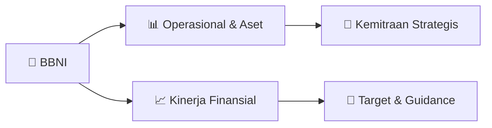

# 📊 Materi Public Expose: [BBNI]

🏢 **Emiten**: `BBNI` | 📅 **Tanggal Pelaksanaan**: `2026-09-04` | 📑 **Total Slide**: `2 Slide`
⬅️ [[knowledge-base/daily-digests/BBNI_20260904|Kembali ke Daily Digest]] | 🎛️ [[Dashboard/BBNI|Ke Dashboard Emiten]]

> [!NOTE]
> Ringkasan materi presentasi resmi Public Expose BBNI yang disampaikan oleh manajemen kepada investor dan bursa. Seluruh poin strategis, matriks operasional, dan angka kinerja diekstrak langsung dari slide deck resmi.

---

## 📅 1. Jadwal & Metadata Penyelenggaraan

| Parameter | Detail Informasi |
|---|---|
| **Nomor Surat Pengantar** | CSE/7/8562 |
| **Perihal Pengumuman** | Penyampaian Materi Public Expose Tahunan |
| **Waktu Pelaksanaan** | 2026-09-04 04-09-2026 12:44 |
| **Lokasi / Media** | Aplikasi Zoom / Daring |
| **Lampiran Resmi** | `1` |

## 📋 2. Agenda Paparan Publik

- Pemaparan Profil & Struktur Bisnis Perseroan
- Kinerja Operasional & Keuangan
- Arah Strategi Usaha & Target Pertumbuhan
- Sesi Tanya Jawab (Q&A)

## 🏢 3. Profil & Pilar Portofolio Bisnis

## 🏗️ 4. Kinerja Operasional & Portofolio Aset

*Detail aset operasional terlampir pada dokumen slide resmi.*

## 📈 5. Kinerja Keuangan & Posisi Finansial

## 🧭 6. Inisiatif Strategis, Kolaborasi, & Kemitraan

- Letter / Announcement No.
Issuer Name Issuer Code Attachment Subject CSE/7/8562
PT Bank Negara Indonesia (Persero) Tbk
BBNI
Public Expose Material Submission
Go To Indonesian Page
Public Expose Material Submission
Reffering to Company's public expose announcement Annual in Letter No. CSE/7/8303
date 26 August 2026 Company submitted public expose material as attached.
Respectfully,
Thus to be informed accordingly.
PT Bank Negara Indonesia (Persero) Tbk
Okki Rushartomo Budiprabowo
Corporate Secretary
Okki Rushartomo Budiprabowo
Sender Name
PT Bank Negara Indonesia (Persero) Tbk
Grha BNI Lantai 24 Jl. Jenderal Sudirman Kavling 1 Jakarta Pusat 10220
Phone : 021-2511946, 021-5728387, Fax : 021-2511961, www.bni.co.id
Corporate Secretary Function
Date and Time
04-09-2026 12:44 Attachment
1. BBNI_Penyampaian Materi Public Expose 2026.pdf
This is an official document of PT Bank Negara Indonesia (Persero) Tbk that does not require a signature as it was
generated electronically by the electronic reporting system. PT Bank Negara Indonesia (Persero) Tbk is fully

## 🎯 7. Target Pertumbuhan & Guidance Manajemen

*Target pertumbuhan ditetapkan mengacu pada prospek industri dan kondisi makroekonomi terkini.*

## 🗺️ 8. Peta Jalur Strategis & Eksekusi

## 📑 9. Daftar Indeks Slide Presentasi

| Slide # | Judul / Topik Slide | Ringkasan Konten |
|---|---|---|
| Slide 1 | **Nomor Surat** | Nama Perusahaan Kode Emiten Lampiran |
| Slide 2 | **Letter / Announcement No.** | Issuer Name Issuer Code Attachment |

---

*Dokumen diolah otomatis oleh **Swarm Intelijen Pasar Modal Indonesia** pada 2026-10-12 16:41 WIB.*