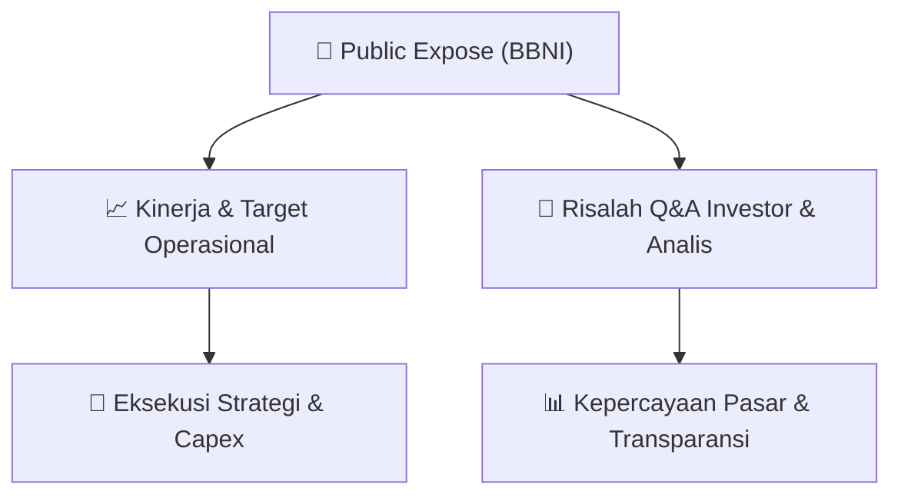

# 📢 Laporan Intelijen Paparan Publik (Public Expose) - [[BBNI]]
🏢 **Emiten**: `[[BBNI]]` | 📅 **Tanggal Pelaksanaan**: `2026-09-14` | 📑 **Dokumen**: `Public Expose`
⬅️ [[knowledge-base/daily-digests/Daily_Digest_20260914|Kembali ke Daily Digest]] | 🎛️ [[Dashboard|Ke Dashboard Utama]]

---

## 📌 1. Ringkasan Eksekutif & Paparan Direksi
> [!NOTE]
> PT Bank Negara Indonesia (Persero) Tbk (BBNI) menyelenggarakan Public Expose Tahunan pada tanggal 04 September 2026, dengan laporan hasil disampaikan pada 14 September 2026. Acara dihadiri oleh 85 peserta (tidak termasuk manajemen dan karyawan). Paparan ini merupakan agenda tahunan untuk mengkomunikasikan kinerja, strategi, dan rencana perseroan kepada investor dan analis. Dokumen yang tersedia hanya memuat laporan administratif pelaksanaan acara, tanpa detail materi paparan atau Q&A yang disampaikan dalam acara tersebut.

#### 🎯 Guidance Operasional & Target Strategis
- Tidak tersedia dalam dokumen. Dokumen hanya berisi konfirmasi pelaksanaan Public Expose Tahunan dan jumlah peserta, tanpa mengungkapkan target kinerja, rencana ekspansi, atau belanja modal (capex) BBNI untuk periode mendatang.

## 📊 2. Matriks Indikator Operasional & Parameter Kunci
| Parameter Utama | Nilai / Keterangan Resmi |
| :--- | :--- |
| **Tanggal Pelaksanaan Public Expose** | `04 September 2026` |
| **Tanggal Pelaporan Hasil** | `14 September 2026` |
| **Jumlah Peserta Hadir** | `85 orang (tidak termasuk manajemen dan karyawan)` |
| **Jenis Acara** | `Public Expose Tahunan` |
| **Narahubung** | `Okki Rushartomo Budiprabowo (Corporate Secretary)` |

---

## 💬 3. Risalah Tanya Jawab (Q&A Session)
### ❓ Pertanyaan 1 (Tidak tersedia)
**Pertanyaan**: Tidak ada pertanyaan yang tercantum dalam dokumen. Dokumen hanya berisi laporan administratif pelaksanaan acara tanpa transkrip sesi tanya jawab.

**Jawaban Manajemen**: Tidak tersedia. Manajemen tidak memberikan jawaban yang terdokumentasi dalam laporan ini.

> [!TIP]
> **Implikasi Bagi Investor**: Investor tidak dapat memperoleh wawasan tambahan dari sesi Q&A karena detail tidak diungkapkan dalam dokumen publik ini. Perlu merujuk pada materi paparan resmi atau siaran pers terpisah untuk informasi lebih lanjut.

## 📌 4. Peta Jalur Strategis & Roadmap

---

## 🔗 Knowledge Graph
- [[knowledge-base/daily-digests/Daily_Digest_20260914|📄 Daily Digest 2026-09-14]]
- [[knowledge-base/calendars/Action_Calendar|🗓️ Kalender Terpusat Aksi Korporasi]]
- [[Dashboard|🎛️ Kembali ke Dashboard Utama]]