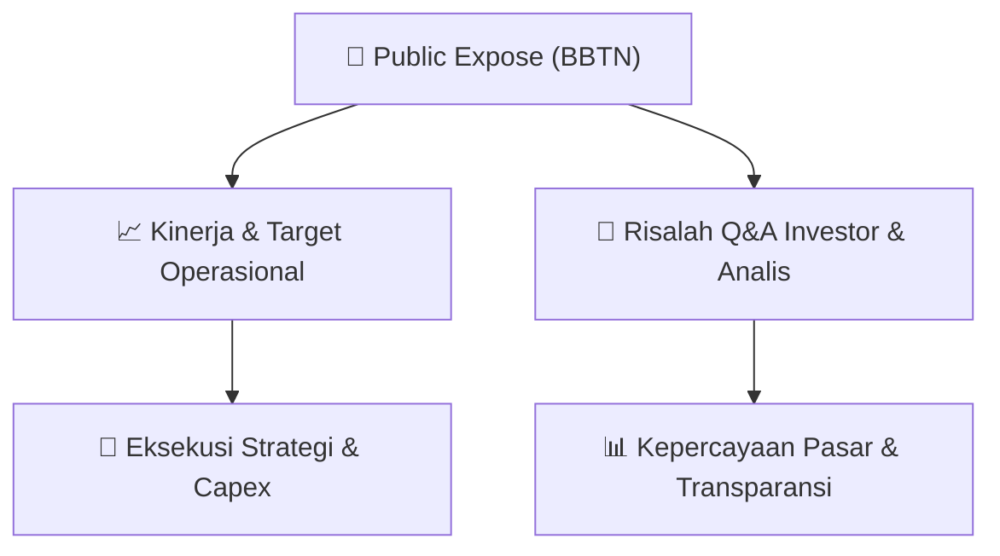

# 📢 Laporan Intelijen Paparan Publik (Public Expose) - [[BBTN]]
🏢 **Emiten**: `[[BBTN]]` | 📅 **Tanggal Pelaksanaan**: `2026-08-27` | 📑 **Dokumen**: `Public Expose`
⬅️ [[knowledge-base/daily-digests/Daily_Digest_20260827|Kembali ke Daily Digest]] | 🎛️ [[Dashboard|Ke Dashboard Utama]]

---

## 📌 1. Ringkasan Eksekutif & Paparan Direksi
> [!NOTE]
> PT Bank Tabungan Negara (Persero) Tbk (BBTN) menyampaikan rencana penyelenggaraan Public Expose Tahunan untuk tahun buku 2026. Acara akan dilaksanakan pada 10 September 2026 pukul 09:00 melalui platform Public Expose Live 2026 yang tercantum di website idx.co.id. Agenda terdiri dari presentasi/pemaparan kinerja perseroan dan press conference. Pengumuman disampaikan oleh Corporate Secretary Division Head Ramon Armando pada 27 Agustus 2026.

#### 🎯 Guidance Operasional & Target Strategis
- Tidak terdapat rincian target kinerja, ekspansi, capex, atau guidance operasional dalam dokumen ini karena hanya merupakan pengumuman rencana Public Expose.

## 📊 2. Matriks Indikator Operasional & Parameter Kunci
| Parameter Utama | Nilai / Keterangan Resmi |
| :--- | :--- |
| **Tanggal Public Expose Tahunan** | `10 September 2026` |
| **Waktu Public Expose** | `09:00` |
| **Tempat/Platform** | `Public Expose Live 2026 di website idx.co.id` |
| **Agenda** | `Presentasi/Pemaparan Kinerja Perseroan dan Press Conference` |
| **Tahun Buku** | `2026` |

---

## 💬 3. Risalah Tanya Jawab (Q&A Session)
`Materi presentasi Public Expose / Risalah Q&A terlampir dalam dokumen resmi bursa.`

## 📌 4. Peta Jalur Strategis & Roadmap

---

## 🔗 Knowledge Graph
- [[knowledge-base/daily-digests/Daily_Digest_20260827|📄 Daily Digest 2026-08-27]]
- [[knowledge-base/calendars/Action_Calendar|🗓️ Kalender Terpusat Aksi Korporasi]]
- [[Dashboard|🎛️ Kembali ke Dashboard Utama]]