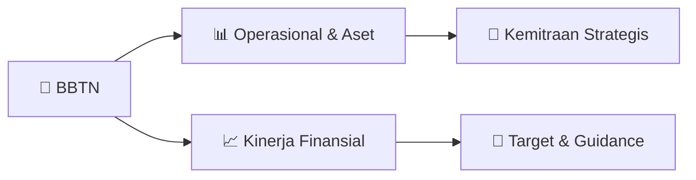

# 📊 Materi Public Expose: [BBTN]

🏢 **Emiten**: `BBTN` | 📅 **Tanggal Pelaksanaan**: `2026-09-07` | 📑 **Total Slide**: `23 Slide`
⬅️ [[knowledge-base/daily-digests/BBTN_20260907|Kembali ke Daily Digest]] | 🎛️ [[Dashboard/BBTN|Ke Dashboard Emiten]]

> [!NOTE]
> Ringkasan materi presentasi resmi Public Expose BBTN yang disampaikan oleh manajemen kepada investor dan bursa. Seluruh poin strategis, matriks operasional, dan angka kinerja diekstrak langsung dari slide deck resmi.

---

## 📅 1. Jadwal & Metadata Penyelenggaraan

| Parameter | Detail Informasi |
|---|---|
| **Nomor Surat Pengantar** | 1874/CSD/CMPO/IX/2026 |
| **Perihal Pengumuman** | Penyampaian Materi Public Expose Tahunan |
| **Waktu Pelaksanaan** | 2026-09-07 07-09-2026 19:17 |
| **Lokasi / Media** | Aplikasi Zoom / Daring |
| **Lampiran Resmi** | `2` |

## 📋 2. Agenda Paparan Publik

- Pemaparan Profil & Struktur Bisnis Perseroan
- Kinerja Operasional & Keuangan
- Arah Strategi Usaha & Target Pertumbuhan
- Sesi Tanya Jawab (Q&A)

## 🏢 3. Profil & Pilar Portofolio Bisnis

## 🏗️ 4. Kinerja Operasional & Portofolio Aset

> Mempercepat Ekspansi
Bisnis Melalui Inisiatif Baru di Tahun 2026
Memperkuat Ekosistem
Digital Melalui Kemitraan
Bancassurance
sebagai Sumber Pendapatan
Baru Ekspansi Ekosistem Berskala Besar Mendorong Pertumbuhan
Bisnis Non - Perumahan
Fokus pada segmen dengan potensi pertumbuhan yang lebih besar untuk menggarap dana murah . ▪ Mengembangkan kemitraan eksklusif bancassurance di kantor cabang
untuk memperkuat cross - selling dan
meningkatkan
pendapatan non bunga .
▪
Mendorong produktivitas cabang serta
membangun sumber pendapatan
non - bunga yang lebih berkelanjutan .
▪ Mendukung pertumbuhan wealth management yang saling menguntungkan dan optimalisasi
kemitraan jangka panjang .
Memperluas ekosistem balé by BTN melalui
kolaborasi dengan destinasi populer untuk
meningkatkan transaksi , interaksi , dan engagement nasabah . ▪Akuisisi portofolio kredit secara selektif untuk mempercepat
pertumbuhan kredit bermargin tinggi
dan diversifikasi portofolio . ▪Mendorong porsi kredit non -
perumahan menjadi ~ 30 % pada
2030 , dengan tetap menjaga kualitas aset dan risiko yang berlandaskan
prinsip kehati - hatian .
Bundling & Cross Selling
Memperkuat bundling dan
cross - selling
produk KPR, KAR, da

> Efisiensi Biaya Operasional per Bulan
Memperkuat Aktivitas Penagihan
melalui Pendekatan Berbasis Klaster Aktivitas Penagihan Menggunakan Pendekatan Berbasis Klaster
▪Berhasil meluncurkan 96
klaster untuk aktivitas
penagihan berdasarkan
wilayah dan beban kerja .
▪Meningkatkan penagihan serta menurunkan formasi
NPL dengan mengelola
sumber daya .
Meningkatkan efisiensi aktivitas penagihan melalui pendekatan klaster untuk
mengoptimalkan
efektivitas operasional .
Progres Implementasi Penagihan Berbasis Klaster
Visit Rate Meningkat di Berbagai Wilayah
Implementasi secara Nasional
Penerapan aktivitas penagihan secara
nasional telah diluncurkan tanggal 10
April 2026 untuk mendukung
penurunan
NPL dan meningkatkan
produktivitas penagihan .
Mendorong Kinerja Penagihan
melalui Kerja Sama
dan Inovasi Digital
Memberikan harga kompetitif bagi
nasabah yang mencari rumah lelang
melalui fitur balé Lelang yang dapat
diakses menggunakan aplikasi balé
by BTN .
2,99 % NPL Gross 33 bps yoy Meningkatkan Kredit Lancar Meningkatkan aktivitas
penagihan sehingga terdapat
perbaikan kualitas menjadi kredit
lancar 46,0 %
Rp 3,8 Miliar
Rp 3,2 Miliar
(Sebelum ) (Sesudah )
Meningkat produktivitas di area:
15,4 % 95

> Guidance
BTN Tahun 2026 - Konsolidasi
Pertumbuhan
Kredit & Pembiayaan
Pertumbuhan DPK
Rasio Cost of Credit (CoC )
Rasio NPL Gross
1H26 11,2% 6,6 % 0,7 % 3,0 % Proyeksi
8 - 10%
7 - 9%
1,0 – 1,2%
<3,0 %

> Kinerja Keuangan 2023 2024 2025
Jun - 25
Jun - 26
Pertumbuhan yoy (%) Aset/ Liabilitas
Total Aset (Rp Miliar)
438.750 469.615 527.793 484.962 545.161 12,4% yoy
Total Kredit & Pembiayaan
(Rp Miliar) 333.698 357.973 400.576 376.110 418.111 11,2% yoy
Total DPK (Rp Miliar)
349.933 381.667 437.398 406.383 433.002 6,6% yoy Profitabilitas
Laba Bersih (Rp Miliar)
3.501
3.007
3.501
1.706
2.402
40,8% yoy
N I M
3,8% 2,9% 4,2% 4,4% 3,5% (85) bps
C I R
45,3% 57,1% 49,3% 43,8% 50,5% 672 bps
RoE (Tier -1)
13,9% 10,8% 11,7% 11,8% 13,3% 152 bps
RoRWA – setelah pajak
2,4% 1,8% 1,9% 1,9% 2,5% bps
RoA ( Return on Asset
) 1,1% 0,8% 0,9% 0,9% 1,1% bps Kualitas Aset
NPL ( Gross )
3,0% 3,2% 3,1% 3,3% 3,0% (33) bps
Loan at Risk
(LAR) 21,1% 19,7% 19,4% 20,2% 18,6% (147) bps NPL Coverage 155,2% 115,4% 123,9% 115,0% 121,7% 665 bps
Cost of Credit
(CoC) 1,2% 0,6% 1,6% 2,0% 0,7% (131) bps Likuiditas LDR 95,4% 93,8% 91,6% 92,6% 96,6% 401 bps LFR 83,2% 83,2% 82,5% 84,5% 83,5% (101) bps CASA 53,7% 54,1% 48,7% 49,1% 49,1% bps Permodalan
CAR (Tier 1)
17,5% 17,1% 18,7% 16,2% 18,0% 183 bps Total CAR 20,1% 18,5% 20,9% 17,5% 20,0% 254 bps Kinerja Keuangan
- Konsolidasi

> Kinerja Keuangan (per 1H26) Mendorong Pengembangan Ekonomi Syariah Melalui Digitalisasi
Bank Syariah Nasional :
Akselerasi Pertumbuhan Bisnis sebagai Penggerak Utama
dalam
Mendorong Kemajuan Ekonomi Syariah dan
Memperkuat Ekosistem Syariah Nasional
Rp 78,8 T
Total Aset
Rp 59,6 T
Total Pembiayaan 4,0 %
NIM ( eqv .)
0,9 % CoC 35,7 % CAR 96,7 % FDR 60,9 % CASA 2,7 % NPF (Gross)
Rp 61,6 T
Total DPK 205 Ribu Akuisisi Nasabah
Rp 4,0 T
Nominal Transaksi 1,7 Jt Total Transaksi Memperluas Jangkauan Melalui Pengembangan Produk Perkembangan kinerja  Bale Syariah sejak diluncurkan
pada Des -25
Memperkuat Sinergi dengan PP Muhammadiyah
▪ BSN resmi menjalin kerja sama dengan PP Muhammadiyah,
salah satu organisasi Islam terbesar di
Indonesia . ▪ BSN menyediakan
layanan keuangan terintegrasi di
seluruh jaringan Muhammadiyah yang mencakup
universitas, rumah sakit , dan bisnis turunannya .
Mendorong Pertumbuhan Bisnis Emas ▪ Memperkuat basis nasabah dan meningkatkan engagement dengan menyediakan produk emas
melalui kerja sama .
▪
Layanan tersebut mencakup tabungan emas , pembelian
emas , dan penjualan emas sehingga memberikan akses
yang lebih mudah terhadap produk investasi emas .
Fokus Utama Kolabo

## 📈 5. Kinerja Keuangan & Posisi Finansial

### 📊 Ringkasan Finansial
```text
Kinerja Keuangan BTN Group
```

### 📊 Ringkasan Finansial
```text
Kinerja Keuangan
BTN dari 2022 - 1H26
Return on Asset
(%) 1,0 1,1 0,8 0,9 0,9 1,1 12M22 12M23 12M24 12M25 1H25 1H26 +24 bps Laba Bersih (Rp T)
Kredit & Pembiayaan
(Rp T)
Dana Pihak Ketiga
(Rp T)
Capital Adequacy Ratio
(%) 298 334 358 400 376 418 Des-22 Des-23 Des-24 Des-25 Jun-25 Jun-26 +11,2% 322 350 382 437 406 433 Des-22 Des-23 Des-24 Des-25 Jun-25 Jun-26 +6,6% 3,0 3,5 3,0 3,5 1,7 2,4 12M22 12M23 12M24 12M25 1H25 1H26
+ 40, 8%
20,2 20,1 18,5 20,9 17,5 20,0 Des-22 Des-23 Des-24 Des-25 Jun-25 Jun-26
+ 254 bps
NPL Gross (%) 3,4 3,0 3,2 3,1 3,3 3,0 Des-22 Des-23 Des-24 Des-25 Jun-25 Jun-26
- 33 bps
```

## 🧭 6. Inisiatif Strategis, Kolaborasi, & Kemitraan

- Inisiatif ESG
Bank pertama yang
mendapat Rating
"AA" ESG MSCI
Program “Bayar Angsuranmu pakai sampahmu ” Pengembangan “Rumah rendah Emisi ” Penerbitan obligasi berwawasan sosial
pertama dengan total
Rp300 M Mendorong Pertumbuhan melalui Pendekatan
Bisnis Berbasis Ekosistem
Ekspansi Beyond Mortgage
Fokus pada Segmen dengan Potensi
Pertumbuhan
yang Lebih Besar
Ekosistem Digital yang Terintegrasi Membangun kemitraan institusional untuk mengoptimalkan bisnis pada ekosistem terkait Wi sa ta & H ib ur an Int itu si Ke ua ng a n Le mb ag a Ke se h at a n Pe me ri nt ah an Pe nd id ik an Ekosistem Terintegrasi &
Solusi Gaya Hidup
4,3 jt Pengguna bale Rite l 25,7 rb Pengguna bale korpora Sales Center >344 rb merchant digital stores >11.000 developer Kerjasama dengan Pemda ~439 rb Rekening payroll Transformasi sistem core banking
Memperluas dan mendiversifikasi
portfolio kredit ke ekosistem non -
perumahan Mendukung pertumbuhan UMKM melalui KPP (Kredit Program Perumahan ) Meningkatkan
akuisisi CASA untuk
mendukung pertumbuhan pendanaan
yang berkelanjutan Memperkuat segmentasi nasabah
ritel untuk meningkatkan
efektivitas penetrasi pasar Memperluas
basis nasabah Middle
Institution untuk mendukung
optimalisasi biaya dana

- Pendekatan Bisnis Berbasis Ekosistem yang Selektif Memperluas Ekosistem Kemitraan dengan Pemerintah Daerah Menjangkau Ekosistem Kesehatan Memanfaatkan Ekosistem Pendidikan
Membuka Peluang di Sektor Pariwisata
▪ BTN memperkuat kerja sama strategis melalui
kolaborasi dengan Pemerintah Daerah (Pemda ) dan
Pemerintah Provinsi (Pemprov ) untuk mendukung
pengembangan
daerah dan memperluas peran BTN
sebagai bank ritel yang komprehensif
. ▪
Pada bulan Juni 2026 , BTN telah bekerjasama dengan
59 Pemerintah Daerah di seluruh Indonesia (Pemkab
Samosir , Pemkab Minahasa Utara, Pemkot Palu, dan
Pemprov Gorontalo) .
▪
Mengelola akun pemerintah daerah dan layanan
treasury , menyediakan
KPR dan kredit konsumer
untuk ASN , layanan payroll , dan solusi finansial
lainnya . ▪
Mendorong kerja sama dengan ekosistem pendidikan
melalui kolaborasi dengan 57 universitas, seperti USU,
UNNES, dan UNESA .
▪ Menyediakan
layanan keuangan yang komprehensif
untuk ekosistem
pendidikan , yang mencakup institusi ,
dosen , tenaga pendidikan , serta mahasiswa .
▪ Memperluas
kolaborasi ke berbagai area strategis ,
seperti perkembangan
sumber daya manusia , riset , dan
berbagai program lainnya .
▪Memperluas jangkauan ke ekosistem kesehatan melalui
kerja sama dengan 26 rumah sakit , seperti RS Fatmawati ,
RS Wahidin Sudirohusodo
, dan RSUD Batanghari .
▪Melalui kolaborasi ini, BTN memberikan layanan finansial
khusus dan nilai tambahan melalui balé Korpora dengan
menghadirkan Healthcare Dashboard
yang interaktif ,
me

## 🎯 7. Target Pertumbuhan & Guidance Manajemen

*Target pertumbuhan ditetapkan mengacu pada prospek industri dan kondisi makroekonomi terkini.*

## 🗺️ 8. Peta Jalur Strategis & Eksekusi



## 📑 9. Daftar Indeks Slide Presentasi

| Slide # | Judul / Topik Slide | Ringkasan Konten |
|---|---|---|
| Slide 1 | **PT Bank Tabungan Negara (Persero) Tbk** | . Public Expose Live 2026 |
| Slide 2 | **Makroekonomi** | & Ikhtisar Kinerja |
| Slide 3 | **71,5 130,2** | 130,2 197,7 254,5 |
| Slide 4 | **Inisiatif ESG** | Bank pertama yang mendapat Rating "AA" ESG MSCI |
| Slide 5 | **Mempercepat** | Ekspansi Bisnis Melalui Inisiatif Baru di Tahun 2026 5 |
| Slide 6 | **Pertumbuhan** | Organik Secara Selektif Melalui Akusisi Portfolio Kredit 6 Tahapan Pelaksanaan |
| Slide 7 | **7 Pendekatan** | Pendekatan Bisnis Berbasis Ekosistem |
| Slide 8 | **2,26 2,19** | 2,19 2,14 2,19 |
| Slide 9 | **4,13%** | 4,15% 4,15% 4,10% 4,06% |
| Slide 10 | **Efisiensi Biaya Dana Seiring Dengan** | Penurunan Biaya DPK 10 Giro |
| Slide 11 | **341,9** | 1.236,6 2.216,3 931,5 |
| Slide 12 | **Sesudah** | 1 Sentralisasi 2 |
| Slide 13 | **8,7% 8,0%** | 8,0% 6,5% 6,5% |
| Slide 14 | **Efisiensi Biaya Operasional per Bulan** | Memperkuat Aktivitas Penagihan melalui Pendekatan Berbasis |
| Slide 15 | **15 Guidance** | Guidance BTN Tahun 2026 - Konsolidasi Pertumbuhan |
| Slide 16 | **Kinerja Keuangan** | BTN Group |
| Slide 17 | **Kinerja Keuangan** | BTN dari 2022 - 1H26 17 Return on Asset |
| Slide 18 | **Kinerja Keuangan** | 2023 2024 2025 |
| Slide 19 | **333,7** | 358,0 400,6 376,1 |
| Slide 20 | **53,7%** | 54,1% 48,7% 49,1% |
| Slide 21 | **Laba Rugi (Rp Miliar)** | 2Q25 1Q26 2Q26 |
| Slide 22 | **22 Kinerja Keuangan** | Kinerja Keuangan (per 1H26) Mendorong Pengembangan |
| Slide 23 | **Investor Relations** | PT Bank Tabungan Negara (Persero) Tbk. Menara BTN 16th Floor Jl. Gajah Mada No. 1 |

---

*Dokumen diolah otomatis oleh **Swarm Intelijen Pasar Modal Indonesia** pada 2026-10-12 16:42 WIB.*