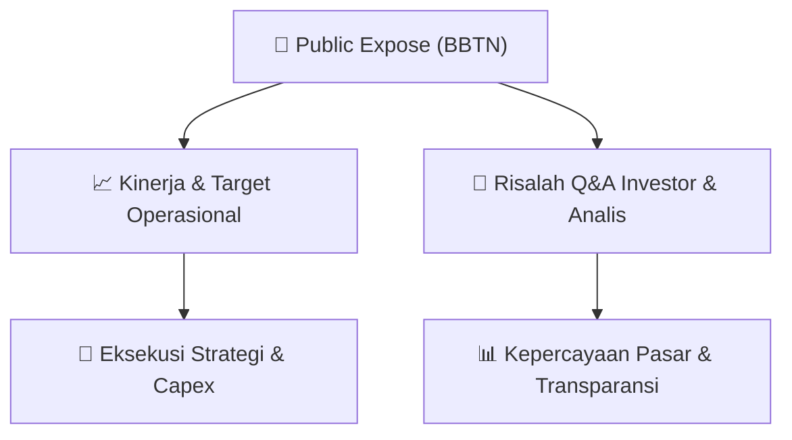

# 📢 Laporan Intelijen Paparan Publik (Public Expose) - [[BBTN]]
🏢 **Emiten**: `[[BBTN]]` | 📅 **Tanggal Pelaksanaan**: `2026-09-15` | 📑 **Dokumen**: `Public Expose`
⬅️ [[knowledge-base/daily-digests/Daily_Digest_20260915|Kembali ke Daily Digest]] | 🎛️ [[Dashboard|Ke Dashboard Utama]]

---

## 📌 1. Ringkasan Eksekutif & Paparan Direksi
> [!NOTE]
> PT Bank Tabungan Negara (Persero) Tbk (BBTN) menyelenggarakan Public Expose Tahunan pada 07 September 2026, dengan laporan hasil disampaikan pada 15 September 2026. Acara dihadiri oleh 189 peserta (tidak termasuk manajemen dan karyawan). Paparan ini merupakan bagian dari kepatuhan keterbukaan informasi kepada publik dan investor, dengan fokus pada kinerja tahunan, strategi bisnis, serta prospek ke depan. Dokumen yang disampaikan mencakup laporan hasil public expose yang merujuk pada materi yang telah dikirim sebelumnya. Emiten menegaskan komitmennya terhadap transparansi dan tata kelola perusahaan yang baik melalui penyelenggaraan acara ini.

#### 🎯 Guidance Operasional & Target Strategis
- Dokumen yang tersedia hanya berisi pengumuman administratif mengenai penyelenggaraan dan hasil Public Expose Tahunan, tanpa memuat rincian target kinerja, ekspansi, atau capex secara spesifik. Informasi mengenai katalis dan guidance operasional tidak tersedia dalam teks yang diberikan. Investor disarankan untuk merujuk pada lampiran dokumen 'BBTN_Laporan Public Expose 2026.pdf' yang disebutkan dalam pengumuman untuk mendapatkan detail lengkap mengenai strategi dan target perusahaan.

## 📊 2. Matriks Indikator Operasional & Parameter Kunci
| Parameter Utama | Nilai / Keterangan Resmi |
| :--- | :--- |
| **Tanggal Penyelenggaraan Public Expose** | `07 September 2026` |
| **Tanggal Pelaporan Hasil Public Expose** | `15 September 2026` |
| **Jumlah Peserta Public Expose** | `189 orang (tidak termasuk manajemen dan karyawan)` |
| **Nomor Surat Pengumuman** | `1942/CSD/CMPO/IX/2026` |
| **Nomor Surat Materi Public Expose** | `1874/CSD/CMPO/IX/2026` |
| **Nama Pejabat Penandatangan** | `Ramon Armando (Corporate Secretary Division Head)` |

---

## 💬 3. Risalah Tanya Jawab (Q&A Session)
### ❓ Pertanyaan 1 (Tidak tersedia dalam dokumen)
**Pertanyaan**: Tidak tersedia dalam dokumen

**Jawaban Manajemen**: Tidak tersedia dalam dokumen

> [!TIP]
> **Implikasi Bagi Investor**: Dokumen yang diberikan hanya berisi pengumuman administratif dan tidak memuat sesi tanya jawab. Investor perlu mengakses lampiran laporan public expose untuk mendapatkan informasi Q&A.

## 📌 4. Peta Jalur Strategis & Roadmap

---

## 🔗 Knowledge Graph
- [[knowledge-base/daily-digests/Daily_Digest_20260915|📄 Daily Digest 2026-09-15]]
- [[knowledge-base/calendars/Action_Calendar|🗓️ Kalender Terpusat Aksi Korporasi]]
- [[Dashboard|🎛️ Kembali ke Dashboard Utama]]