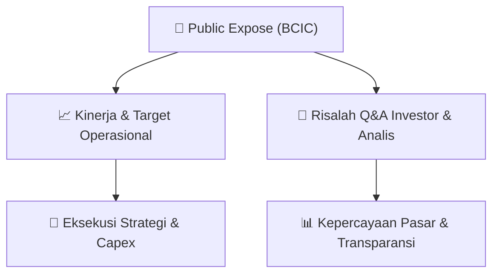

# 📢 Laporan Intelijen Paparan Publik (Public Expose) - [[BCIC]]
🏢 **Emiten**: `[[BCIC]]` | 📅 **Tanggal Pelaksanaan**: `2026-09-16` | 📑 **Dokumen**: `Public Expose`
⬅️ [[knowledge-base/daily-digests/Daily_Digest_20260916|Kembali ke Daily Digest]] | 🎛️ [[Dashboard|Ke Dashboard Utama]]

---

## 📌 1. Ringkasan Eksekutif & Paparan Direksi
> [!NOTE]
> PT Bank JTrust Indonesia Tbk. (BCIC) mengumumkan rencana penyelenggaraan Public Expose Tahunan untuk Tahun Buku 2025 yang akan dilaksanakan secara virtual melalui Zoom Meeting pada tanggal 30 September 2026 pukul 10:00 WIB. Acara ini akan membahas paparan kinerja perseroan dan informasi lainnya. Pendaftaran peserta dibuka hingga 29 September 2026 pukul 17.00 WIB melalui tautan Google Forms yang disediakan. Public Expose akan dihadiri oleh Direktur yang membawahi fungsi keuangan serta kepatuhan, dan materi paparan akan dibagikan maksimal 3 hari bursa sebelum acara.

#### 🎯 Guidance Operasional & Target Strategis
- Dokumen ini merupakan pengumuman rencana Public Expose Tahunan, sehingga belum memuat target kinerja, ekspansi, atau capex spesifik. Informasi tersebut akan dipaparkan pada saat acara berlangsung pada 30 September 2026. Katalis yang dapat diantisipasi investor adalah paparan kinerja Tahun Buku 2025 dan potensi informasi strategis lainnya yang akan disampaikan manajemen dalam acara tersebut.

## 📊 2. Matriks Indikator Operasional & Parameter Kunci
| Parameter Utama | Nilai / Keterangan Resmi |
| :--- | :--- |
| **Tanggal Penyelenggaraan Public Expose** | `30 September 2026, pukul 10:00 WIB` |
| **Tahun Buku yang Dipaparkan** | `Tahun Buku 2025` |
| **Metode Pelaksanaan** | `Zoom Meeting (Virtual)` |
| **Batas Akhir Pendaftaran** | `29 September 2026, pukul 17.00 WIB` |
| **Pihak yang Menghadiri** | `Direktur yang membawahi fungsi keuangan serta kepatuhan` |
| **Agenda Acara** | `Paparan Kinerja Perseroan dan Informasi Lain` |
| **Tanggal Pengumuman** | `16 September 2026` |

---

## 💬 3. Risalah Tanya Jawab (Q&A Session)
### ❓ Pertanyaan 1 (Belum tersedia (dokumen pengumuman, bukan risalah acara))
**Pertanyaan**: Belum tersedia - dokumen ini hanya mengumumkan rencana acara, belum memuat sesi tanya jawab.

**Jawaban Manajemen**: Belum tersedia - sesi tanya jawab akan berlangsung pada saat Public Expose tanggal 30 September 2026.

> [!TIP]
> **Implikasi Bagi Investor**: Investor yang ingin mengajukan pertanyaan dapat mendaftar melalui tautan yang disediakan dan menghadiri acara secara virtual untuk mendapatkan klarifikasi langsung dari manajemen.

## 📌 4. Peta Jalur Strategis & Roadmap

---

## 🔗 Knowledge Graph
- [[knowledge-base/daily-digests/Daily_Digest_20260916|📄 Daily Digest 2026-09-16]]
- [[knowledge-base/calendars/Action_Calendar|🗓️ Kalender Terpusat Aksi Korporasi]]
- [[Dashboard|🎛️ Kembali ke Dashboard Utama]]