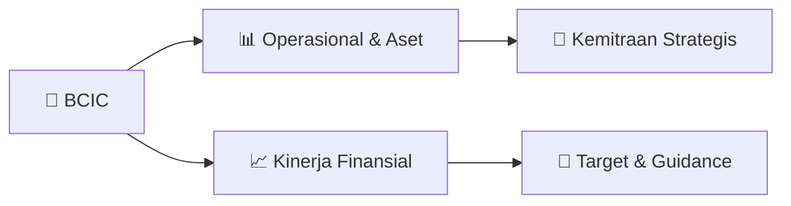

# 📊 Materi Public Expose: [BCIC]

🏢 **Emiten**: `BCIC` | 📅 **Tanggal Pelaksanaan**: `2026-09-16` | 📑 **Total Slide**: `4 Slide`
⬅️ [[knowledge-base/daily-digests/BCIC_20260916|Kembali ke Daily Digest]] | 🎛️ [[Dashboard/BCIC|Ke Dashboard Emiten]]

> [!NOTE]
> Ringkasan materi presentasi resmi Public Expose BCIC yang disampaikan oleh manajemen kepada investor dan bursa. Seluruh poin strategis, matriks operasional, dan angka kinerja diekstrak langsung dari slide deck resmi.

---

## 📅 1. Jadwal & Metadata Penyelenggaraan

| Parameter | Detail Informasi |
|---|---|
| **Nomor Surat Pengantar** | 035/CSD/JTRUST/IX/2026 |
| **Perihal Pengumuman** | Rencana Penyelenggaraan Public Expose Tahunan |
| **Waktu Pelaksanaan** | 30 September 2026 10:00 |
| **Lokasi / Media** | Zoom Meeting |
| **Lampiran Resmi** | `0` |

## 📋 2. Agenda Paparan Publik

1. Nama Perusahaan
2. Kode Emiten
3. Lampiran
4. Perihal
5. 035/CSD/JTRUST/IX/2026
6. PT Bank JTrust Indonesia Tbk.
7. Rencana Penyelenggaraan Public Expose Tahunan
8. Go To English Page
9. Perseroan melaporkan rencana Public Expose Tahunan sebagai berikut:
10. Rencana Penyelenggaraan Public Expose
11. Tahun Buku yang Berakhir pada
12. Tempat
13. : Zoom Meeting
14. https://us06web.zoom.us/j/82108270149?pwd=ntedV0jVLM5c98T
15. O6G7U1uro4ibSON.1
16. Meeting ID: 821 0827 0149
17. Passcode: 815970
18. Hari/Tanggal
19. : 30 September 2026
20. Waktu
21. 10:00
22. Agenda
23. : Paparan Kinerja Perseroan
24. Informasi Lain
25. Pendaftaran Public Expose Tahunan 2026 PT Bank JTrust Indonesia Tbk agar dilakukan melalui tautan
26. https://forms.gle/7MxnCtyDxni53mmk7 sampai selambat-lambatnya tanggal 29 September 2026 pukul 17.00 WIB.
27. Sesuai ketentuan yang berlaku, materi Public Expose Tahunan akan kami sampaikan selambat-lambatnya 3 (hari) Hari
28. Bursa sebelum tanggal penyelenggaraan. Public Expose akan dihadiri oleh Direktur yang membawahi fungsi keuangan
29. serta kepatuhan.
30. Hormat Kami,
31. Demikian untuk diketahui.
32. Gedung Sahid Sudirman Center, Lantai 33, Jl. jend.Sudirman No. 86
33. Corsec Division Head
34. Nama Pengirim
35. Telepon : 02129261111 , Fax : 02129261492 , www.jtrustbank.co.id
36. PT Bank JTrust Indonesia Tbk.
37. Hendy Deiny Wong
38. PT Bank JTrust Indonesia Tbk.
39. Hendy Deiny Wong
40. Jabatan
41. Corsec Division Head
42. Tanggal dan Waktu
43. 16-09-2026 16:46
44. Issuer Name
45. Issuer Code
46. Attachment
47. Subject
48. 035/CSD/JTRUST/IX/2026
49. PT Bank JTrust Indonesia Tbk.
50. General Announcement Public Expose
51. Go To Indonesian Page
52. Company announces public expose plan Annual as follows:
53. Public Expose Announcement
54. Fiscal Year
55. Place
56. : Zoom Meeting
57. https://us06web.zoom.us/j/82108270149?pwd=ntedV0jVLM5c98T
58. O6G7U1uro4ibSON.1
59. Meeting ID: 821 0827 0149
60. Passcode: 815970
61. : 30 September 2026
62. 10:00
63. Agenda
64. : Company Performance Presentation
65. Other Information:
66. The registration of Annual Public Expose 2026 PT Bank JTrust Indonesia Tbk is to be done through the link
67. https://forms.gle/7MxnCtyDxni53mmk7 until 29 September 2026 at 17.00 WIB. In accordance to the regulation, the
68. Annual Public Expose material will be shared at the maximum on 3 (days) Exchange Days before the event. This Public
69. Expose will be attended by the respective Directors overseeing business, financials, and legal.
70. Respectfully,
71. Thus to be informed accordingly.
72. PT Bank JTrust Indonesia Tbk.
73. Hendy Deiny Wong
74. Corsec Division Head
75. Hendy Deiny Wong
76. Sender Name
77. PT Bank JTrust Indonesia Tbk.
78. Gedung Sahid Sudirman Center, Lantai 33, Jl. jend.Sudirman No. 86
79. Phone : 02129261111 , Fax : 02129261492 , www.jtrustbank.co.id
80. Corsec Division Head
81. Function
82. Date and Time
83. 16-09-2026 16:46

## 🏢 3. Profil & Pilar Portofolio Bisnis

## 🏗️ 4. Kinerja Operasional & Portofolio Aset

*Detail aset operasional terlampir pada dokumen slide resmi.*

## 📈 5. Kinerja Keuangan & Posisi Finansial

## 🧭 6. Inisiatif Strategis, Kolaborasi, & Kemitraan

*Strategi usaha difokuskan pada penguatan fundamental dan ekspansi operasional.*

## 🎯 7. Target Pertumbuhan & Guidance Manajemen

*Target pertumbuhan ditetapkan mengacu pada prospek industri dan kondisi makroekonomi terkini.*

## 🗺️ 8. Peta Jalur Strategis & Eksekusi

## 📑 9. Daftar Indeks Slide Presentasi

| Slide # | Judul / Topik Slide | Ringkasan Konten |
|---|---|---|
| Slide 1 | **Nomor Surat** | Nama Perusahaan Kode Emiten Lampiran |
| Slide 2 | **Dokumen ini merupakan dokumen resmi PT Bank JTrust Indonesia Tbk.  yang tidak memerlukan tanda tangan** | karena dihasilkan secara elektronik oleh sistem pelaporan elektronik. PT Bank JTrust Indonesia Tbk.  bertanggung jawab penuh atas informasi yang terte |
| Slide 3 | **Letter / Announcement No.** | Issuer Name Issuer Code Attachment |
| Slide 4 | **This is an official document of PT Bank JTrust Indonesia Tbk.  that does not require a signature as it was generated** | electronically by the electronic reporting system. PT Bank JTrust Indonesia Tbk.  is fully responsible for the |

---

*Dokumen diolah otomatis oleh **Swarm Intelijen Pasar Modal Indonesia** pada 2026-10-12 16:42 WIB.*